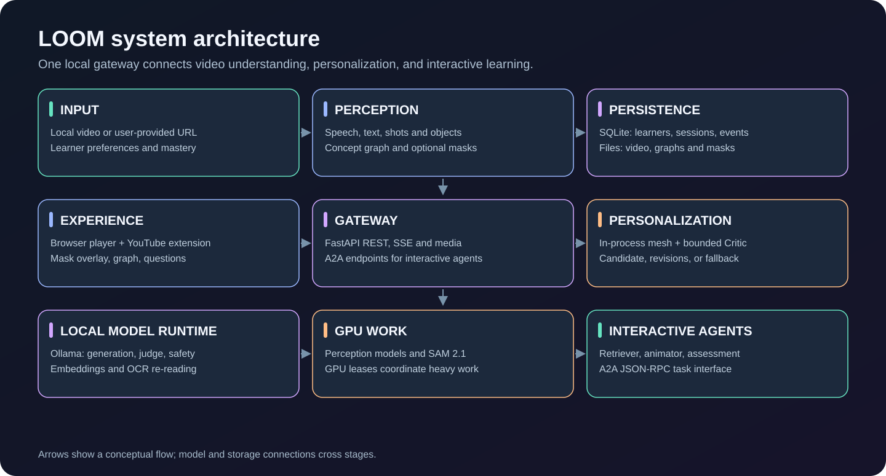
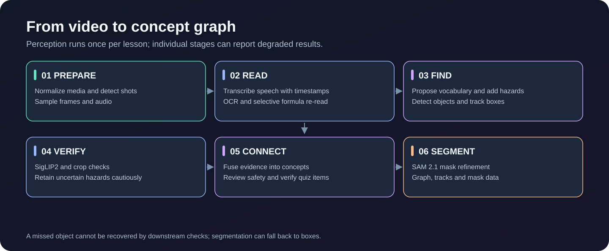
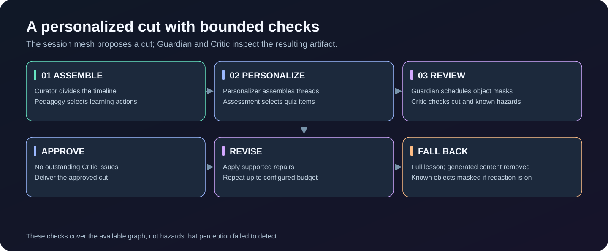
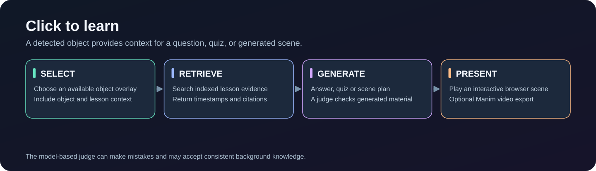
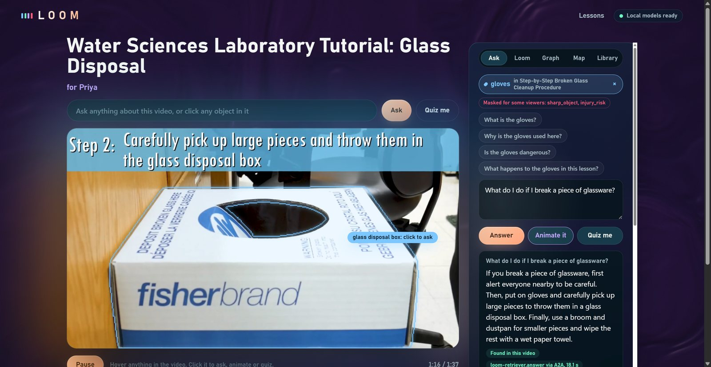
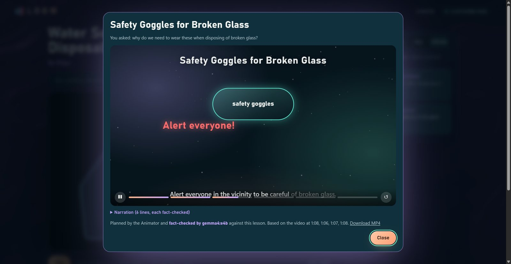

<div align="center">

# LOOM

### Live · Object-grounded · Orchestrated Media

**A local-first research prototype for personalized, interactive instructional video.**

One lesson becomes a concept graph. A learner profile shapes a video cut, while object overlays, questions, quizzes, and generated scenes offer additional ways to explore it.


[Overview](#overview) · [Architecture](#architecture) · [Getting started](#getting-started) · [Evaluation](#evaluation) · [Limitations](#limitations) · [Project map](#project-map)


</div>

## Overview

LOOM processes an instructional video into timestamped speech, on-screen text, object tracks, concepts, and quiz material. A session uses this graph and a learner profile to select, condense, expand, or skip portions of the lesson. A Guardian schedules object redactions for the profile, and a Critic checks a candidate cut before it is approved or a fallback is returned.

The player also lets a viewer select detected objects, ask questions with evidence links, request quizzes, and generate narrated scene plans. Learner mastery is stored for later sessions. An optional browser extension adds a LOOM overlay to supported YouTube pages.

| Explore | What is implemented |
| --- | --- |
| **Understand a lesson** | Speech recognition, OCR, open-vocabulary object detection, tracking, safety review, concept fusion, and SAM 2.1 mask refinement. |
| **Adapt a session** | An in-process agent mesh applies mastery and safety policies; a bounded verification loop can revise the candidate or produce a fallback. |
| **Learn from an object** | Select an available object to retrieve evidence, ask a question, request a quiz, or create a narrated scene. |
| **Inspect the process** | The player shows agent events, the concept graph, retrieval results, and cut decisions. |
| **Run locally** | The gateway, inference models, data, and player run locally once dependencies and weights are installed. Downloads require network access. |

> **Research prototype:** A Critic score is a check over the system's detected objects and available evidence, not a guarantee of safety or factual correctness. The measured hazard recall below is not sufficient for safety-critical use.

## Architecture



The **FastAPI gateway** serves the browser player, media, REST and SSE endpoints, and the A2A host. Curator, Pedagogy, Personalizer, Assessment, Guardian and Critic run as an **in-process mesh**. The retriever, animator, and interactive assessment agents expose A2A JSON-RPC interfaces. SQLite stores sessions, events and learner state; video, graphs and masks are stored as files under the configured data directory.

### 1 · Understand the video



The pipeline uses faster-whisper, RapidOCR, Grounding DINO, SigLIP2 and local language/vision models. SAM 2.1 refines object tracks into pixel masks when available. A failed refinement leaves the pipeline degraded and may require a box fallback; neither detection nor segmentation finds every object reliably.

### 2 · Weave and check a session



The mesh chooses actions from learner mastery and profile preferences. Guardian constructs masks for known objects requiring redaction. The Critic checks known-hazard mask timing, thread structure, prerequisites and quiz membership. A cut is approved when there are no outstanding issues; otherwise supported repairs run within the configured pass budget. On exhaustion, the fallback keeps the full lesson and removes generated content; it masks **known objects** for profiles with redaction enabled. Profiles with redaction disabled receive no fallback masks.

The Critic cannot evaluate an object missing from the graph. An approved cut or fallback should therefore not be treated as a safety guarantee.

### 3 · Ask, explore, and learn



Retrieved transcript, text, concepts and objects provide context for answers and generated scenes. A separate local judge checks generated claims and quiz questions, but its verdicts are fallible and its prompt allows consistent general knowledge beyond the supplied lesson. The browser plays a structured scene plan; a Manim video can also be rendered.

<table>
<tr><td width="50%"><br /><sub>Object overlays in the player</sub></td><td width="50%"><br /><sub>Question answering with evidence links</sub></td></tr>
<tr><td width="50%"><br /><sub>Concept graph</sub></td><td width="50%"><br /><sub>Interactive scene explainer</sub></td></tr>
</table>

## Getting started

The commands below assume a Windows PowerShell terminal. This project lives in **`remake/`** in this workspace; if the repository checkout places its contents at the root, run the commands from the directory containing `pyproject.toml`.

### Requirements

- Python 3.12 and [uv](https://docs.astral.sh/uv/); [Ollama](https://ollama.com/); FFmpeg on `PATH`.
- NVIDIA GPU: the development machine was an RTX 5070 Laptop GPU with 8 GB VRAM. Model availability and memory requirements vary with configuration. The scripts are Windows-first.
- Enough disk space for model weights (approximately 40 GB is recommended). LaTeX and `dvisvgm` are needed for optional Manim rendering.

### Install and check

```powershell
git clone https://github.com/Kamalllx/GenAI_7thSem.git
cd GenAI_7thSem
git checkout master
# Enter remake only when the checkout keeps the project there:
if (Test-Path .\remake\pyproject.toml) { Set-Location remake }

uv sync --all-groups
powershell -ExecutionPolicy Bypass -File setup\pull-models.ps1 -ConfigureServer
# Restart Ollama after changing its server configuration.
uv run --group setup python setup\fetch_weights.py
uv run --group setup python setup\fetch_weights.py --verify
uv run loom doctor
```

Inspect `loom.toml` before running; `loom.example.toml` documents the configuration. Model and weight downloads use the network. Offline operation depends on having the required models, weights and media already available. URLs must be downloaded before they can be processed offline.

### Start and use

```powershell
uv run loom gateway
```

Open [http://127.0.0.1:8000](http://127.0.0.1:8000). Add a local lesson or supported URL from the player, or use the CLI:

```powershell
uv run loom ingest path\to\lesson.mp4 --title "My lesson"
uv run loom eval make-demo          # downloads source clips if needed
uv run loom masks <video_id>        # retry SAM 2.1 mask refinement
```

Choose a learner and lesson, watch the cut being assembled, and explore available object overlays and the Ask, Quiz, Graph, Map and Library features. Finishing a session can update the learner's mastery for the next session. For the browser extension, follow [extension/README.md](extension/README.md).

### Tests and evaluation

```powershell
uv run pytest -q
uv run loom contracts export --check
uv run loom eval asr
uv run loom eval ocr
uv run loom eval vocab
uv run loom eval grounding
uv run loom prompts
```

Model-based evaluation requires the corresponding models, weights, hardware and test media. Results under `data/eval/` are local artifacts and may not be present in a fresh checkout. The specification describes additional evaluation suites; do not assume that every planned suite is implemented or has been run.

## Evaluation

The following values come from locally available evaluation JSON, recorded on the project's synthetic acid–base lesson on an RTX 5070 Laptop GPU. They are narrow experiments, not general performance estimates.

| Experiment | Result | Scope |
| --- | --- | --- |
| Speech recognition | WER **0.000**, 170 reference words | One 68.73 s lesson with synthesized narration; normalized scoring. |
| OCR | Recall **1.00** at character similarity 0.8; mean temporal IoU **0.98**; formula exact match **1.00** | The demo's annotated on-screen text; not arbitrary video text. |
| Hazard grounding, detector only | Precision **0.240**, recall **0.922**, false-block time **30.1 s** | One 10.3 s annotated hazard interval; box-track evaluation. |
| Hazard grounding, after verification | Precision **1.000**, recall **0.583**, false-block time **0.0 s**, missed hazard time **4.3 s** | Same lesson and interval. Recall misses the 0.90 target; this is not an evaluation of delivered pixel masks. |

The grounding artifact labels this experiment **T0 boxes**. It does not establish SAM mask IoU or end-to-end redaction recall. Generic SigLIP verification produced the measured reduction in false-block time; the later look-alike and crop-check rows have the same aggregate values in this run. See `data/eval/asr.json`, `ocr.json`, and `grounding.json` when available, along with [the evaluation specification](spec/07-evaluation.md).

## Limitations

- The annotated quantitative evaluation covers one short synthetic lesson; no learner study establishes improved learning or engagement.
- The 0.583 hazard recall and 4.3 s missed in the grounding experiment mean that known-object checks cannot ensure that all unsafe content is masked. Larger padding and masking unreviewed objects do not address every missed detection.
- Model judges and generated explanations can be wrong. Interactive explanations may include general background knowledge judged consistent with the lesson rather than text strictly supported by it.
- Pixel-level mask accuracy, broader outage behavior, and real-world latency distributions need further evaluation. Rendering, model loading, and segmentation may degrade or fail on a given machine.
- This is a local, single-user research prototype, not a hardened multi-user service. The extension has not been validated across all YouTube layouts.

## Project map

```text
remake/
├── loom/perception/     ingest, speech, OCR, detection, verification and masks
├── loom/agents/         session mesh, knowledge retrieval and scene generation
├── loom/gateway/        FastAPI routes, A2A host and browser player
├── loom/core/           configuration, contracts, events, GPU leases and storage
├── loom/eval/           implemented evaluation commands
├── contracts/           JSON Schemas; TypeScript types in packages/contracts-ts/
├── prompts/             versioned local-model prompts
├── extension/           YouTube browser extension
├── setup/               model and weight setup scripts
├── tests/               unit and contract tests
├── docs/diagrams/       editable SVG diagrams used above
└── spec/                design and evaluation plans (may describe future work)
```

A revised paper draft is saved as `final_paper.docx`; its results are scoped to the implementation and available artifacts in this workspace. Check its conference layout and citations before submission.

## Credits

LOOM was developed at Ramaiah Institute of Technology. The project uses open-source and open-weight components; consult each dependency and model for its own license. Demo footage and referenced lessons remain subject to their respective licenses.
