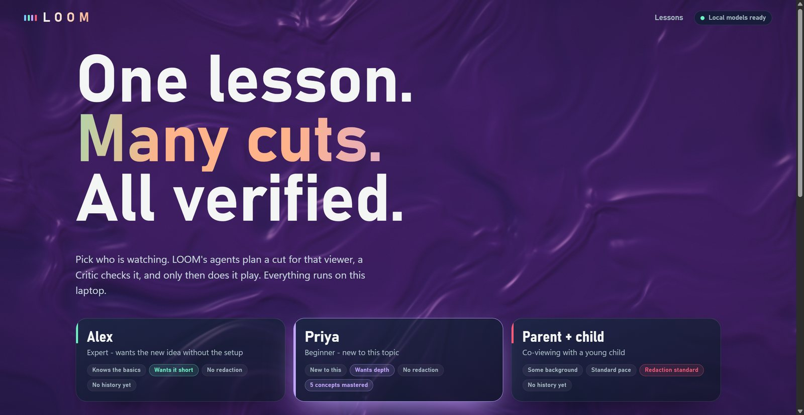
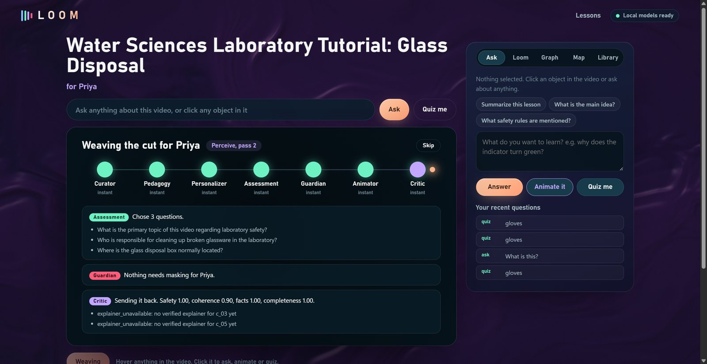
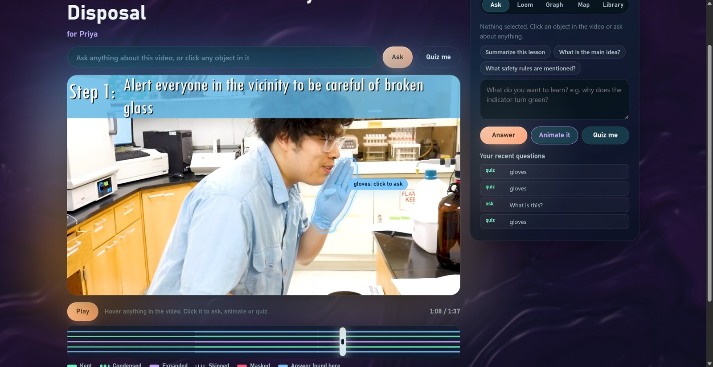
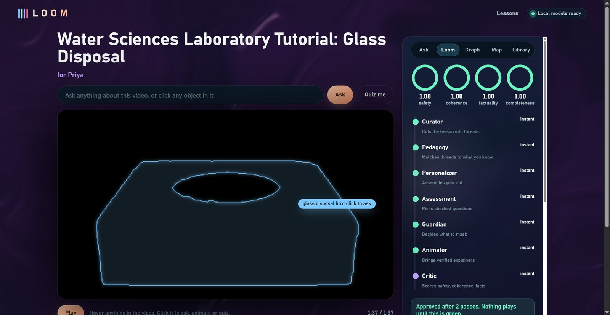
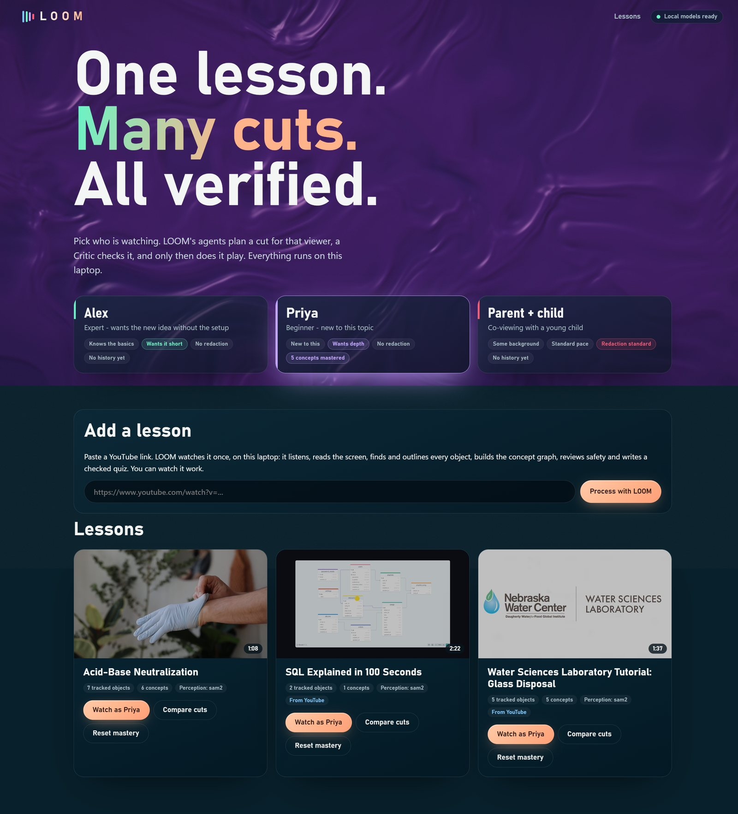
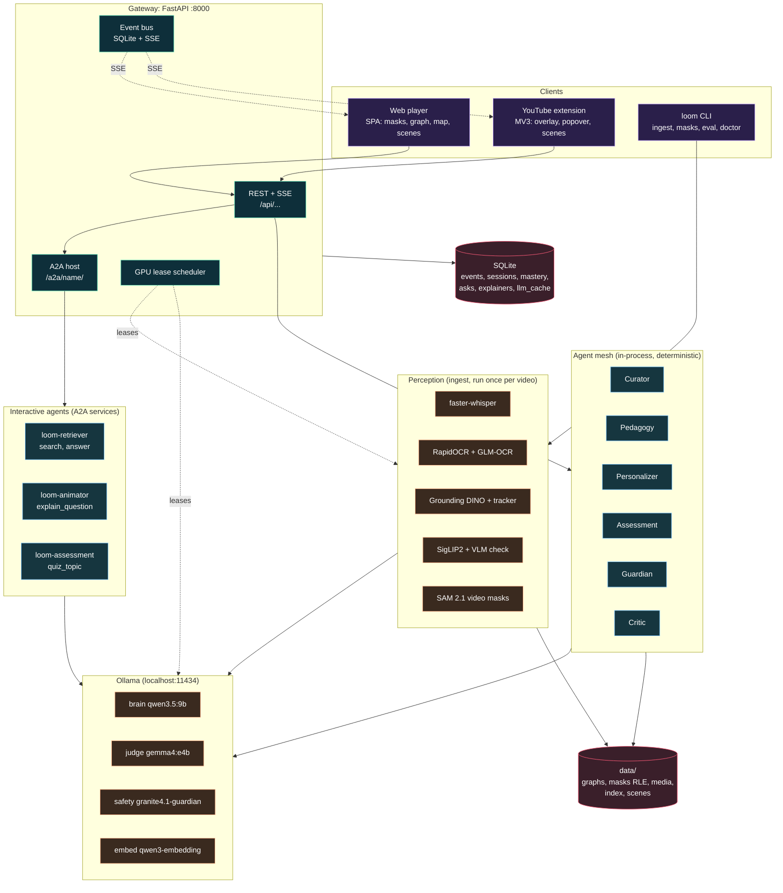
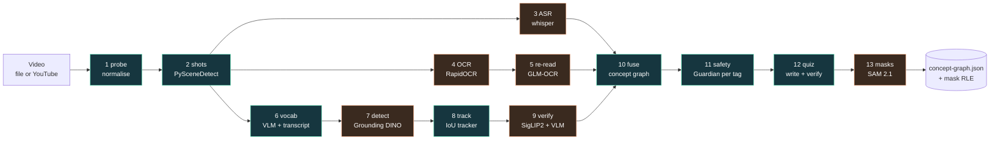
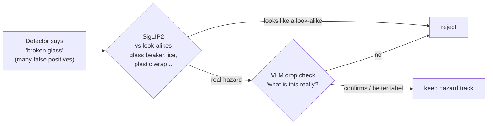
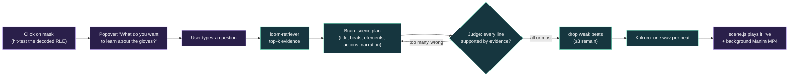

<div align="center">



# L O O M

### **L**ive · **O**bject-grounded · **O**rchestrated **M**edia

**One source video. A different, *verified* cut for every viewer. Every object in it is clickable, askable and explainable. Every model runs on your own laptop.**


[What it is](#1-what-is-loom) ·
[Tour](#2-a-tour-in-screenshots) ·
[Novelty](#3-novelty-and-contributions) ·
[Architecture](#4-system-architecture) ·
[Local AI](#5-the-local-ai-stack) ·
[Perception](#6-pipeline-a--perception-ingest) ·
[Agent mesh](#7-pipeline-b--the-agent-mesh-and-the-verification-loop) ·
[Interactive layer](#8-pipeline-c--the-interactive-layer) ·
[Safety](#9-safety-and-trust-model) ·
[Metrics](#10-evaluation-and-metrics) ·
[Limits](#11-honest-limitations) ·
[Run it](#13-run-it) ·
[Paper notes](#14-notes-for-the-research-paper)

</div>

---

## 1. What is LOOM?

Educational video is one-size-fits-all. A chemistry teacher records one lesson, and then:

* an **expert** is bored by the safety preamble they already know,
* a **novice** needs the prerequisite explained, not just stated,
* a **parent watching with a child** must not see the broken-glass close-up,
* nobody can **point at the thing on screen** and ask "what is that, and why does it matter?".

**LOOM** (*Live, Object-grounded, Orchestrated Media*) watches a video **once**, builds a machine-readable understanding of it, and then
**weaves a personal, verified cut for each viewer**:

| Idea | What LOOM does |
|---|---|
| **Understand once** | Speech, on-screen text, shots, every object (with exact pixel masks), concepts and prerequisites, a per-object safety review and a fact-checked quiz bank are extracted into one **concept graph**. |
| **Weave per viewer** | A mesh of agents (Curator, Pedagogy, Personalizer, Assessment, Guardian, Critic) cuts the lesson into threads, decides per thread to *keep / condense / expand / skip*, blurs hazardous objects **only for viewers who should not see them**, and picks the quiz. |
| **Never ship unverified** | A **Critic** scores the cut for safety, coherence, factuality and completeness. A bounded loop (budget 3) repairs it; if it cannot be verified it **fails closed** to a safe fallback. |
| **Make every pixel a doorway** | Click any outlined object *while the video plays*: "What do you want to learn about the *gloves*?" Type anything, and LOOM retrieves evidence from the video, plans a scene, **fact-checks every narrated line**, voices it, and plays a cinematic explainer. |
| **Show the machinery** | Live agent status (who is working, what they are thinking, what they produced), a concept graph, and a **similarity map** that lights up exactly what was retrieved for your question. |
| **Stay private** | Everything (language, vision, safety, embeddings, speech, OCR, detection, segmentation, TTS) runs **on the laptop**. No API keys. No cloud calls. The only network use is a *user-initiated* YouTube download and one-time model downloads. |

> **In one sentence:** LOOM is a local, multi-agent, safety-verified video personaliser whose output you can touch, question and quiz, down to the individual object.

---

## 2. A tour in screenshots

All images below are real screenshots of the running system (Water Sciences Laboratory Tutorial, a CC-licensed YouTube lesson, processed locally).

### 2.1 Watching the agents think

While your cut is woven, the player shows the **live A2A pipeline**: each agent lights up in turn, a comet travels the track, and every agent streams what it is *thinking* (italic) and what it *produced* (cards).



### 2.2 Exact-shape masks you can click while the video plays

Not boxes: **SAM 2.1 pixel masks**, propagated through the video, drawn as exact outlines. Hover shows the label; click selects.



### 2.3 Click an object, ask anything, get a custom animation


The popover knows *what* you clicked, *where in the lesson* it appears, any **viewer-specific safety note**, and suggests questions. **Make an animation** starts the generator; **Just answer** runs grounded retrieval; **Quiz me** quizzes you on that object.

### 2.4 Cinematic explainers (better than a rendered Manim clip)

Explainers are **scene plans** played live in the browser (glowing shapes, camera moves, particle field, karaoke captions, per-beat voice, clickable beat timeline). An MP4 copy is exported in the background.


### 2.5 Grounded answers that jump the video to the evidence


Answers cite moments from the video ("Hear it at 1:02"), show which A2A agent answered and how long it took, and **seek the player to the most relevant moment**.

### 2.6 What was retrieved, visualised: the similarity map

Every speech sentence, on-screen text, concept and object is embedded and projected to 2-D (PCA). Close points mean similar meaning. **Your question appears as a point; its retrieved neighbours light up with edges.**


### 2.7 The concept graph and the cut explanation

<table>
<tr>
<td width="50%"><br/><sub><b>Graph</b>: concepts (violet), prerequisite arrows, and the objects that show them. Click to jump, double-click to ask.</sub></td>
<td width="50%"><br/><sub><b>Loom</b>: Critic scores, every agent's role and latency, and the reason for each woven thread.</sub></td>
</tr>
</table>

### 2.8 The library and "add a lesson"



Paste a YouTube link; LOOM runs the perception pipeline locally and streams its progress stage by stage.

---

## 3. Novelty and contributions

These are the claims this project makes. Each is backed by something in the repo (code, a measured result, or a test), see [§14](#14-notes-for-the-research-paper) for the mapping.

1. **Object-level, viewer-specific redaction in time.** Safety is not "block the video"; it is *blur this exact object, only between these timestamps, only for viewers whose profile requires it*. Masks are **SAM 2.1 pixel masks**, not boxes, with a larger safety pad for child profiles.
2. **A verify-then-deliver loop that fails closed.** No cut reaches a viewer until a Critic scores it (safety = 1.0, coherence ≥ 0.8, factuality ≥ 0.8, completeness). The loop is bounded (budget 3) and on exhaustion falls back to a known-safe cut. Unreviewed objects are *masked by default*; a downed safety model never silently passes content.
3. **Three-stage hazard grounding that kills false alarms.** Open-vocabulary detector → **SigLIP2 look-alike verification** → **VLM crop check**. On our hazard test, false-block time dropped from **30.1 s to 0 s** at the cost of recall (reported honestly in [§10](#10-evaluation-and-metrics)).
4. **Scene-plan DSL instead of free-form code generation.** A 9 B local model failed **8 of 8** free-form Manim renders (invented APIs). Asking it for a small *scene plan* (shapes, moves, one narrated line per beat) and **compiling** that to safe code with a layout solver made rendering reliable.
5. **Fact-checked generative explainers with *graded* leniency.** Every narrated line is checked against retrieved evidence by a separate judge model. Weak lines are *dropped* (if enough remain) instead of failing the whole explainer; contradicted/invented lines are never kept.
6. **Real A2A orchestration, made visible.** Retriever, Animator and Assessment are real **A2A** agents (agent cards, JSON-RPC `message/send`, long-running tasks). Their calls, thoughts and outputs stream to the UI as events: you *see* the orchestration.
7. **Click any mask to learn.** A mask is a *query handle*: the object's identity, time, concept links and safety note are injected into retrieval and generation.
8. **Retrieval you can see.** A live semantic similarity map plus citations plus `jump_to` makes retrieval inspectable instead of a black box.
9. **Adaptive mastery loop with persistent preferences.** Quiz results and watched explainers update a per-learner **mastery graph** in SQLite, changing the *next* cut (an observable closed loop).
10. **Fully local, 8 GB-VRAM-feasible.** Seven model families and a GPU lease scheduler fit a single consumer laptop GPU (windowed SAM 2 cut peak VRAM from **8.88 GB to 2.91 GB**).
11. **A YouTube extension with the same powers.** Exact masks over the real YouTube player, tap-to-learn, scene explainers and quizzes, all against the local gateway.

---

## 4. System architecture



### 4.1 Process model

| Process | What runs in it | Why separate |
|---|---|---|
| **Ollama** (`:11434`) | brain, judge, safety, embedding and OCR models | Own GPU residency and keep-alive management |
| **Gateway** (`:8000`) | REST, SSE, A2A host, the mesh, static player, media | One origin for UI, API and agents (no CORS pain) |
| **Perception worker** (subprocess) | GPU torch models: ASR, detection, SigLIP2, SAM 2.1 | **No torch work while an Ollama model is resident**: stages unload/lease the GPU |
| **Browser / extension** | UI, mask decode (COCO RLE), scene player | Pure client; all data via the gateway |

### 4.2 GPU scheduling (8 GB is tight)

Only one heavy model family is resident at a time (`OLLAMA_MAX_LOADED_MODELS=1`). The gateway issues **GPU leases** with priorities (`tap_explainer 0 < session 1 < ingest 2 < prerender 3`) and every lease is logged as a `gpu_lease` event. Perception stages free Ollama models before loading torch. SAM 2.1 runs in **20-second windows** at 5 fps with masks down-scaled to 480 px, keeping VRAM near **3 GB** instead of 8.9 GB.

### 4.3 Repository layout

```
remake/
├── loom/
│   ├── core/            config, Ollama client, structured-output LLM layer, store (SQLite), blobs,
│   │                    events, A2A client/server, GPU leases, offline guard, weights registry,
│   │                    contracts/ (Pydantic, exported as JSON Schema), migrations/
│   ├── perception/      probe, shots, asr, ocr, detect, verify, segment (SAM 2.1), refine_masks, pipeline
│   ├── agents/          mesh.py (Curator…Critic), session.py (loop + persistence), scene_dsl.py,
│   │                    animator.py (sandboxed Manim + TTS), knowledge.py (index, search, answers, explainers),
│   │                    a2a_agents.py (retriever / animator / assessment services)
│   ├── gateway/         app.py, routes/ (REST + SSE), static/ (the player: index.html, app.js, watch.js,
│   │                    silk.js, scene.js, rle.js, *.css)
│   ├── eval/            asr / ocr / vocab / grounding / spike evaluation suites + demo builder
│   └── ops/             `loom doctor`
├── extension/           Chrome MV3 extension (content.js, background.js, rle.js, scene.js, content.css)
├── prompts/             versioned prompt files (id@version, role, schema)
├── contracts/           generated JSON Schemas (concept-graph, candidate-cut, verified-cut, event, a2a-*, …)
├── packages/contracts-ts/   TypeScript types generated from the same schemas
├── spec/                the original specification pack (00-audit … 07-evaluation)
├── setup/               pull-models.ps1, fetch_weights.py, doctor.ps1
├── tests/               21 test modules (unit + contract), fixtures, eval ground truth
└── data/                (git-ignored) DB, graphs, masks, media, eval results
```

~12.3 k lines of Python, ~3.3 k lines of JS/CSS/HTML, **212 automated tests**.

---

## 5. The local AI stack

Every role is a **tag in `loom.toml`**, swappable; each has a measured fallback (Stage-0 spike, `data/eval/spike.json`).

| Role | Model | Runs on | Used for | Notes (measured) |
|---|---|---|---|---|
| **Brain** | `qwen3.5:9b` (fallback `qwen3.5:4b`) | Ollama | Concept fusion, vocabulary proposal, quiz writing, scene planning, grounded answers | JSON-schema output **50/50 valid first try**, p50 **3.5 s**, p95 6.6 s; `think=false` default (thinking: p50 52 s, 0.9 valid). `num_ctx 6144` fits fully in VRAM (5.58 GB); 8192 spills 0.79 GB to CPU |
| **Judge** | `gemma4:e4b` (fallback `e4b-it-qat`) | Ollama | Fact-check narration lines, verify quiz questions, crop check (vision) | Structured valid **50/50**, p50 **1.2 s**; as a safety classifier recall 1.0, false-flag 0 |
| **Safety** | `granite4.1-guardian:8b-q4_K_M` | Ollama | Per-object risk tags, native `<score> yes\|no </score>` | q4_K_M chosen: Q6_K spills 2 GB to CPU and is ~4× slower at the same accuracy. Accuracy 0.96, hazard recall 0.92, false-flag 0, p50 **1.18 s** |
| **Embedding** | `qwen3-embedding:0.6b` | Ollama | Semantic index and search | 1024-d, unit norm, deterministic (max abs diff 0.0); batch-64 cold 7.5 s / warm 3.5 s |
| **OCR (re-read)** | `glm-ocr:q8_0` | Ollama | Re-read low-confidence formulas | ~1.5 GB resident |
| **ASR** | `faster-whisper large-v3-turbo` (fp16) | torch/CT2 | Transcript with word timing | WER **0.0** on the demo lesson (170 words) |
| **OCR (primary)** | RapidOCR (PP-OCR on torch-CUDA) | torch | On-screen text, formula detection | recall **1.0**, formula exact **1.0**, temporal IoU **0.98** |
| **Detector** | Grounding DINO base | torch | Open-vocabulary boxes from a phrase list | |
| **Look-alike verifier** | SigLIP2 base | torch | "Is this *really* broken glass or a glass beaker?" | |
| **Segmenter** | SAM 2.1 Hiera-base+ | torch | Exact masks, forward + reverse video propagation | |
| **TTS** | Kokoro-82M (ONNX) | CPU/ONNX | Per-beat narration (voice `af_heart`) | |
| **Scene renderer** | Manim (+ LaTeX) | CPU | Background MP4 export of explainers | sandboxed, no network |

**Structured output** is used everywhere: every LLM call has a Pydantic contract, is sent as a JSON Schema, retried with the validation error on failure, and cached in SQLite (`llm_cache`) keyed by prompt id@version + model digest + inputs.

---

## 6. Pipeline A · Perception (ingest)

Run once per video (`loom ingest <file|url>` or "Add a lesson" in the player). Streams `ingest_stage` events to the UI.



| # | Stage | What happens | Output |
|---|---|---|---|
| 1 | **probe** | ffprobe + normalise to a working MP4, duration, fps, audio | media record |
| 2 | **shots** | PySceneDetect content detection | shot boundaries (e.g. 7 shots in the 69 s demo; 10 in the 97 s YouTube lesson) |
| 3 | **ASR** | faster-whisper large-v3-turbo fp16, sentence ids, `start < end`, contiguous | transcript sentences |
| 4–5 | **OCR + re-read** | RapidOCR on sampled frames, merged into spans with temporal extent; spans below confidence 0.85 are **re-read by GLM-OCR**, formulas get exact-match checks | on-screen text with time ranges |
| 6 | **vocab** | The brain+VLM propose an *object vocabulary* from keyframes **and** transcript, then the hazard classes (broken glass, knife, flame, needle…) are always added | phrase list with sources |
| 7 | **detect** | Grounding DINO base, 2 fps base + 4 fps *hazard windows* | candidate boxes |
| 8 | **track** | IoU tracker links boxes into instances | tracks |
| 9 | **verify** | Three-way check, see below | verified tracks |
| 10 | **fuse** | The brain fuses transcript + on-screen text + objects into **concept nodes** with prerequisites and **thread roles** (intro / core / setup / safety…) with evidence ids | concept graph |
| 11 | **safety** | Granite Guardian scores each object tag (`sharp_object`, `injury_risk`, `fire_or_explosion`, `weapon`, `blood_or_gore`, `nudity`, `drugs_or_alcohol`, `hazardous_chemical`, `disturbing`) | per-object `child_unsafe` + tags |
| 12 | **quiz** | Brain writes questions *grounded in evidence*; the judge verifies each one is answerable from the lesson (**unverified questions are discarded**) | `quiz_bank` |
| 13 | **masks** | SAM 2.1 propagates exact masks from the tracked boxes, forward **and** reverse, in 20 s windows; stored as COCO RLE | per-object mask tracks |

### 6.1 Hazard verification (stage 9)



Ablation on the demo lesson (hazard truth 48.0–58.3 s; see [§10.3](#103-hazard-grounding-ablation)): the detector alone raises **72 tracks / 30 hazard tracks** and would blur **30.1 s of safe footage**; verification keeps **3 hazard tracks and 0 s of false blocking**.

### 6.2 Exact masks (stage 13)

* SAM 2.1 `Sam2VideoModel` via 🤗 Transformers, prompted with the verified box on its best frame.
* Propagates **forward and in reverse**, merged by union; presence runs are derived per instance.
* Cropped to the picture area, down-scaled to 480 px width, lightly dilated; encoded as `rle:<h>x<w>:<counts>` (COCO RLE) and decoded in the browser by `rle.js` (which splits only at the first two colons: counts contain `:`).
* Windowing fixed an out-of-memory peak: **8.88 GB → 2.91 GB**.

---

## 7. Pipeline B · The agent mesh and the verification loop

For `(video, viewer)` the gateway starts a **session**. Events (`agent_call`, `agent_done`, `agent_note`, `loop_phase`) stream to the player's live pipeline.


### 7.1 The agents

| Agent | Responsibility | Key logic and thresholds (`loom.toml`) |
|---|---|---|
| **Curator** | Cuts the lesson into **threads** (self-contained segments aligned to sentence and shot boundaries; the last thread ends exactly at video duration) | Prefers shot boundaries; never ends mid-sentence |
| **Pedagogy** | Per thread, from the viewer's mastery *m* of that thread's concepts: **keep / condense / expand / skip** | `m ≥ 0.80` → skip, `≥ 0.60` → condense, `≥ 0.35` → keep, below → expand (shifted by the viewer's pace preference ±0.10). Guards: **core and safety threads are never skipped** (downgraded to a refresher), a thread is not skipped if a prerequisite is below mastery 0.35, a summary keeps a short recap, and a viewer's "never skip" preference is honoured |
| **Personalizer** | Assembles the candidate cut and the list of explainers to attach | Condensed threads keep `max(6 s, 50 %)` of their length, ending at a sentence boundary; formulas are held ≥ 3 s |
| **Assessment** | Picks up to 3 *verified* questions on the concepts the viewer knows least; grades answers server-side; updates mastery | `+0.35` on correct, `×0.75` decay on wrong, `+0.05` per explainer watched, `+0.03` per exposure |
| **Guardian** | Decides which objects to mask for this viewer and when | Standard threshold 0.5, **strict (child) 0.2**; time pad 0.5 s; box pad 0.04, child pad ×3; **unreviewed objects are masked** |
| **Critic** | Scores the cut: **safety, coherence, factuality, completeness** and returns typed issues | safety must be **1.0**; coherence ≥ 0.8; factuality ≥ 0.8; detects overlapping/out-of-order threads, mid-sentence cuts, unmasked hazards, unsupported explainer/quiz claims, missing prerequisites, missing quiz |

### 7.2 Personas (built-in viewers)

| Viewer | Profile | Typical weave |
|---|---|---|
| **Alex** (expert) | High mastery | Intro/setup skipped, the rest condensed, never core or safety |
| **Priya** (novice) | Low mastery | Everything kept, prerequisite threads *expanded*, explainers attached |
| **Parent + child** | Strict safety profile | Full lesson, with hazardous objects masked at larger padding |

### 7.3 Closed loop

Answering quiz questions and watching explainers writes to the `mastery` table (per learner × concept). **Watch again** produces a *different* cut. This is the observable adaptation loop.

---

## 8. Pipeline C · The interactive layer

### 8.1 Click-to-learn flow



### 8.2 Grounded answers and semantic search

* `build_index` embeds **speech, on-screen text, concepts and objects** (qwen3-embedding, 1024-d) and caches it per video.
* `search` returns the most similar items with timestamps; `answer` makes the brain answer **only from the retrieved evidence**, with citations and a `jump_to` equal to the **most relevant** citation (not the earliest). The player seeks there.
* The **Map** tab shows PCA-2D positions of every item, similarity edges, and highlights the retrieved set for the last question.

### 8.3 Scene explainers (the "better than Manim" animator)

The brain writes a **`ScenePlan`**:

```jsonc
{ "title": "Safety Goggles for Broken Glass",
  "takeaway": "Wear safety goggles and alert others when handling broken glass in the lab.",
  "beats": [ { "narration": "These protect your eyes from flying shards.",
               "elements": [ {"id":"g","kind":"pill","text":"safety goggles","size":"m"} ],
               "actions":  [ {"op":"appear","target":"g"}, {"op":"highlight","target":"g"} ] } ] }
```

* `scene_dsl.compile_plan` turns a plan into **safe Manim code** (AST-gated, sandboxed render with socket calls blocked) with a **layout solver** (`MIN_GAP`, slot allocation) so elements never overlap.
* `scene.js` plays the *same plan* in the browser: orbs / cards / pills / text, SVG arrows, move / merge-flash / fade / connect actions, camera focus, drifting dust, karaoke captions, a clickable beat timeline, per-beat Kokoro audio, intro and takeaway cards.
* Explainers can be **opened and closed at any time**, are stored (`custom_explainers`), and appear in the **Library** tab with their question.

**Fact-checking ("lenient but honest")**: the judge labels each line *supported* if it is stated, implied, paraphrased, correct general knowledge or common-sense safety advice; *unsupported* only if it is wrong, contradicting, invents specifics, or is misleading/unsafe. If ≥ 3 beats remain and the dropped count is ≤ max(2, n/3), weak beats are dropped; otherwise the rejections are fed back for a redraft (up to 3 drafts). The UI shows each line with ✓ or ✗ as it happens.

### 8.4 Topic quizzes

"Quiz me" on any topic or object: the `loom-assessment` agent selects from the verified bank or writes new questions, which the judge verifies; answers are graded server-side (`adhoc_questions`, `adhoc_attempts`).

### 8.5 A2A and live status

| A2A service | Skills | Notes |
|---|---|---|
| `loom-retriever` | `search`, `answer` | `GET /a2a/loom-retriever/.well-known/agent-card.json` |
| `loom-animator` | `explain_question` (long-running) | JSON-RPC `message/send`, then `tasks/get`; 1500 s ceiling |
| `loom-assessment` | `quiz_topic` | |

`A2AClient` publishes `agent_call` / `agent_done` events; agents add `agent_note` events (`thinking`, `output`, `progress`, with item lists). Events persist to SQLite and stream over SSE (`/api/events/{channel}`, channels `sess_*`, `ingest_*`, `tap_*`, `job_*`, `system_*`).

### 8.6 YouTube extension

A Manifest-V3 extension (no build step). On a YouTube watch page: docked LOOM panel, **exact-mask overlay locked to the video** (theatre mode, fullscreen, SPA navigation), tap-to-learn popover, Ask / Animate / Quiz / Library, scene explainers (audio fetched through the service worker because YouTube's CSP blocks direct gateway media). Host permission is `127.0.0.1:8000` only. See [`extension/README.md`](extension/README.md).

---

## 9. Safety and trust model

LOOM is designed so that **failure is safe by default**:

| Failure | Behaviour |
|---|---|
| Safety model unavailable at ingest | Objects marked `unreviewed` → **masked** |
| Judge unavailable | Artifact (explainer/quiz) is **dropped**, never shown unverified |
| Critic cannot approve within budget | **Fail-closed fallback** cut |
| LLM returns malformed output | Schema validation → retry with error → else degrade (never pass-through) |
| Generated animation code | AST gate + sandboxed render, no network sockets, bounded time/memory/lines |
| Explainer claim not in evidence | Dropped or redrafted; contradictions never kept |
| Stale cached model output | LLM cache is keyed by prompt id@version, model digest and inputs, so a changed prompt or model never reuses old answers |
| Privacy | Offline mode: HF offline, loopback-only model hosts; extension talks only to `127.0.0.1` |

---

## 10. Evaluation and metrics

> Every number below is read from `data/eval/*.json` (written by `loom eval <suite>` with machine info, model digests and commit embedded) or computed from the SQLite event log. Nothing is typed by hand. Where a target was **missed**, it says so.
> Hardware: **NVIDIA RTX 5070 Laptop GPU, 8 GB**, Windows 11, Ollama 0.40.12, Python 3.12.

### 10.1 Local model spike (Stage 0; 50 structured calls per model)

| Model | Valid first try | Accuracy | p50 / p95 latency | Resident VRAM | Peak VRAM | CPU spill |
|---|---|---|---|---|---|---|
| `qwen3.5:9b` (brain) | 1.00 | 1.00 | 3.5 s / 6.6 s | 5.58 GB | 7.4 GB | 0 |
| `qwen3.5:4b` (fallback) | 1.00 | 1.00 | 1.9 s / 5.6 s | 3.2 GB | 4.9 GB | 0 |
| `gemma4:e4b` (judge) | 1.00 | 1.00 | 1.2 s / 3.5 s | | 5.8 GB | 0 |
| `gemma4:e4b-it-qat` | 1.00 | 1.00 | 1.4 s / 4.4 s | 3.1 GB | 5.3 GB | 0 |
| `granite4.1-guardian:8b` (Q6) | 1.00 | 0.96 | 1.2 s / 1.6 s | 6.1 GB | 7.0 GB | **2.0 GB** → switched to q4_K_M |
| `qwen3-embedding:0.6b` | n/a | deterministic | batch-64 3.5 s warm | 1.3 GB | 2.4 GB | 0 |

Thinking mode (brain): p50 **52.6 s**, valid 0.9, one timeout, so `think=false` is the default.

### 10.2 Perception quality (demo lesson, 68.7 s)

| Suite | Metric | Result | Target | Status |
|---|---|---|---|---|
| **ASR** | WER (170 ref words) | **0.000** | ≤ 0.03 | ✅ |
| | runtime for 68.7 s of audio | 10.3 s (**RTF 0.15**) | | |
| **OCR** | recall @ char-sim 0.8 | **1.00** | 1.0 | ✅ |
| | mean temporal IoU | **0.98** | ≥ 0.90 | ✅ |
| | formula exact match | **1.00** | 100 % | ✅ |
| | cost | 6.2 s shots + 18.0 s RapidOCR + 4.1 s re-read (151 frames) | | |
| **Vocab** | ground-truth object recall | **1.00** (all hazard classes present) | | ✅ |

### 10.3 Hazard grounding ablation

Ground truth hazard window **48.0–58.3 s** (10.3 s). Resolution 0.1 s. Targets: precision ≥ 0.95, recall ≥ 0.90, false-block ≤ 2 s, missed ≤ 0.5 s.

| Configuration | Tracks | Hazard tracks | Precision | Recall | F1 | False-block (s) | Missed (s) |
|---|---|---|---|---|---|---|---|
| Detector only | 72 | 30 | 0.240 | **0.922** | 0.381 | 30.1 | 0.8 |
| + SigLIP2 generic | 16 | 3 | **1.000** | 0.583 | 0.736 | **0.0** | 4.3 |
| + SigLIP2 look-alikes | 16 | 3 | 1.000 | 0.583 | 0.736 | 0.0 | 4.3 |
| + VLM crop check (LOOM) | 16 | 3 | 1.000 | 0.583 | 0.736 | 0.0 | 4.3 |

**Reading:** verification removes **all 30.1 s of false blocking** (precision 0.24 → 1.00) but costs recall (0.92 → 0.58; 4.3 s of real hazard unmasked). **The recall target (0.90) is not met.** The safety-critical consequence is mitigated by the viewer-profile policy (strict profiles use wider pads and the `unreviewed → masked` rule) but remains the main open accuracy issue (see [§11](#11-honest-limitations)). Total time of this evaluation: 214 s (detect 67 + 47 s, crops 22 s, SigLIP 16 s, VLM 62 s).

### 10.4 Segmentation efficiency

| Setting | Peak VRAM |
|---|---|
| SAM 2.1 whole-shot propagation (long shot) | **8.88 GB** (OOM-risk on 8 GB) |
| 20 s windows, 5 fps, 480 px masks | **2.91 GB** |

### 10.5 Corpus processed end-to-end

| Lesson | Length | Shots | Sentences | On-screen text spans | Objects | Concepts | Verified quiz questions |
|---|---|---|---|---|---|---|---|
| Acid-Base Neutralization (synthetic demo) | 68.7 s | 7 | 15 | 4 | 7 (1 child-unsafe) | 6 | 18 |
| Water Sciences Lab Tutorial: Glass Disposal (YouTube, CC) | 97.5 s | 10 | 15 | 76 | 5 (3 child-unsafe) | 5 | 12 |
| SQL Explained in 100 Seconds (YouTube) | 142.4 s | 9 | 22 | 723 | 2 (flagged unsafe; not manually audited) | 1 | 3 |

Exact SAM 2.1 masks were generated for all three.

### 10.6 Agent mesh (from the event log: 36 sessions, 1,168 persisted events)

| Metric | Value |
|---|---|
| Sessions approved by the Critic | **34 / 36** (the other 2 never finished; stale `running` rows from interrupted runs) |
| Passes to approval | **26 × 1 pass, 8 × 2 passes** (mean **1.24**, max 2; budget 3) |
| Fallbacks (budget exhausted) | **0** |
| Final Critic scores on the latest session | safety **1.00**, coherence **1.00**, factuality **1.00**, completeness **1.00** |
| Deterministic agents (Curator, Pedagogy, Personalizer, Guardian, Critic) | effectively instant (median < 1 ms) |
| Event kinds | `agent_call` 300, `agent_done` 295, `gpu_lease` 144, `loop_phase` 134, `render_progress` 69, `ingest_stage` 65, `agent_note` 45, `delivered` 39, `session_start` 36, `candidate_ready` 34, `error` 7 |
| LLM cache entries | 543 |

### 10.7 Interactive latency (single observed runs on the target laptop, not benchmarked distributions)

| Interaction | Observed |
|---|---|
| Grounded answer via A2A (retrieve + generate + cite) | ~11–18 s |
| Topic quiz (write + verify) | ~48 s |
| Scene explainer (plan → fact-check → narrate) for a 26 s scene | a few minutes end-to-end, dominated by the brain and judge calls |
| Scene explainer first-attempt render success (plan-compiled) | 3 / 3 observed; free-form Manim code had **0 / 8** |
| Fact-check pass on the user's previously failing goggles question | 6 / 8 lines supported in one draft (previously: failed after 4 drafts) |

### 10.8 Software quality

* **212 automated tests** (21 modules: unit + contract + gateway + A2A), all passing; 
* data contracts exported as JSON Schema (24 schemas) and as TypeScript types;
* path-traversal tests on the media route; determinism tests on embedding; regression tests for cut-boundary rounding;
* `loom doctor` checks Python, CUDA, FFmpeg, NVENC, LaTeX, Ollama settings, every model (with a smoke call), weights, ports and disk.

---

## 11. Honest limitations

* **Hazard recall is below target** (0.58 vs 0.90): tiny or fast-changing hazards (e.g. shards) can be missed after verification, and tiny shards can lie outside the SAM mask.
* **Guardian over-flags** protective gear (gloves, goggles) on the YouTube lesson → they are masked for the child profile even though they are safe.
* Evaluation is on **one annotated lesson** for the quantitative suites (ASR/OCR/grounding); mask IoU against hand-annotated masks and the planned fault-injection suite (`critic_faults`), `redaction`, `animator` and `latency` suites are specified in `spec/07-evaluation.md` but **not yet run**.
* Interactive latencies are single observations, not distributions.
* The extension was exercised in a harness; it has not been through a broad matrix of real YouTube layouts.
* The graph tab's labels can overlap in narrow panels.
* Single-GPU, single-user design (no multi-tenant scheduling, no auth).
* Windows-first setup scripts (PowerShell); the Python code is portable.

---

## 12. Design principles

1. **Local first.** If it cannot run on the laptop, it is not in the product.
2. **Verify before showing.** Generation proposes; independent checks dispose.
3. **Fail closed.** Unknown means masked, dropped, or fallback.
4. **Typed everywhere.** Pydantic contracts → JSON Schema → TS types; prompts are versioned files.
5. **Make the machinery visible.** Agents, evidence, similarity, scores: all inspectable.
6. **Honest numbers.** Metrics come from reproducible suites; misses are reported.

---

## 13. Run it

### 13.1 Requirements

| Need | Notes |
|---|---|
| OS | Windows 11 (scripts are PowerShell; Python code is portable) |
| GPU | NVIDIA with **8 GB VRAM** (developed on RTX 5070 Laptop; RTX 50xx needs CUDA 12.8 torch builds). Close other GPU-heavy apps; use a *Standard/Ultimate* GPU mode, not Eco |
| Disk | ~40 GB free for models and weights |
| Software | [uv](https://docs.astral.sh/uv/), [Ollama](https://ollama.com), Python 3.12 (uv installs it), FFmpeg on `PATH`; **LaTeX + dvisvgm only for the optional Manim MP4 export** |
| Browser | Chrome / Edge (player and extension) |

### 13.2 Install

```powershell
git clone https://github.com/Kamalllx/GenAI_7thSem.git
cd GenAI_7thSem
git checkout master

# 1. Python environment (all groups: dev, setup, demo, perception)
uv sync --all-groups

# 2. Local language / vision / safety / embedding / OCR models via Ollama
powershell -ExecutionPolicy Bypass -File setup\pull-models.ps1 -ConfigureServer
#    (restart Ollama once so the server settings apply; add -Fallbacks for the comparison models)

# 3. Open-weight models used outside Ollama (Whisper, Grounding DINO, SAM 2.1, SigLIP2, Kokoro) - one-time download
uv run --group setup python setup\fetch_weights.py
uv run --group setup python setup\fetch_weights.py --verify      # offline check

# 4. Check the machine (add --no-smoke to skip the model calls)
uv run loom doctor
```

### 13.3 Start LOOM

```powershell
uv run loom gateway          # API + SSE + A2A + player + media on http://127.0.0.1:8000
```

Open **http://127.0.0.1:8000**; the top-right badge must read **Local models ready**.

### 13.4 Get a lesson

```powershell
# Option A: build the synthetic demo lesson (downloads 5 royalty-free Pexels clips once; Kokoro narration)
uv run loom eval make-demo

# Option B: process any video file or YouTube link (perception runs once, locally)
uv run loom ingest "https://www.youtube.com/watch?v=ZZO-v10h8tc"
uv run loom ingest path\to\lesson.mp4 --title "My lesson"

# Exact SAM 2.1 masks (run automatically during ingest; or re-run)
uv run loom masks <video_id>
```

You can also paste a link into **Add a lesson** in the player and watch the stages live.

### 13.5 Use it

1. Pick a lesson and a viewer (**Alex / Priya / Parent + child**) → **Watch**. Watch the agent pipeline weave the cut.
2. **Hover** objects in the video (exact outlines), **click** one → type what you want to learn → **Make an animation**.
3. Use **Ask** (grounded answer + jump), **Quiz me** (any topic), and the **Loom / Graph / Map / Library** tabs.
4. Finish a quiz → **Save to my mastery graph** → **Watch again** to see the cut change.

### 13.6 YouTube extension

1. `uv run loom gateway` (must answer on `127.0.0.1:8000`).
2. Chrome → `chrome://extensions` → **Developer mode** → **Load unpacked** → select the `extension/` folder.
3. Open a processed lesson on YouTube (e.g. `https://www.youtube.com/watch?v=ZZO-v10h8tc`). After editing the extension, reload it **and refresh the YouTube tab**.

### 13.7 Tests, evaluation and CLI reference

```powershell
uv run pytest -q                       # 212 tests

uv run loom eval spike                 # model spike (structured output, thinking, vision, latency, VRAM)
uv run loom eval asr                   # WER on the demo lesson
uv run loom eval ocr                   # recall / temporal IoU / formula exactness
uv run loom eval vocab                 # object vocabulary recall
uv run loom eval grounding             # detector → SigLIP2 → VLM ablation (hazard precision/recall in seconds)
uv run loom contracts export           # regenerate JSON Schemas from the Pydantic contracts
uv run loom prompts                    # validate every prompt file, list id@version
```

| Command | Purpose |
|---|---|
| `loom doctor` | Verify machine, models, weights, ports, disk |
| `loom gateway` | Serve everything on `:8000` |
| `loom ingest <src>` | Perceive a video once |
| `loom masks <video_id>…` | Exact-shape SAM 2.1 masks |
| `loom explain` | Render and store explainers |
| `loom eval <suite>` | Reproducible evaluation suites |

### 13.8 Key HTTP endpoints

| Endpoint | Purpose |
|---|---|
| `GET /api/videos`, `GET /api/videos/{id}/graph` | Lessons and concept graph |
| `POST /api/sessions` | Start a weave for `(video, learner)` |
| `GET /api/events/{channel}` | SSE stream (`sess_*`, `ingest_*`, `tap_*`) |
| `POST /api/videos/{id}/ask` | Grounded answer via A2A (`jump_to`, citations) |
| `POST /api/videos/{id}/explain` | Question-driven scene explainer (long-running) |
| `GET /api/videos/{id}/explainers` | Library of explainers |
| `GET /api/videos/{id}/map` | 2-D similarity map |
| `POST /api/videos/{id}/quiz` | Topic quiz |
| `POST /api/videos/link` | Ingest a YouTube link |
| `GET /api/agents`, `/a2a/{name}/.well-known/agent-card.json` | A2A agent cards |

### 13.9 Configuration

Everything tunable lives in [`loom.toml`](loom.toml) (copied from `loom.example.toml`): model tags and fallbacks, thresholds, pads, loop budget, GPU limits, TTS voice. `offline = true` disables link ingest and forces loopback-only hosts.

---

## 14. Notes for the research paper

### 14.1 Suggested problem framing and research questions

* **RQ1.** Can a *fully local* multi-agent pipeline on an 8 GB consumer GPU produce per-viewer video cuts that a verifier approves, with a bounded number of repair passes?
  *Evidence:* §10.6 (34/36 approved, mean 1.24 passes, 0 fallbacks); §5 (VRAM budgets).
* **RQ2.** Does staged verification (detector → SigLIP2 → VLM) make object-level redaction usable?
  *Evidence:* §10.3 (false-block 30.1 s → 0 s) **and its recall cost** (0.92 → 0.58, target missed).
* **RQ3.** Is a constrained scene-plan DSL more reliable than free-form code generation for small local LLMs?
  *Evidence:* 0/8 free-form renders vs 3/3 plan-compiled (small n; §10.7).
* **RQ4.** Does graded, evidence-grounded fact-checking keep generated explainers faithful without rejecting useful content?
  *Evidence:* strict checker failed the goggles question after 4 drafts; lenient+drop passes with 6/8 lines (§8.3, §10.7).
* **RQ5.** Do inspectable retrieval (similarity map, citations, jump-to) and visible agent orchestration improve trust and usability? *(User study not yet run; interface evidence in §2.)*

### 14.2 Claim → evidence map

| Claim | Where to find it |
|---|---|
| Local-only stack, model roles, VRAM | `loom.toml`, `data/eval/spike.json`, §5 |
| Exact masks with windowed SAM 2.1 | `loom/perception/segment.py`, `refine_masks.py`, §6.2, §10.4 |
| Hazard ablation | `data/eval/grounding.json`, `loom/eval/grounding_eval.py` |
| ASR / OCR quality | `data/eval/asr.json`, `ocr.json` |
| Mesh + loop + fail-closed | `loom/agents/mesh.py`, `session.py`, `tests/unit/test_mesh.py` |
| Scene DSL + layout solver | `loom/agents/scene_dsl.py`, `tests/unit/test_scene_dsl.py` |
| Fact-check prompt | `prompts/claims_verify.md` (v2) |
| A2A services | `loom/core/a2a.py`, `loom/agents/a2a_agents.py`, `tests/contract/test_a2a.py` |
| Contracts | `loom/core/contracts/`, `contracts/*.schema.json` |
| Specification and audit of the earlier build | `spec/00-audit.md` … `spec/07-evaluation.md` |

### 14.3 Related-work hooks (verify citations before use)

Personalised/adaptive video and intelligent tutoring; segmentation of video objects (SAM 2); open-vocabulary detection (Grounding DINO); vision-language verification (SigLIP 2); agent-to-agent protocols (A2A) and multi-agent verification loops; retrieval-augmented generation and attributed answers; safety classifiers (Granite Guardian); programmatic animation (Manim) and LLM code-generation reliability.

### 14.4 Threats to validity

Single hardware setup; one annotated quantitative lesson; synthetic demo video; single-run latencies; LLM nondeterminism mitigated by temperature 0.2/0 and seed 7 plus caching, not eliminated; no human user study yet.

### 14.5 Reproducibility

Each `loom eval <suite>` writes `data/eval/<suite>.json` with machine info, model tags + digests, git commit and timestamps. Prompts are versioned files; contracts are generated; fixtures and ground truth are under `tests/`.

---

## 15. Credits

Open models and libraries this project builds on: **Ollama**, **Qwen3.5 / Qwen3-Embedding** (Alibaba), **Gemma 4** (Google), **Granite Guardian** (IBM), **GLM-OCR**, **faster-whisper / Whisper large-v3-turbo**, **RapidOCR**, **Grounding DINO** (IDEA Research), **SAM 2.1** (Meta), **SigLIP 2** (Google), **Kokoro-82M**, **PySceneDetect**, **Manim**, **FastAPI**, **Pydantic**, **yt-dlp**. Demo footage: Pexels (royalty-free). Lesson videos from YouTube are processed locally on user request only.

<div align="center">

**LOOM** · local · verified · touchable

*Course project: RIT GenAI, 7th semester.*

</div>
