<div align="center">

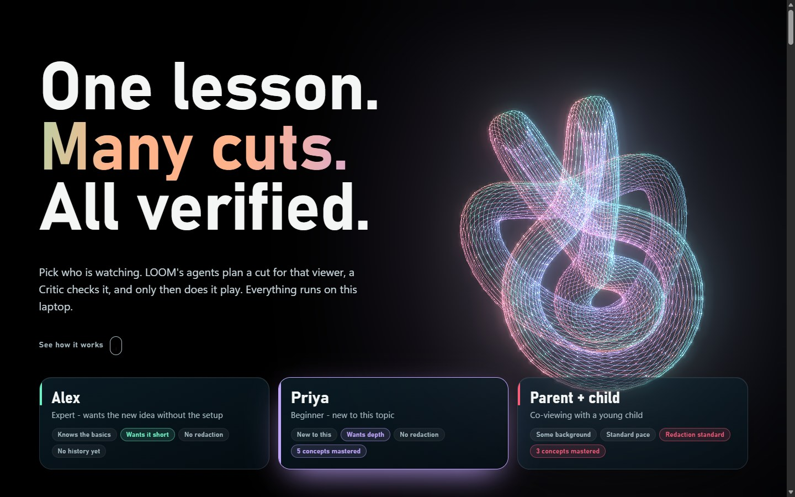

# L O O M

### **L**ive · **O**bject-grounded · **O**rchestrated **M**edia

**One source video. A different, *verified* cut for every viewer. Every object in it is clickable, askable and explainable. Every model runs on your own laptop.**


[What it is](#1-what-is-loom) ·
[Tour](#2-a-tour-in-screenshots) ·
[Novelty](#3-novelty-and-contributions) ·
[Architecture](#4-system-architecture) ·
[Local AI](#5-the-local-ai-stack) ·
[Perception](#6-pipeline-a--perception-ingest) ·
[Agent mesh](#7-pipeline-b--the-agent-mesh-and-the-verification-loop) ·
[Interactive layer](#8-pipeline-c--the-interactive-layer) ·
[Safety](#9-safety-and-trust-model) ·
[Metrics](#10-evaluation-and-metrics) ·
[Results on 30 lessons](#109-batch-evaluation-30-short-lessons-14-styles) ·
[Limits](#11-honest-limitations) ·
[Testing report](docs/TESTING_REPORT.md) ·
[Evidence for the paper](docs/PAPER_EVIDENCE.md) ·
[Run it](#13-run-it) ·
[Paper notes](#14-notes-for-the-research-paper)

</div>

---

## 1. What is LOOM?

Educational video is one-size-fits-all. A chemistry teacher records one lesson, and then:

* an **expert** is bored by the safety preamble they already know,
* a **novice** needs the prerequisite explained, not just stated,
* a **parent watching with a child** must not see the broken-glass close-up,
* nobody can **point at the thing on screen** and ask "what is that, and why does it matter?".

**LOOM** (*Live, Object-grounded, Orchestrated Media*) watches a video **once**, builds a machine-readable understanding of it, and then
**weaves a personal, verified cut for each viewer**:

| Idea | What LOOM does |
|---|---|
| **Understand once** | Speech, on-screen text, shots, every object (with pixel masks), concepts and prerequisites, a per-object safety review and a fact-checked quiz bank are extracted into one **concept graph**. |
| **Weave per viewer** | A mesh of agents (Curator, Pedagogy, Personalizer, Assessment, Guardian, Critic) cuts the lesson into threads, decides per thread to *keep / condense / expand / skip*, blurs hazardous objects **only for viewers who should not see them**, and picks the quiz. |
| **Never ship unverified** | A **Critic** scores the cut for safety, coherence, factuality and completeness. A bounded loop (budget 3) repairs it; if it cannot be verified it **fails closed** to a safe fallback. |
| **Make every pixel a doorway** | Click any outlined object *while the video plays*: "What do you want to learn about the *gloves*?" Type anything, and LOOM retrieves evidence from the video, plans a scene, **fact-checks every narrated line**, voices it, and plays a cinematic explainer. |
| **Show the machinery** | Live agent status (who is working, what they are thinking, what they produced), a concept graph, and a **similarity map** that lights up exactly what was retrieved for your question. |
| **Stay private** | Everything (language, vision, safety, embeddings, speech, OCR, detection, segmentation, TTS) runs **on the laptop**. No API keys. No cloud calls. The only network use is a *user-initiated* YouTube download and one-time model downloads. |

> **In one sentence:** LOOM is a local, multi-agent, safety-verified video personaliser whose output you can touch, question and quiz, down to the individual object.

---

## 2. A tour in screenshots

All images below are real screenshots of the running system (Water Sciences Laboratory Tutorial, a CC-licensed YouTube lesson, processed locally).

### 2.1 Watching the agents think

While your cut is woven, the player shows the **live A2A pipeline**: each agent lights up in turn, a comet travels the track, and every agent streams what it is *thinking* (italic) and what it *produced* (cards).


### 2.2 Pixel masks you can click while the video plays

Not boxes: **SAM 2.1 pixel masks**, propagated through the video, drawn as exact outlines. Hover shows the label; click selects.


### 2.3 Click an object, ask anything, get a custom animation

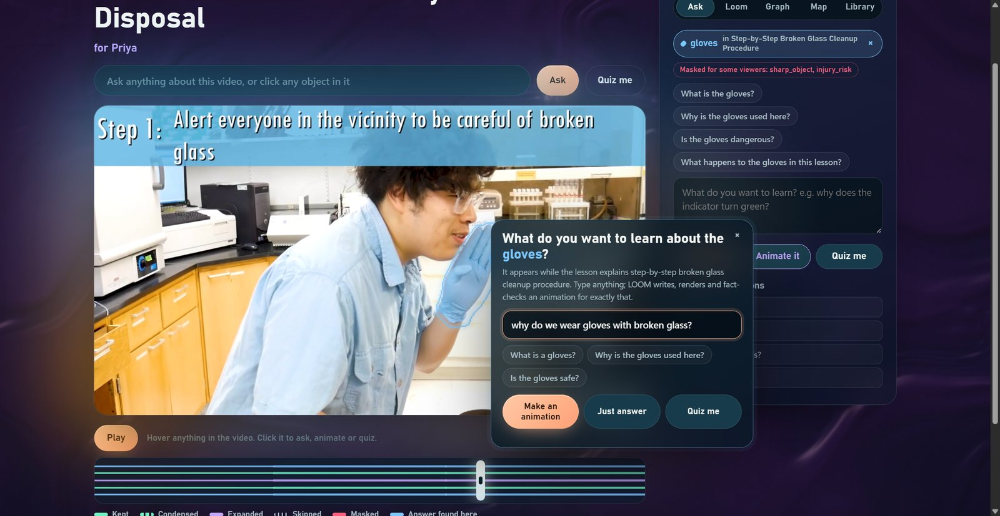

The popover knows *what* you clicked, *where in the lesson* it appears, any **viewer-specific safety note**, and suggests questions. **Make an animation** starts the generator; **Just answer** runs grounded retrieval; **Quiz me** quizzes you on that object.

### 2.4 Cinematic explainers (better than a rendered Manim clip)

Explainers are **scene plans** played live in the browser (glowing shapes, camera moves, particle field, karaoke captions, per-beat voice, clickable beat timeline). An MP4 copy is exported in the background.


### 2.5 Grounded answers that jump the video to the evidence


Answers cite moments from the video ("Hear it at 1:02"), show which A2A agent answered and how long it took, and **seek the player to the most relevant moment**.

### 2.6 What was retrieved, visualised: the similarity map

Every speech sentence, on-screen text, concept and object is embedded and projected to 2-D (PCA). Close points mean similar meaning. **Your question appears as a point; its retrieved neighbours light up with edges.**

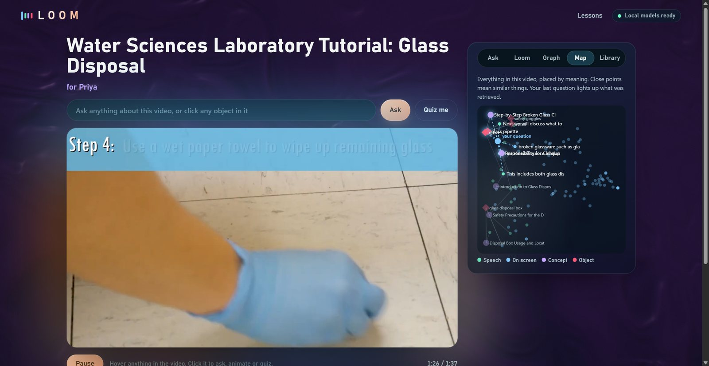

### 2.7 The concept graph and the cut explanation

<table>
<tr>
<td width="50%">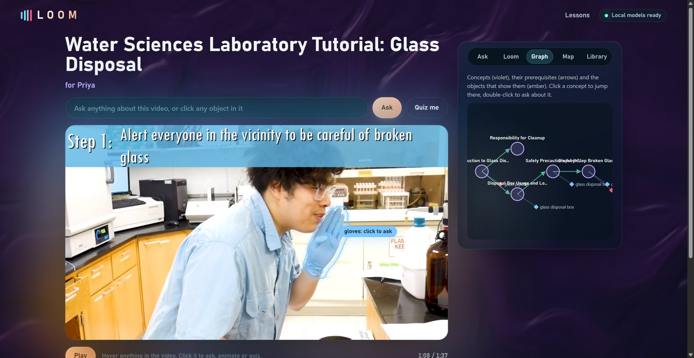<br/><sub><b>Graph</b>: concepts (violet), prerequisite arrows, and the objects that show them. Click to jump, double-click to ask.</sub></td>
<td width="50%"><br/><sub><b>Loom</b>: Critic scores, every agent's role and latency, and the reason for each woven thread.</sub></td>
</tr>
</table>

### 2.8 The library and "add a lesson"


Paste a YouTube link; LOOM runs the perception pipeline locally and streams its progress stage by stage.

### 2.9 A 3-D landing that tells the story while you scroll

The Lessons page opens on a **3-D sculpture of glowing threads** (three.js, bloom) woven into a knot. Scroll, and a pinned
five-step journey re-weaves it: the threads unravel into a **loom** (LOOM watches the lesson), weave **cloth** (it reads
the board), **lift a piece out** (everything is touchable), become **orbiting agents** (agents weave, a critic checks),
and re-knot in **your viewer's colour** (your cut, your questions). Smooth scrolling (Lenis), staggered reveals,
magnetic buttons and a woven thread curtain between pages come from one motion layer (GSAP + ScrollTrigger), all off
under `prefers-reduced-motion`.


<table>
<tr>
<td width="33%">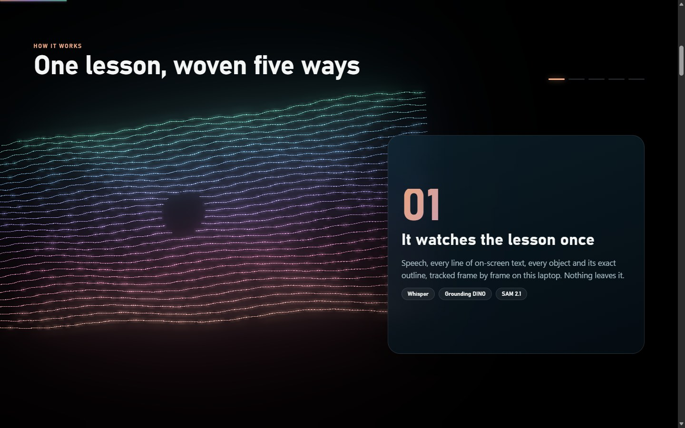<br/><sub>01 · it watches the lesson once</sub></td>
<td width="33%">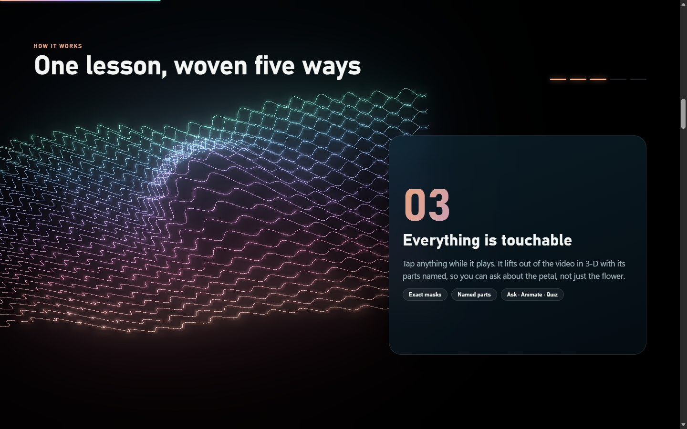<br/><sub>03 · everything is touchable</sub></td>
<td width="33%">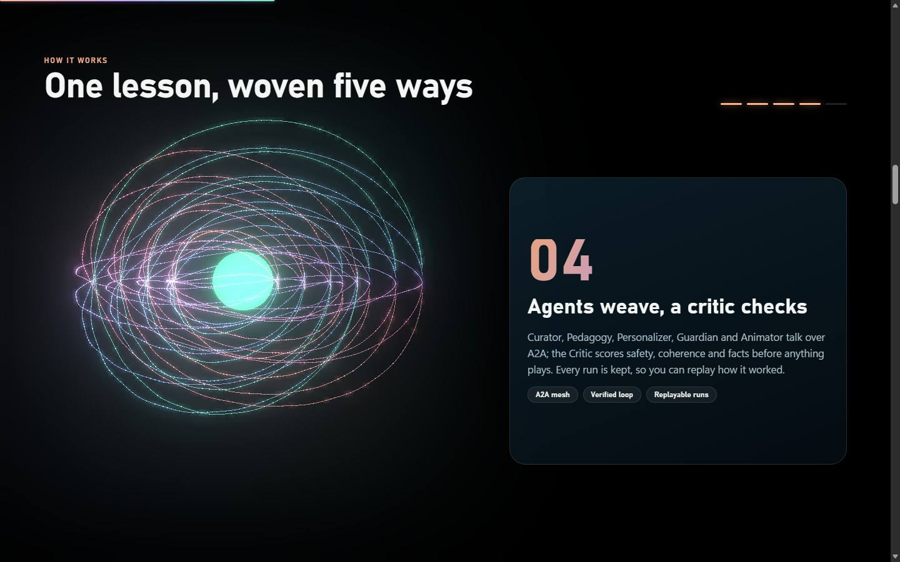<br/><sub>04 · agents weave, a critic checks</sub></td>
</tr>
</table>

### 2.10 Upload a file or paste a link; a reload never loses a running job

<table>
<tr>
<td width="55%">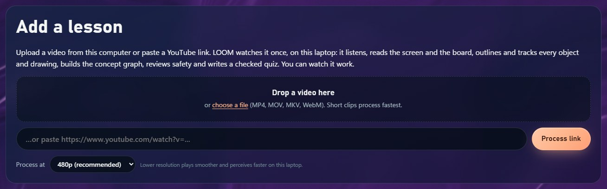</td>
<td width="45%">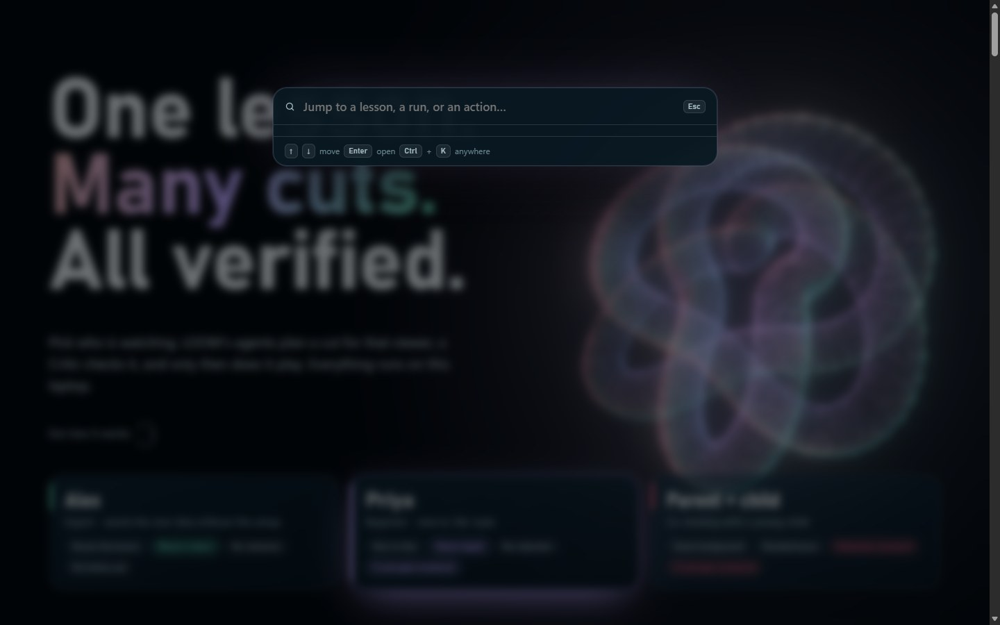</td>
</tr>
</table>

Drop a video (streamed to the gateway, any size up to 4 GB) or paste a YouTube link, and choose the resolution it is
processed at (480p keeps long lessons light). Reloading the page **reattaches** to a running ingest and replays what it
did so far; the header's live pill lists every run in progress. **Ctrl/Cmd + K** opens a command palette to jump to any
lesson, running job or action.

### 2.11 Every element outlined, tracked and labelled — boards, animations and chalk

**Show all elements** (key `E`) draws every element's outline, its box, a `#n label` tag and its recent path.
Elements come from three perception tiers: the **board scanner** (ink on a board, with a memory that ignores the teacher
and follows a shaky phone camera), **segment-everything** (SAM 2.1 point-grid masks on drawn frames: animations, slides)
and the **object detector** (Grounding DINO + SAM 2.1 on camera footage).

<table>
<tr>
<td width="50%">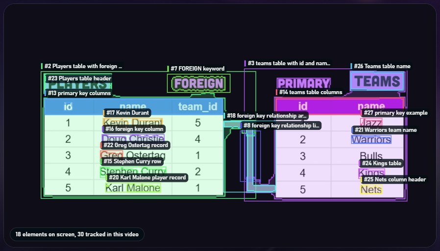<br/><sub>An SQL animation: tables, rows, the key arrow, each separately masked.</sub></td>
<td width="50%">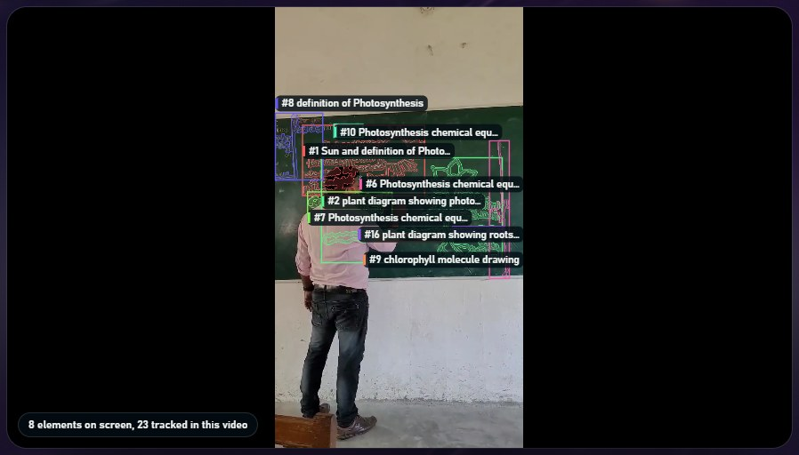<br/><sub>A phone-filmed chalkboard: definition, equation, diagram, soil line, border.</sub></td>
</tr>
</table>

### 2.12 Tap to lift: the element comes out of the video, its parts fan out

Click anything and it is **cut out of the frame along its mask and lifted toward you in 3-D** (it tilts with the
pointer while the lesson behind it dims). Its **named parts** fan out as an exploded diagram; pick one and ask about it,
animate it or get quizzed on it. "Part of …" climbs to the containing element.

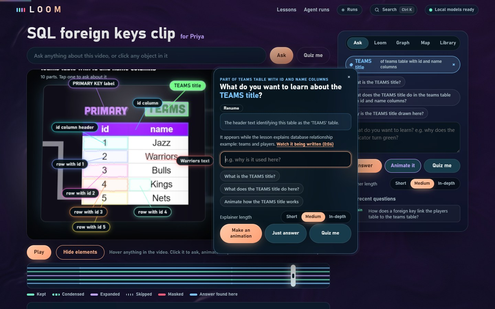

### 2.13 See through the teacher

On a filmed board, the scanner already knows the last unobstructed colour of every board pixel. **See through the
teacher** (key `T`) overlays that memory, so the board is readable wherever the teacher stands.

<table>
<tr>
<td width="50%">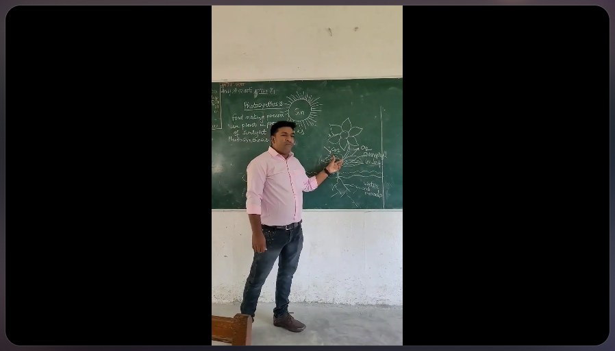<br/><sub>The lesson as filmed.</sub></td>
<td width="50%">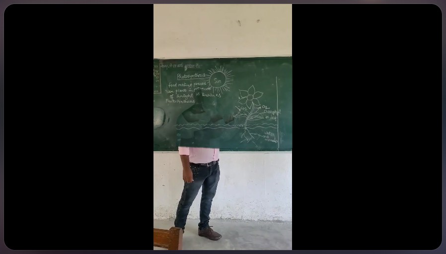<br/><sub>The same moment, teacher made transparent.</sub></td>
</tr>
</table>

### 2.14 3-D explainers with real pictures, at the length you want

Ask for an explainer in your own words and pick **Short**, **Medium** or **In-depth**. The plan is fact-checked line by
line, narrated, and played as a **3-D scene** (three.js): glossy orbs, glass cards, arrows that draw themselves, merges
that burst into their product, a camera that frames each beat, karaoke captions. It can show **pictures from the lesson
itself** (here, the players table from the video) and, when online, credited Wikimedia Commons images.

<table>
<tr>
<td width="50%">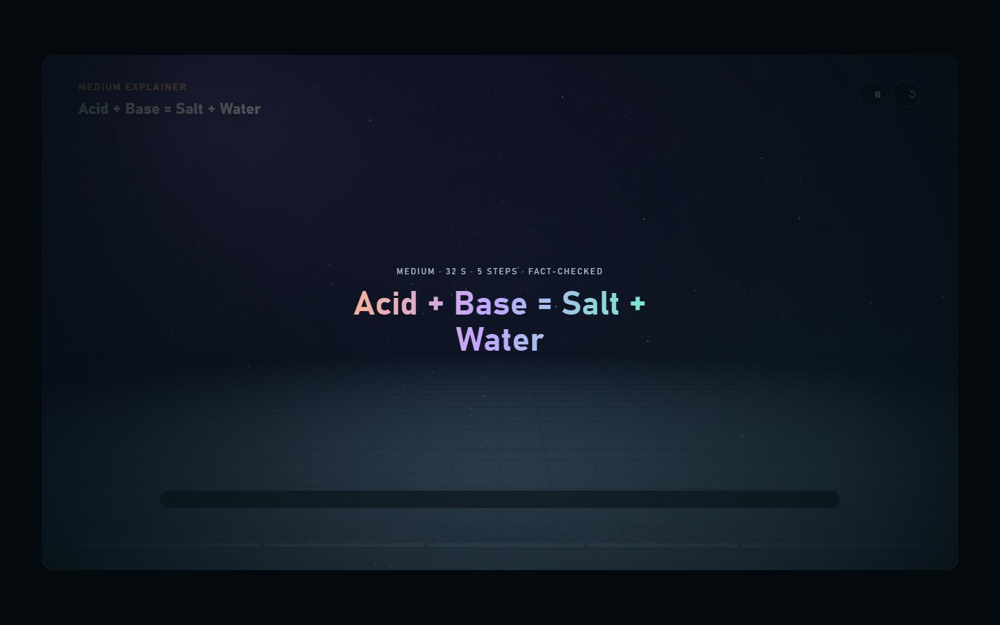</td>
<td width="50%">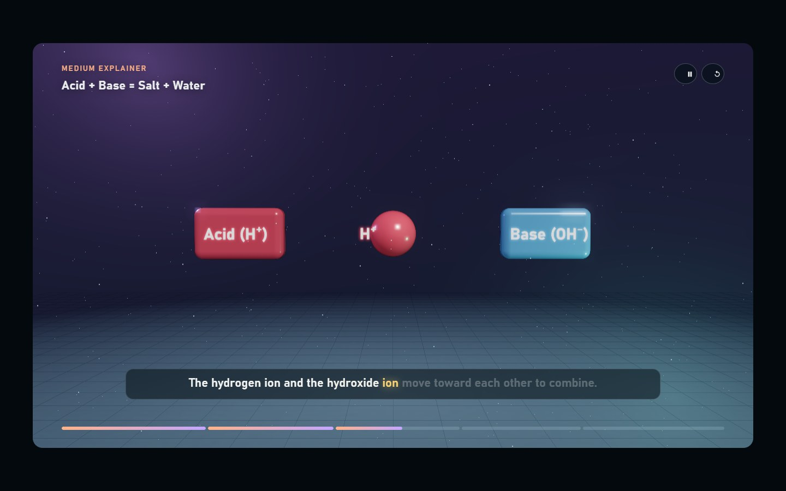</td>
</tr>
</table>

**Geometry is drawn, not decorated.** Ask how to bisect an angle and LOOM does not hand you glowing orbs: the planner
writes the *construction* (points, rays, an arc centred on B that crosses both rays, the crossing of two equal arcs, the
ray through it) and LOOM **solves it exactly** (`loom/agents/geometry.py`) before a 3-D compass, needle on the centre,
sweeps each arc across a slate and a straightedge lays each line. D really lies on the ray, both small arcs really have
the same opening, and the two halves of the angle are equal to four decimals. Steps that do not resolve go back to the
planner like a fact-checker's rejections; arcs too narrow to meet are opened wider, as a teacher would.

<table>
<tr>
<td width="50%">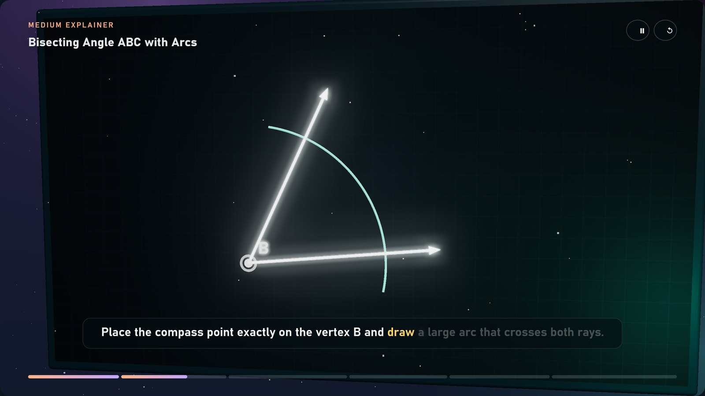<br/><sub>The compass sweeps the arc from the vertex B.</sub></td>
<td width="50%">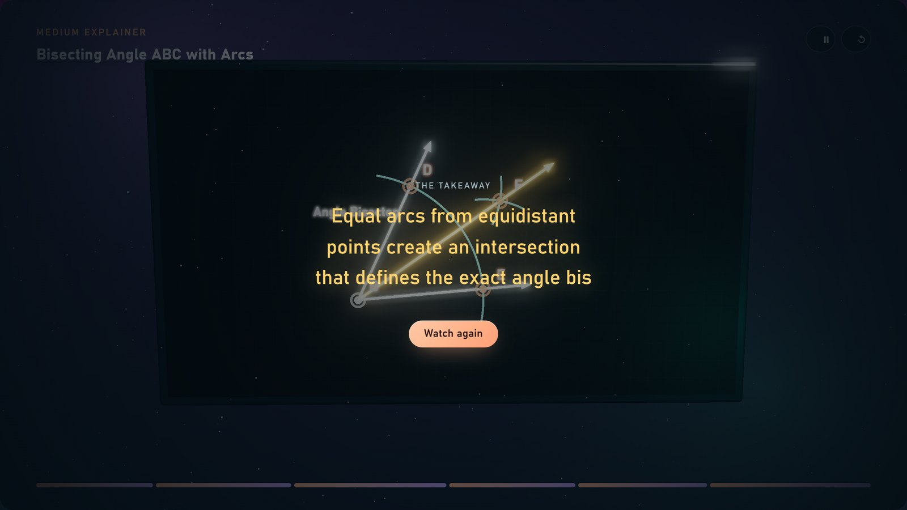<br/><sub>D, E, the equal arcs crossing at F, and the bisector BF.</sub></td>
</tr>
</table>

**Every line shows its verdict.** The narration panel lists each planned sentence with a ✓ or a ✗ and the
fact-checker's reason; a line the judge rejected only because the video did not say it (which its rules forbid) is
kept and marked as such.

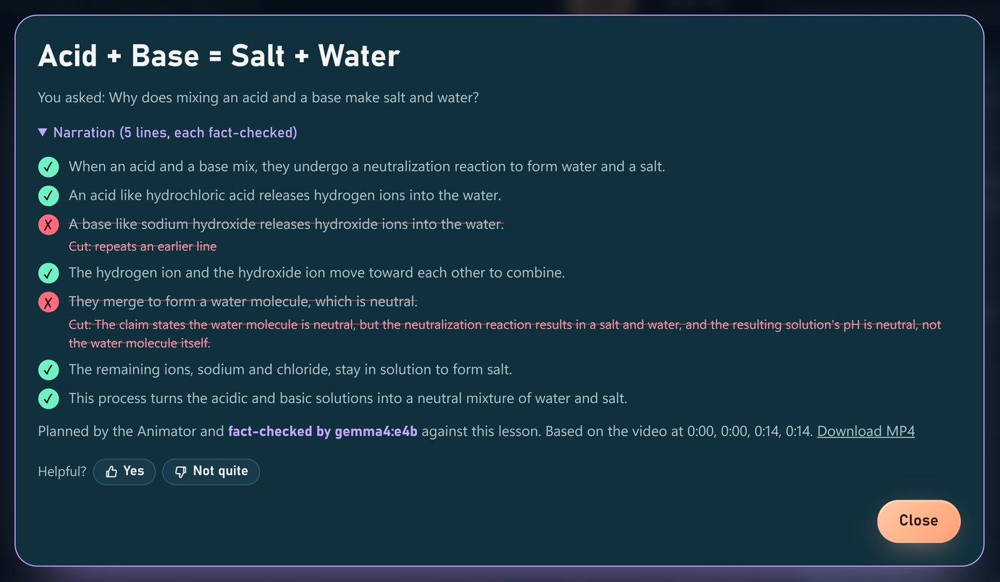

### 2.15 Every agent run, live and replayable

Nothing the agents did is thrown away. **Agent runs** lists every perception pass, woven cut, answer, explainer and
quiz; a run opens as an **orchestration graph** (A2A packets travel to each agent and back), **agent lanes on a
timeline** (bars grow live; drag to scrub; Replay re-runs it as it happened) and a feed of what each agent thought and
produced, synced to the playhead.

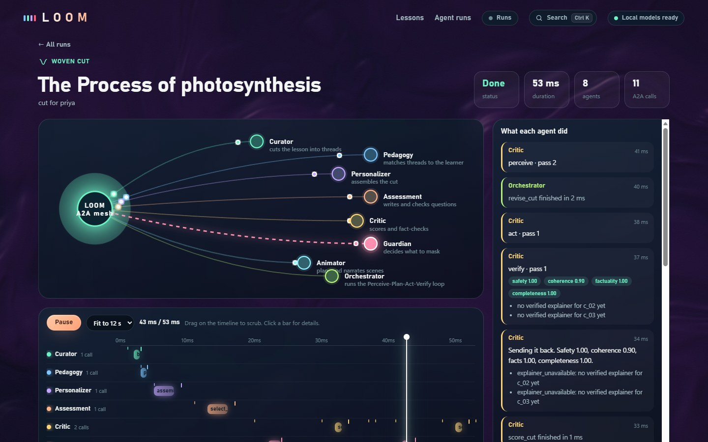

<table>
<tr>
<td width="50%">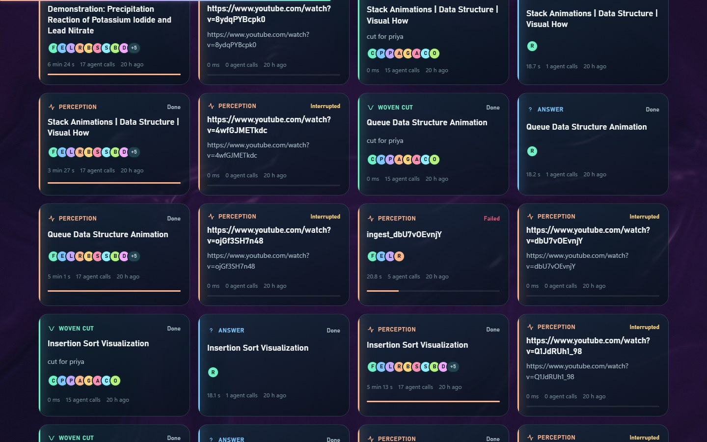</td>
<td width="50%">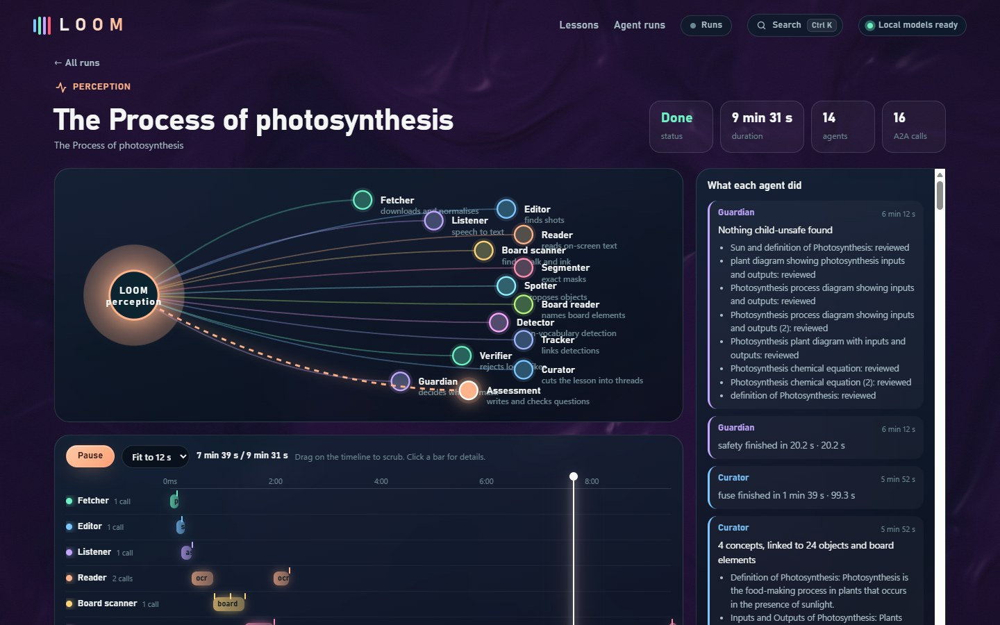</td>
</tr>
</table>

### 2.16 The feedback loop

Every answer and explainer can be rated. A thumbs-down asks *why* (too basic, too advanced, wrong, unclear), stores
it, and **re-plans for exactly that**; any misnamed element or part can be renamed for everyone. Answers make the
elements they cite glow in the video, and board elements offer "watch it being written".

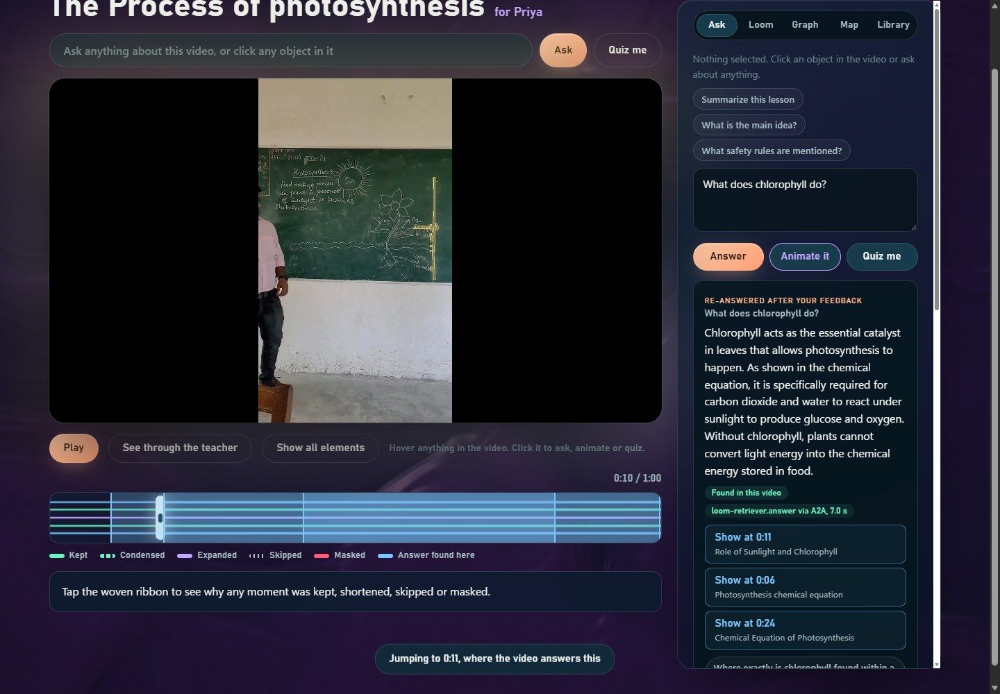

---

## 3. Novelty and contributions

These are the claims this project makes. Each is backed by something in the repo (code, a measured result, or a test), see [§14](#14-notes-for-the-research-paper) for the mapping.

1. **Object-level, viewer-specific redaction in time.** Safety is not "block the video"; it is *blur this exact object, only between these timestamps, only for viewers whose profile requires it*. Masks are **SAM 2.1 pixel masks**, not boxes, with a larger safety pad for child profiles.
2. **A verify-then-deliver loop that fails closed.** No cut reaches a viewer until a Critic scores it (safety = 1.0, coherence ≥ 0.8, factuality ≥ 0.8, completeness). The loop is bounded (budget 3) and on exhaustion falls back to a known-safe cut. Unreviewed objects are *masked by default*; a downed safety model never silently passes content.
3. **Three-stage hazard grounding that kills false alarms.** Open-vocabulary detector → **SigLIP2 look-alike verification** → **VLM crop check**. On our hazard test, false-block time dropped from **30.1 s to 0 s** at the cost of recall (reported honestly in [§10](#10-evaluation-and-metrics)).
4. **Scene-plan DSL instead of free-form code generation.** A 9 B local model failed **8 of 8** free-form Manim renders (invented APIs). Asking it for a small *scene plan* (shapes, moves, one narrated line per beat) and **compiling** that to safe code with a layout solver made rendering reliable.
5. **Fact-checked generative explainers with *graded* leniency.** Every narrated line is checked against retrieved evidence by a separate judge model. Weak lines are *dropped* (if enough remain) instead of failing the whole explainer; contradicted/invented lines are never kept.
6. **Real A2A orchestration, made visible.** Retriever, Animator and Assessment are real **A2A** agents (agent cards, JSON-RPC `message/send`, long-running tasks). Their calls, thoughts and outputs stream to the UI as events: you *see* the orchestration.
7. **Click any mask to learn.** A mask is a *query handle*: the object's identity, time, concept links and safety note are injected into retrieval and generation.
8. **Retrieval you can see.** A live semantic similarity map plus citations plus `jump_to` makes retrieval inspectable instead of a black box.
9. **Adaptive mastery loop with persistent preferences.** Quiz results and watched explainers update a per-learner **mastery graph** in SQLite, changing the *next* cut (an observable closed loop).
10. **Fully local, 8 GB-VRAM-feasible.** Seven model families and a GPU lease scheduler fit a single consumer laptop GPU (windowed SAM 2 cut peak VRAM from **8.88 GB to 2.91 GB**).
11. **A YouTube extension with the same powers.** Pixel masks over the real YouTube player, tap-to-learn, scene explainers and quizzes, all against the local gateway.
12. **Board understanding with an occlusion-aware memory.** Chalk and marker become tracked, read elements: a per-pixel board memory that only changes where the board is visible (the teacher never erases it), follows a panning, shaking phone camera, picks the board as *the surface that holds the writing* (not the biggest one), and splits long strokes so a diagram does not swallow the board. On a phone-filmed chalkboard: **0 → 24 tracked elements**.
13. **Segment-everything for drawn lessons, named in one look.** On animation and slide frames, a GPU-side SAM 2.1 point grid (0.6–0.7 s/frame, 2.4 GB) finds every element; its sub-masks become **parts**, and all parts of an element are named in **one set-of-marks VLM call** (the local VLM cannot localise parts itself; it can name numbered ones).
14. **Tap-to-lift with an exploded parts view.** The tapped element is cut out along its mask and lifted in 3-D; any part can be asked about, animated or quizzed (`part_id` reaches the agents).
15. **See through the teacher.** The board memory doubles as a presenter-free picture of the board, overlaid on the live video.
16. **Teaching explainers, not video narration, with real pictures.** Evidence is chosen for diversity (concepts and speech always in, OCR fragments out); lines that describe the video are rejected deterministically; the judge may not reject correct facts merely for being absent; the planner places crops of the lesson itself (and opt-in Wikimedia images) in a 3-D scene, at a learner-chosen length.
17. **Replayable agent runs.** Every A2A orchestration is rebuilt from the persisted event log and can be watched live or replayed: graph, lanes, notes.
18. **A learner feedback loop that changes the next answer.** Ratings with reasons re-plan answers and explainers; label corrections apply for everyone without touching the sealed graph.
19. **Exact constructions from a 9B planner.** The model names the steps; a geometry solver computes them (intersections, equal radii, widening arcs that miss) and the player draws them with a 3-D compass. Planner geometry errors become feedback, not pictures.
20. **Overlay-aware board memory.** Burned-in captions and watermarks are told apart from the board because they keep their colour while what lies *beneath* them changes; tracks are re-identified across board restarts, and text lines are joined relative to letter height.
21. **A fact-checker with enforced rules.** Judge rejections whose only ground is "the video does not mention it" are overruled, lines that narrate the video are rejected deterministically, and every verdict is shown to the learner.

---

## 4. System architecture

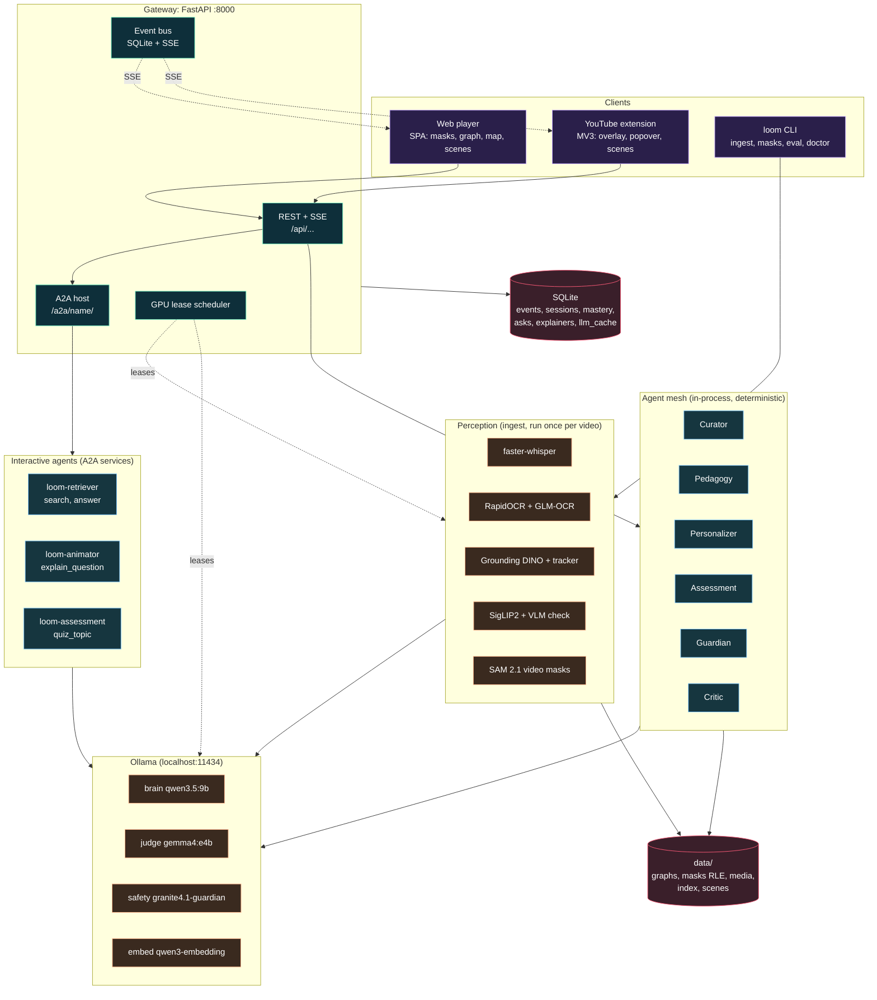

### 4.1 Process model

| Process | What runs in it | Why separate |
|---|---|---|
| **Ollama** (`:11434`) | brain, judge, safety, embedding and OCR models | Own GPU residency and keep-alive management |
| **Gateway** (`:8000`) | REST, SSE, A2A host, the mesh, static player, media | One origin for UI, API and agents (no CORS pain) |
| **Perception worker** (subprocess) | GPU torch models: ASR, detection, SigLIP2, SAM 2.1 | **No torch work while an Ollama model is resident**: stages unload/lease the GPU |
| **Browser / extension** | UI, mask decode (COCO RLE), scene player | Pure client; all data via the gateway |

### 4.2 GPU scheduling (8 GB is tight)

Only one heavy model family is resident at a time (`OLLAMA_MAX_LOADED_MODELS=1`). The gateway issues **GPU leases** with priorities (`tap_explainer 0 < session 1 < ingest 2 < prerender 3`) and every lease is logged as a `gpu_lease` event. Perception stages free Ollama models before loading torch. SAM 2.1 runs in **20-second windows** at 5 fps with masks down-scaled to 480 px, keeping VRAM near **3 GB** instead of 8.9 GB.

### 4.3 Repository layout

```
remake/
├── loom/
│   ├── core/            config, Ollama client, structured-output LLM layer, store (SQLite), blobs,
│   │                    events, A2A client/server, GPU leases, offline guard, weights registry,
│   │                    contracts/ (Pydantic, exported as JSON Schema), migrations/
│   ├── perception/      probe, shots, asr, ocr, detect, verify, segment (SAM 2.1), refine_masks, pipeline
│   ├── agents/          mesh.py (Curator…Critic), session.py (loop + persistence), scene_dsl.py,
│   │                    animator.py (sandboxed Manim + TTS), knowledge.py (index, search, answers, explainers),
│   │                    a2a_agents.py (retriever / animator / assessment services)
│   ├── gateway/         app.py, routes/ (REST + SSE), static/ (the player: index.html, app.js, watch.js,
│   │                    silk.js, scene.js, rle.js, *.css)
│   ├── eval/            asr / ocr / vocab / grounding / spike evaluation suites + demo builder
│   └── ops/             `loom doctor`
├── extension/           Chrome MV3 extension (content.js, background.js, rle.js, scene.js, content.css)
├── prompts/             versioned prompt files (id@version, role, schema)
├── contracts/           generated JSON Schemas (concept-graph, candidate-cut, verified-cut, event, a2a-*, …)
├── packages/contracts-ts/   TypeScript types generated from the same schemas
├── spec/                the original specification pack (00-audit … 07-evaluation)
├── setup/               pull-models.ps1, fetch_weights.py, doctor.ps1
├── tests/               21 test modules (unit + contract), fixtures, eval ground truth
└── data/                (git-ignored) DB, graphs, masks, media, eval results
```

~12.3 k lines of Python, ~3.3 k lines of JS/CSS/HTML, **212 automated tests**.

---

## 5. The local AI stack

Every role is a **tag in `loom.toml`**, swappable; each has a measured fallback (Stage-0 spike, `data/eval/spike.json`).

| Role | Model | Runs on | Used for | Notes (measured) |
|---|---|---|---|---|
| **Brain** | `qwen3.5:9b` (fallback `qwen3.5:4b`) | Ollama | Concept fusion, vocabulary proposal, quiz writing, scene planning, grounded answers | JSON-schema output **50/50 valid first try**, p50 **3.5 s**, p95 6.6 s; `think=false` default (thinking: p50 52 s, 0.9 valid). `num_ctx 6144` fits fully in VRAM (5.58 GB); 8192 spills 0.79 GB to CPU |
| **Judge** | `gemma4:e4b` (fallback `e4b-it-qat`) | Ollama | Fact-check narration lines, verify quiz questions, crop check (vision) | Structured valid **50/50**, p50 **1.2 s**; as a safety classifier recall 1.0, false-flag 0 |
| **Safety** | `granite4.1-guardian:8b-q4_K_M` | Ollama | Per-object risk tags, native `<score> yes\|no </score>` | q4_K_M chosen: Q6_K spills 2 GB to CPU and is ~4× slower at the same accuracy. Accuracy 0.96, hazard recall 0.92, false-flag 0, p50 **1.18 s** |
| **Embedding** | `qwen3-embedding:0.6b` | Ollama | Semantic index and search | 1024-d, unit norm, deterministic (max abs diff 0.0); batch-64 cold 7.5 s / warm 3.5 s |
| **OCR (re-read)** | `glm-ocr:q8_0` | Ollama | Re-read low-confidence formulas | ~1.5 GB resident |
| **ASR** | `faster-whisper large-v3-turbo` (fp16) | torch/CT2 | Transcript with word timing | WER **0.0** on the demo lesson (170 words) |
| **OCR (primary)** | RapidOCR (PP-OCR on torch-CUDA) | torch | On-screen text, formula detection | recall **1.0**, formula exact **1.0**, temporal IoU **0.98** |
| **Detector** | Grounding DINO base | torch | Open-vocabulary boxes from a phrase list | |
| **Look-alike verifier** | SigLIP2 base | torch | "Is this *really* broken glass or a glass beaker?" | |
| **Segmenter** | SAM 2.1 Hiera-base+ | torch | Pixel masks, forward + reverse video propagation | |
| **TTS** | Kokoro-82M (ONNX) | CPU/ONNX | Per-beat narration (voice `af_heart`) | |
| **Scene renderer** | Manim (+ LaTeX) | CPU | Background MP4 export of explainers | sandboxed, no network |

**Structured output** is used everywhere: every LLM call has a Pydantic contract, is sent as a JSON Schema, retried with the validation error on failure, and cached in SQLite (`llm_cache`) keyed by prompt id@version + model digest + inputs.

---

## 6. Pipeline A · Perception (ingest)

Run once per video (`loom ingest <file|url>` or "Add a lesson" in the player). Streams `ingest_stage` events to the UI.

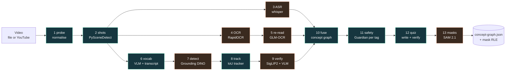

| # | Stage | What happens | Output |
|---|---|---|---|
| 1 | **probe** | ffprobe + normalise to a working MP4, duration, fps, audio | media record |
| 2 | **shots** | PySceneDetect content detection | shot boundaries (e.g. 7 shots in the 69 s demo; 10 in the 97 s YouTube lesson) |
| 3 | **ASR** | faster-whisper large-v3-turbo fp16, sentence ids, `start < end`, contiguous | transcript sentences |
| 4–5 | **OCR + re-read** | RapidOCR on sampled frames, merged into spans with temporal extent; spans below confidence 0.85 are **re-read by GLM-OCR**, formulas get exact-match checks | on-screen text with time ranges |
| 6 | **vocab** | The brain+VLM propose an *object vocabulary* from keyframes **and** transcript, then the hazard classes (broken glass, knife, flame, needle…) are always added | phrase list with sources |
| 7 | **detect** | Grounding DINO base, 2 fps base + 4 fps *hazard windows* | candidate boxes |
| 8 | **track** | IoU tracker links boxes into instances | tracks |
| 9 | **verify** | Three-way check, see below | verified tracks |
| 10 | **fuse** | The brain fuses transcript + on-screen text + objects into **concept nodes** with prerequisites and **thread roles** (intro / core / setup / safety…) with evidence ids | concept graph |
| 11 | **safety** | Granite Guardian scores each object tag (`sharp_object`, `injury_risk`, `fire_or_explosion`, `weapon`, `blood_or_gore`, `nudity`, `drugs_or_alcohol`, `hazardous_chemical`, `disturbing`) | per-object `child_unsafe` + tags |
| 12 | **quiz** | Brain writes questions *grounded in evidence*; the judge verifies each one is answerable from the lesson (**unverified questions are discarded**) | `quiz_bank` |
| 13 | **masks** | SAM 2.1 propagates masks from the tracked boxes, forward **and** reverse, in 20 s windows; stored as COCO RLE | per-object mask tracks |

### 6.1 Hazard verification (stage 9)

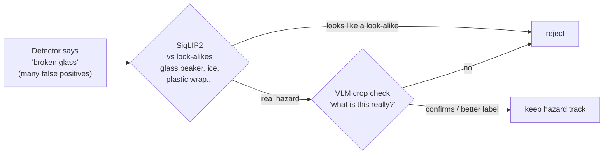

Ablation on the demo lesson (hazard truth 48.0–58.3 s; see [§10.3](#103-hazard-grounding-ablation)): the detector alone raises **72 tracks / 30 hazard tracks** and would blur **30.1 s of safe footage**; verification keeps **3 hazard tracks and 0 s of false blocking**.

### 6.2 Pixel masks (stage 13)

* SAM 2.1 `Sam2VideoModel` via 🤗 Transformers, prompted with the verified box on its best frame.
* Propagates **forward and in reverse**, merged by union; presence runs are derived per instance.
* Cropped to the picture area, down-scaled to 480 px width, lightly dilated; encoded as `rle:<h>x<w>:<counts>` (COCO RLE) and decoded in the browser by `rle.js` (which splits only at the first two colons: counts contain `:`).
* Windowing fixed an out-of-memory peak: **8.88 GB → 2.91 GB**.

### 6.3 Board, slide and animation elements (stages `board` + `elements`)

Lessons on a blackboard, a whiteboard, slides or animation carry their meaning in *marks and drawn things*, which no
phrase list names in advance. Two CPU/GPU stages run before the language models load:

* **board** (`loom/perception/board.py`, OpenCV): ink on a flat surface; board memory ignores the presenter, follows a
  panning camera, and groups strokes into lines, formulas and diagrams.
* **elements** (`loom/perception/everything.py`, SAM 2.1 automatic masks): on frames that are *drawn* (graphic score:
  the calmest half of the frame is exactly flat on ≥ 90 % of pixels; animation 0.95–1.0, camera footage 0.62–0.80),
  a 24 × 24 point grid is decoded in batches, candidates are filtered on the 256 px logits (predicted IoU ≥ 0.82,
  stability ≥ 0.90), NMS'd and de-duplicated on the GPU (**0.6–0.7 s a frame, 2.4 GB**; the stock pipeline took
  12–22 s at 6.3 GB). Words on one line join into one text element, stray single letters are dropped, and masks are
  linked through time by mask IoU (box IoU for moving elements), so each element keeps one id. Copies of board-ink
  elements are dropped; nested ones (a row inside a table) stay hoverable.

**Chalkboards filmed on a phone** (first real test: 0 elements found) needed four board fixes: the board colour is the
large background colour that carries the most writing, not the largest one (a phone sees more wall than board);
board-coloured patches cut off from the board by thin bridges (dark jeans) are not board; board memory and the
"new slide" test tolerate 2 px of handheld shake; long straight or wavy strokes (a border, the soil line under a plant)
are elements of their own so they do not chain a whole board into one block, and multi-line blocks also keep their
parts as nested elements. Tracks are matched one-to-one per sample (a big block no longer steals a neighbour's id).
On that lesson: 0 → 24 tracked elements, stable for the whole clip. "480p" now caps the short side, so a portrait
video keeps 480 px of width.

**Parts inside elements.** Animation elements keep the smaller SAM masks that lie inside them (a table's rows, a chip
on a board); drawn board elements are split by SAM on their presenter-free picture (a denser 32 × 32 grid, looser
thresholds, never on board the scanner did not see, never on skin). All of an element's parts are then named in **one**
set-of-marks VLM call (`prompts/element_parts.md`: each part outlined in its own colour, its number outside its corner).
The local VLM could not *locate* parts itself (its boxes were off and it took 35 s), but it names numbered parts well:
on the SQL clip the teams table became *id column, TEAMS title, row with id 1 … 5, PRIMARY KEY label, Warriors text*.
Parts are `GraphObject.parts` (`ObjectPart`: label, description, mask, box at time `t`), hashed only when present.

**See through the teacher.** The board scanner already keeps the last unobstructed colour of every board pixel; every
2 s (5 s for long lessons) it writes that picture as a WebP with transparency (`media/boards/<video>/`). On filmed boards
(not animations or slides) the player overlays it, so the teacher becomes transparent wherever they stand in front of
the board.

Both feed `board_read`: the brain VLM names every element from an outlined crop (`board_element` / `scene_element`
prompts) and the elements enter fusion, safety, retrieval and the map like any object. On a 20 s SQL animation clip
this found **37 labelled elements** (before: 10). The player's **Show all elements** toggle (key `E`) draws every
element's outline, box, `#n label` tag and recent path; masks hold between samples (board elements are re-sampled
only when their ink changes), so they no longer blink.

---

## 7. Pipeline B · The agent mesh and the verification loop

For `(video, viewer)` the gateway starts a **session**. Events (`agent_call`, `agent_done`, `agent_note`, `loop_phase`) stream to the player's live pipeline.

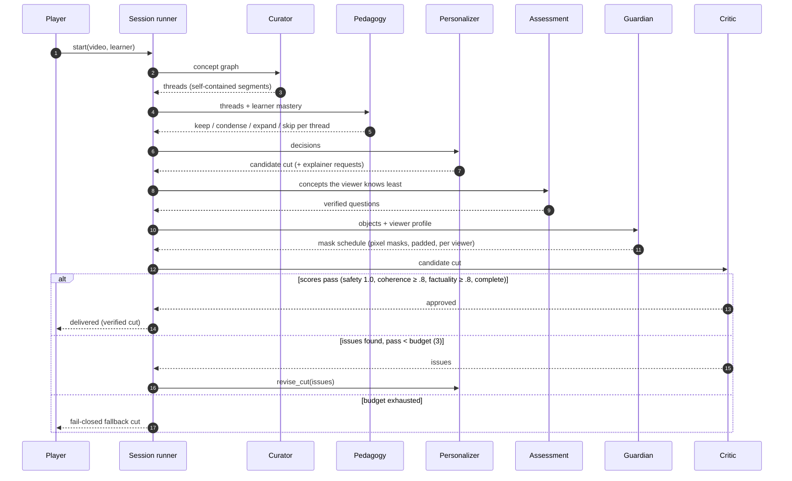

### 7.1 The agents

| Agent | Responsibility | Key logic and thresholds (`loom.toml`) |
|---|---|---|
| **Curator** | Cuts the lesson into **threads** (self-contained segments aligned to sentence and shot boundaries; the last thread ends exactly at video duration) | Prefers shot boundaries; never ends mid-sentence |
| **Pedagogy** | Per thread, from the viewer's mastery *m* of that thread's concepts: **keep / condense / expand / skip** | `m ≥ 0.80` → skip, `≥ 0.60` → condense, `≥ 0.35` → keep, below → expand (shifted by the viewer's pace preference ±0.10). Guards: **core and safety threads are never skipped** (downgraded to a refresher), a thread is not skipped if a prerequisite is below mastery 0.35, a summary keeps a short recap, and a viewer's "never skip" preference is honoured |
| **Personalizer** | Assembles the candidate cut and the list of explainers to attach | Condensed threads keep `max(6 s, 50 %)` of their length, ending at a sentence boundary; formulas are held ≥ 3 s |
| **Assessment** | Picks up to 3 *verified* questions on the concepts the viewer knows least; grades answers server-side; updates mastery | `+0.35` on correct, `×0.75` decay on wrong, `+0.05` per explainer watched, `+0.03` per exposure |
| **Guardian** | Decides which objects to mask for this viewer and when | Standard threshold 0.5, **strict (child) 0.2**; time pad 0.5 s; box pad 0.04, child pad ×3; **unreviewed objects are masked** |
| **Critic** | Scores the cut: **safety, coherence, factuality, completeness** and returns typed issues | safety must be **1.0**; coherence ≥ 0.8; factuality ≥ 0.8; detects overlapping/out-of-order threads, mid-sentence cuts, unmasked hazards, unsupported explainer/quiz claims, missing prerequisites, missing quiz |

### 7.2 Personas (built-in viewers)

| Viewer | Profile | Typical weave |
|---|---|---|
| **Alex** (expert) | High mastery | Intro/setup skipped, the rest condensed, never core or safety |
| **Priya** (novice) | Low mastery | Everything kept, prerequisite threads *expanded*, explainers attached |
| **Parent + child** | Strict safety profile | Full lesson, with hazardous objects masked at larger padding |

### 7.3 Closed loop

Answering quiz questions and watching explainers writes to the `mastery` table (per learner × concept). **Watch again** produces a *different* cut. This is the observable adaptation loop.

---

## 8. Pipeline C · The interactive layer

### 8.1 Click-to-learn flow

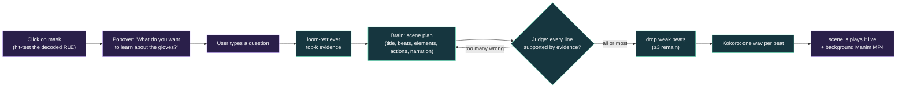

### 8.2 Grounded answers and semantic search

* `build_index` embeds **speech, on-screen text, concepts and objects** (qwen3-embedding, 1024-d) and caches it per video.
* `search` returns the most similar items with timestamps; `answer` makes the brain answer **only from the retrieved evidence**, with citations and a `jump_to` equal to the **most relevant** citation (not the earliest). The player seeks there.
* The **Map** tab shows PCA-2D positions of every item, similarity edges, and highlights the retrieved set for the last question.

### 8.3 Scene explainers (the "better than Manim" animator)

The brain writes a **`ScenePlan`**:

```jsonc
{ "title": "Safety Goggles for Broken Glass",
  "takeaway": "Wear safety goggles and alert others when handling broken glass in the lab.",
  "beats": [ { "narration": "These protect your eyes from flying shards.",
               "elements": [ {"id":"g","kind":"pill","text":"safety goggles","size":"m"} ],
               "actions":  [ {"op":"appear","target":"g"}, {"op":"highlight","target":"g"} ] } ] }
```

* `scene_dsl.compile_plan` turns a plan into **safe Manim code** (AST-gated, sandboxed render with socket calls blocked) with a **layout solver** (`MIN_GAP`, slot allocation) so elements never overlap.
* `scene.js` plays the *same plan* in the browser: orbs / cards / pills / text, SVG arrows, move / merge-flash / fade / connect actions, camera focus, drifting dust, karaoke captions, a clickable beat timeline, per-beat Kokoro audio, intro and takeaway cards.
* Explainers can be **opened and closed at any time**, are stored (`custom_explainers`), and appear in the **Library** tab with their question.

**Fact-checking ("lenient but honest")**: the judge labels each line *supported* if it is stated, implied, paraphrased, correct general knowledge or common-sense safety advice; *unsupported* only if it is wrong, contradicting, invents specifics, or is misleading/unsafe. If ≥ 3 beats remain and the dropped count is ≤ max(2, n/3), weak beats are dropped; otherwise the rejections are fed back for a redraft (up to 3 drafts). The UI shows each line with ✓ or ✗ as it happens.

**Tap to lift, parts, and the feedback loop (player).** Clicking an element cuts it out of the frame (along its mask, for
objects, the teacher-free board for board elements) and lifts it toward the viewer in 3-D: it tilts with the pointer,
the lesson behind it dims, and its named parts fan out as an exploded diagram with leader lines. A part can be picked
and asked about, animated or quizzed (`part_id` reaches the agents; the planner and the answerer are told which part).
"Part of …" lifts the containing element. Every answer and explainer can be rated; a thumbs-down asks why (too basic,
too advanced, wrong, unclear), stores it, and re-plans with that reason (`learner_feedback` in the prompts; a new cache
key). Any element or part can be renamed; overrides live in `label_overrides` and are applied wherever the lesson is
served or asked about, while the sealed graph stays as perception produced it. Answers make the elements they cite
glow in the video, and board elements offer "watch it being written" (jump to the moment they first appeared).

**3-D explainers with real pictures, at the length you want.** `static/scene.js` plays a scene plan in three.js
(vendored under `static/vendor/`, no CDN at runtime): clear-coated orbs, glass cards, capsules, tube arrows that draw
themselves, bloom, a reflective floor and drifting dust; the camera frames each beat; merges collide and burst; a
placement solver keeps everything apart and old things clear away (at most five shapes and one picture on stage).
Pictures come from `agents/visuals.py`: crops of the elements the explainer is grounded on (teacher-free on filmed
boards) and, when not offline, freely licensed Wikimedia Commons images with author and licence on screen. The planner
(`manim_plan` v4) is offered the pictures by caption and uses the ones that show what a beat says. Learners pick
**Short** (4-5 beats), **Medium** (6-8) or **In-depth** (10-14, in chapters); the length is part of the cache key. On
the SQL clip a short explainer used the lesson's own players and teams tables, 5 of 5 lines fact-checked, 40 s. (The
YouTube extension still plays its older 2-D copy, `extension/scene.js`.)

**Motion and 3-D on the site** (`static/motion.js`, `weave3d.js`, `motion.css`; GSAP + ScrollTrigger + Lenis,
vendored). Lenis smooth scrolling on GSAP's ticker; staggered blur-in reveals; magnetic primary buttons; a woven thread
curtain between pages; a scroll-progress thread; a command palette (**Ctrl/Cmd + K**: lessons, running runs, actions).
The Lessons page has a 3-D thread sculpture (28 threads, bloom) that is a woven knot in the hero and, across a pinned
five-step "how it works" journey, unravels into a loom, weaves cloth, lifts a piece out, orbits as agents and re-knots
in the viewer's colour. All of it is off under `prefers-reduced-motion`.

**Agent runs (live and replayable).** Events were always persisted; `routes/runs.py` turns each channel into runs
(ingest, woven cut, answer, explainer, quiz). The *Agent runs* page lists them; a run view draws the orchestration graph
(A2A packets travel from LOOM to each agent and back), the agents as lanes on a timeline (bars grow live; drag to
scrub; Replay sweeps the run as it happened) and a feed of what each agent thought and produced, synced to the
playhead. The header's live pill lists what is running now; reloading the page reattaches to a running ingest and
replays what it did so far.

**Teach the topic, never narrate the video** (`manim_plan` v2, `claims_verify` v4, `animator.not_teaching`). An early
explainer on a chalkboard lesson said "The video shows the word Photosynthesis" eight times: retrieval had returned
four garbled OCR readings of the title, and the planner restated them. Now (1) evidence is chosen by `grounding`:
every lesson item ranked, near-duplicates and OCR fragments dropped, at most 2 screen spans, and the best-matching
concept summaries always included; (2) the planner is told to teach like a teacher (definition → inputs → mechanism →
outputs), fix OCR typos and add correct textbook facts; (3) lines that describe the video ("the video shows…", "on
screen…") or repeat an earlier line are rejected deterministically before narration; (4) the judge gets the lesson
topic and may never reject a correct fact only because the video did not say it. The same question now yields
"Plants make their own food using a process called photosynthesis. The plant takes in carbon dioxide from the air and
water from the soil. Inside the leaves, a green pigment called chlorophyll captures energy from the sunlight…", with
CO₂ and H₂O merging into sugar on screen. Explainers are cached under a versioned key (`EXPLAINER_VERSION`).

### 8.4 Topic quizzes

"Quiz me" on any topic or object: the `loom-assessment` agent selects from the verified bank or writes new questions, which the judge verifies; answers are graded server-side (`adhoc_questions`, `adhoc_attempts`).

### 8.5 A2A and live status

| A2A service | Skills | Notes |
|---|---|---|
| `loom-retriever` | `search`, `answer` | `GET /a2a/loom-retriever/.well-known/agent-card.json` |
| `loom-animator` | `explain_question` (long-running) | JSON-RPC `message/send`, then `tasks/get`; 1500 s ceiling |
| `loom-assessment` | `quiz_topic` | |

`A2AClient` publishes `agent_call` / `agent_done` events; agents add `agent_note` events (`thinking`, `output`, `progress`, with item lists). Events persist to SQLite and stream over SSE (`/api/events/{channel}`, channels `sess_*`, `ingest_*`, `tap_*`, `job_*`, `system_*`).

### 8.6 YouTube extension

A Manifest-V3 extension (no build step). On a YouTube watch page: docked LOOM panel, **pixel-mask overlay locked to the video** (theatre mode, fullscreen, SPA navigation), tap-to-learn popover, Ask / Animate / Quiz / Library, scene explainers (audio fetched through the service worker because YouTube's CSP blocks direct gateway media). Host permission is `127.0.0.1:8000` only. See [`extension/README.md`](extension/README.md).

---

## 9. Safety and trust model

LOOM is designed so that **failure is safe by default**:

| Failure | Behaviour |
|---|---|
| Safety model unavailable at ingest | Objects marked `unreviewed` → **masked** |
| Judge unavailable | Artifact (explainer/quiz) is **dropped**, never shown unverified |
| Critic cannot approve within budget | **Fail-closed fallback** cut |
| LLM returns malformed output | Schema validation → retry with error → else degrade (never pass-through) |
| Generated animation code | AST gate + sandboxed render, no network sockets, bounded time/memory/lines |
| Explainer claim not in evidence | Dropped or redrafted; contradictions never kept |
| Stale cached model output | LLM cache is keyed by prompt id@version, model digest and inputs, so a changed prompt or model never reuses old answers |
| Privacy | Offline mode: HF offline, loopback-only model hosts; extension talks only to `127.0.0.1` |

---

## 10. Evaluation and metrics

> Every number below is read from `data/eval/*.json` (written by `loom eval <suite>` with machine info, model digests and commit embedded) or computed from the SQLite event log. Nothing is typed by hand. Where a target was **missed**, it says so.
> Hardware: **NVIDIA RTX 5070 Laptop GPU, 8 GB**, Windows 11, Ollama 0.40.12, Python 3.12.

### 10.1 Local model spike (Stage 0; 50 structured calls per model)

| Model | Valid first try | Accuracy | p50 / p95 latency | Resident VRAM | Peak VRAM | CPU spill |
|---|---|---|---|---|---|---|
| `qwen3.5:9b` (brain) | 1.00 | 1.00 | 3.5 s / 6.6 s | 5.58 GB | 7.4 GB | 0 |
| `qwen3.5:4b` (fallback) | 1.00 | 1.00 | 1.9 s / 5.6 s | 3.2 GB | 4.9 GB | 0 |
| `gemma4:e4b` (judge) | 1.00 | 1.00 | 1.2 s / 3.5 s | | 5.8 GB | 0 |
| `gemma4:e4b-it-qat` | 1.00 | 1.00 | 1.4 s / 4.4 s | 3.1 GB | 5.3 GB | 0 |
| `granite4.1-guardian:8b` (Q6) | 1.00 | 0.96 | 1.2 s / 1.6 s | 6.1 GB | 7.0 GB | **2.0 GB** → switched to q4_K_M |
| `qwen3-embedding:0.6b` | n/a | deterministic | batch-64 3.5 s warm | 1.3 GB | 2.4 GB | 0 |

Thinking mode (brain): p50 **52.6 s**, valid 0.9, one timeout, so `think=false` is the default.

### 10.2 Perception quality (demo lesson, 68.7 s)

| Suite | Metric | Result | Target | Status |
|---|---|---|---|---|
| **ASR** | WER (170 ref words) | **0.000** | ≤ 0.03 | ✅ |
| | runtime for 68.7 s of audio | 10.3 s (**RTF 0.15**) | | |
| **OCR** | recall @ char-sim 0.8 | **1.00** | 1.0 | ✅ |
| | mean temporal IoU | **0.98** | ≥ 0.90 | ✅ |
| | formula exact match | **1.00** | 100 % | ✅ |
| | cost | 6.2 s shots + 18.0 s RapidOCR + 4.1 s re-read (151 frames) | | |
| **Vocab** | ground-truth object recall | **1.00** (all hazard classes present) | | ✅ |

### 10.3 Hazard grounding: two ground-truthed lessons, every decision rule

<!-- EVAL-GROUNDING:START -->
Time-level hazard precision / recall at 0.1 s against hand-marked windows: the synthetic demo (48.033-58.333 s) and the Water Sciences YouTube lesson (61.9-66.77 s, 71.46-74 s; window annotated by the AI assistant, to be confirmed by a human). The suite stores every stage's verdict per track, so the same tracks are re-scored under each decision rule. Targets: precision >= 0.95, recall >= 0.90, false-block <= 2 s, missed <= 0.5 s.

**Acid-Base demo** (VLM verdicts on hazard tracks: {'confirmed': 2, 'rejected': 28})

| Decision rule | Hazard tracks kept | Precision | Recall | F1 | False-block (s) | Missed (s) |
|---|---:|---:|---:|---:|---:|---:|
| detector only | 30 | 0.240 | 0.922 | 0.381 | 30.1 | 0.8 |
| SigLIP generic only | 3 | 1.000 | 0.583 | 0.736 | 0.0 | 4.3 |
| SigLIP look-alikes only | 3 | 1.000 | 0.583 | 0.736 | 0.0 | 4.3 |
| VLM only | 2 | 0.889 | 0.388 | 0.541 | 0.5 | 6.3 |
| SigLIP AND VLM | 1 | 1.000 | 0.146 | 0.254 | 0.0 | 8.8 |
| SigLIP OR VLM (LOOM) | 4 | 0.943 | 0.796 | 0.863 | 0.5 | 2.1 |

**Water Sciences** (VLM verdicts on hazard tracks: {'rejected': 13})

| Decision rule | Hazard tracks kept | Precision | Recall | F1 | False-block (s) | Missed (s) |
|---|---:|---:|---:|---:|---:|---:|
| detector only | 13 | 0.392 | 1.000 | 0.563 | 11.5 | 0.0 |
| SigLIP generic only | 0 | n/a | 0.000 | 0.000 | 0.0 | 7.4 |
| SigLIP look-alikes only | 0 | n/a | 0.000 | 0.000 | 0.0 | 7.4 |
| VLM only | 0 | n/a | 0.000 | 0.000 | 0.0 | 7.4 |
| SigLIP AND VLM | 0 | n/a | 0.000 | 0.000 | 0.0 | 7.4 |
| SigLIP OR VLM (LOOM) | 0 | n/a | 0.000 | 0.000 | 0.0 | 7.4 |


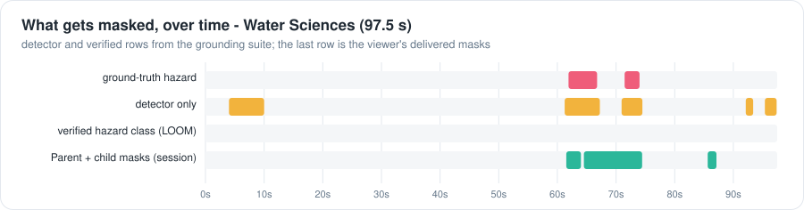

**Reading.** Verification removes the detector's false blocking but costs recall, and **the recall target (0.90) is missed on both lessons**. In the first demo run (2026-11-02) the VLM rejected all 30 hazard crops, true ones included, so the three verified rows were identical (precision 1.00, recall 0.583; README at commit 1945562). Re-measured on 2026-11-16, the detector and SigLIP rows are unchanged (deterministic) but the VLM confirmed 2 of 30 crops - one of them a true hazard SigLIP had dropped - so LOOM's row moved from SigLIP's 1.00 / 0.583 to 0.943 / 0.796 (precision / recall). The VLM is rarely decisive and not stable across runs; under the OR-rule its rare confirmations only add recall, while VLM-only or AND rules lose most of the hazard. On Water Sciences it rejected 13 of 13. On Water Sciences the hazard is a broken pipette on the floor; the detector proposed it as "cigarette", "needle", "syringe" and "open flame", all rightly rejected (the VLM called it a pipette), so class-level grounding finds none of it, while the Guardian's review of the tracked "glass pipette" object masks it. Two complementary paths; neither is enough alone. Delivered recall for Parent + child on Water Sciences: 0.93 (with gloves, goggles and a bottle masked too). Full tables: [docs/TESTING_REPORT.md](docs/TESTING_REPORT.md#3-hazard-grounding-two-ground-truthed-lessons).
<!-- EVAL-GROUNDING:END -->

### 10.4 Segmentation efficiency

| Setting | Peak VRAM |
|---|---|
| SAM 2.1 whole-shot propagation (long shot) | **8.88 GB** (OOM-risk on 8 GB) |
| 20 s windows, 5 fps, 480 px masks | **2.91 GB** |

### 10.5 Corpus processed end-to-end

| Lesson | Length | Shots | Sentences | On-screen text spans | Objects | Concepts | Verified quiz questions |
|---|---|---|---|---|---|---|---|
| Acid-Base Neutralization (synthetic demo) | 68.7 s | 7 | 15 | 4 | 7 (1 child-unsafe) | 6 | 18 |
| Water Sciences Lab Tutorial: Glass Disposal (YouTube, CC) | 97.5 s | 10 | 15 | 76 | 5 (3 child-unsafe) | 5 | 12 |
| SQL Explained in 100 Seconds (YouTube) | 142.4 s | 9 | 22 | 723 | 2 (both the channel's flame logo: false positives, audited from frames) | 1 | 3 |

SAM 2.1 masks were generated for all three (mask IoU against hand-drawn masks is pending: 15 keyframes are exported for annotation, `loom/eval/mask_iou.py`).

### 10.6 Agent mesh (from the event log: 36 sessions, 1,168 persisted events)

| Metric | Value |
|---|---|
| Sessions approved by the Critic | **34 / 36** (the other 2 never finished; stale `running` rows from interrupted runs) |
| Passes to approval | **26 × 1 pass, 8 × 2 passes** (mean **1.24**, max 2; budget 3) |
| Fallbacks (budget exhausted) | **0** |
| Final Critic scores on the latest session | safety **1.00**, coherence **1.00**, factuality **1.00**, completeness **1.00** |
| Deterministic agents (Curator, Pedagogy, Personalizer, Guardian, Critic) | effectively instant (median < 1 ms) |
| Event kinds | `agent_call` 300, `agent_done` 295, `gpu_lease` 144, `loop_phase` 134, `render_progress` 69, `ingest_stage` 65, `agent_note` 45, `delivered` 39, `session_start` 36, `candidate_ready` 34, `error` 7 |
| LLM cache entries | 543 |

### 10.7 Latency, verification and fact-checking (repeated runs)

<!-- EVAL-VERIFY:START -->
Every request below asks a *different* question, so no answer comes from the cache (a repeated question returns in 0.08 s).

| Interaction | n | Median | IQR | Range |
|---|---:|---:|---:|---:|
| Grounded answer via A2A (retrieve + generate + cite) | 10 | 22.80 s | 13.84-32.69 s | 11.87-72.74 s |
| Topic quiz (write + verify) | 5 | 36.84 s | 19.61-40.74 s | 6.05-42.05 s |
| Verified session (6 agents + Critic loop) | 12 | 0.27 s | 0.27-0.28 s | 0.26-0.30 s |

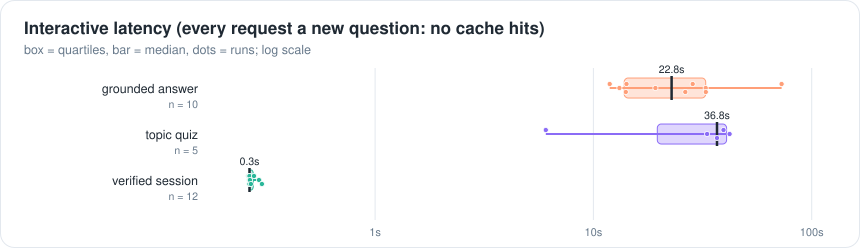

**Critic fault injection** (`loom/eval/critic_faults.py`, 3 lessons x 3 viewers): **76/76 planted faults detected**, 9/9 clean cuts approved (0 false rejections). The loop repairs 49; the other 27 end in the fallback cut (whole lesson, no generated content, every object masked), so no faulty cut is delivered. Not repaired in the loop: quiz faults (no re-selection) and overlap repairs that oscillate with mid-sentence repairs.


**Explainer fact-checking** (event log, 12 runs): first-draft line support 72%, first draft accepted 9/12. Against 40 labelled narration lines, the judge alone agrees 0.60 (kappa 0.05); LOOM's final verdict (judge + absence-only overrule + not-teaching guard) 0.93 (kappa 0.69) with 0 false accepts. *These labels are the AI assistant's; a human column is waiting in `data/eval/factcheck_lines.csv`.*

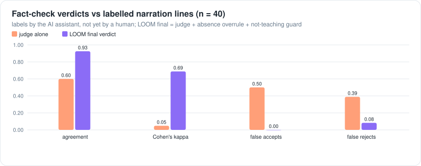
<!-- EVAL-VERIFY:END -->

### 10.8 Software quality

* **265 automated tests** (unit + contract + gateway + A2A), all passing; 
* data contracts exported as JSON Schema (24 schemas) and as TypeScript types;
* path-traversal tests on the media route; determinism tests on embedding; regression tests for cut-boundary rounding;
* `loom doctor` checks Python, CUDA, FFmpeg, NVENC, LaTeX, Ollama settings, every model (with a smoke call), weights, ports and disk.

### 10.9 Batch evaluation: 30 short lessons, 14 styles

Thirty 10–60 s lessons (`tests/eval_data/shorts_batch.txt`): chalkboard and digital whiteboard (picked by watching
them), lightboard, handwriting on paper, whiteboard doodle animation, 2-D animated explainers, Manim-style maths,
algorithm and data-structure visualisations, chemistry lab demos, a physics demo, a coding screencast and 3-D anatomy.
Each went through the running gateway exactly as a user's would (`uv run python -m loom.eval.batch`): perception, one
question to the answer agent, and three screenshots (all elements, one lifted with its parts, the agent run). The
numbers below are generated by `uv run python -m loom.eval.batch_report` from `data/eval/batch/summary.json`.

<!-- BATCH:START -->
**22 short lessons in 12 styles** (15.0 minutes of video) went through the full pipeline on one laptop GPU; 8 failed (listed below).

| | Total | Per video (mean) |
|---|---:|---:|
| Elements found and tracked (board, drawn, detected) | 850 | 38.6 |
| Named parts inside elements | 203 | 9.2 |
| Concepts in the knowledge graph | 88 | 4.0 |
| Quiz questions written and verified | 106 | 4.8 |
| Perception time | 242 min | 661 s |
| Answer agent: "What is the main idea of this lesson?" | 21/21 answered from the video | 21.0 s |

**By lesson style**

| Style | Videos | Mean length | Elements | Parts | Concepts | Quiz | Perception |
|---|---:|---:|---:|---:|---:|---:|---:|
| Math animation | 4 | 44 s | 35.0 | 4.8 | 5.2 | 4.5 | 508 s |
| Chalkboard | 3 | 21 s | 20.0 | 2.3 | 2.0 | 2.3 | 403 s |
| 2D animated explainer | 3 | 50 s | 63.0 | 11.7 | 5.7 | 9.7 | 1528 s |
| Algorithm visualization | 2 | 41 s | 71.0 | 49.5 | 4.0 | 9.5 | 914 s |
| Data structure animation | 2 | 26 s | 32.0 | 4.5 | 4.0 | 0.0 | 249 s |
| 3D anatomy | 2 | 19 s | 0.0 | 0.0 | 3.0 | 0.0 | 120 s |
| Digital whiteboard | 1 | 104 s | 93.0 | 16.0 | 1.0 | 3.0 | 1023 s |
| Glass lightboard | 1 | 47 s | 21.0 | 0.0 | 3.0 | 9.0 | 404 s |
| Handwriting on paper | 1 | 57 s | 73.0 | 18.0 | 0.0 | 0.0 | 809 s |
| Chemistry lab demo | 1 | 35 s | 19.0 | 0.0 | 8.0 | 0.0 | 333 s |
| Physics demo | 1 | 36 s | 1.0 | 0.0 | 3.0 | 6.0 | 321 s |
| Coding screencast | 1 | 59 s | 48.0 | 0.0 | 7.0 | 15.0 | 1268 s |

**Every video**

| # | Style | Lesson | Length | Elements (drawn / detected) | Parts | Concepts | Quiz | Perception | Answer |
|---:|---|---|---:|---:|---:|---:|---:|---:|---|
| 1 | Algorithm visualization | [Merge Sort Explained in 60 Seconds / Animated & Simple! St…](https://www.youtube.com/shorts/2FmSASgpC8M) | 58 s | 107 (107 / 0) | 99 | 5 | 19 | 1520 s | 0 s, from video |
| 2 | Chalkboard | [Chalkboard Geometry: Bisect Angle Construction #geometricc…](https://www.youtube.com/shorts/XapGLl0ppD8) | 26 s | 34 (34 / 0) | 7 | 2 | 4 | 670 s | 20 s, from video |
| 3 | Chalkboard | [Chalkboard Geometry: Perpendicular Line Construction #geom…](https://www.youtube.com/shorts/nE2QubbYigs) | 16 s | 14 (14 / 0) | 0 | 1 | 3 | 286 s | 20 s, from video |
| 4 | Chalkboard | [Chalkboard Geometry: Construct Parallel Line!! #geometricc…](https://www.youtube.com/shorts/q6yUcJvFSiA) | 22 s | 12 (12 / 0) | 0 | 3 | 0 | 252 s | 19 s, from video |
| 5 | Digital whiteboard | [Graspable Math Whiteboard for Right Triangle Trigonometry …](https://www.youtube.com/shorts/BKUc10F8zlQ) | 104 s | 93 (93 / 0) | 16 | 1 | 3 | 1023 s | 26 s, from video |
| 6 | Glass lightboard | [Sample of one of my Lightboard Classes during COVID-19](https://www.youtube.com/watch?v=UI3XHzrH6BA) | 47 s | 21 (21 / 0) | 0 | 3 | 9 | 404 s | 18 s, from video |
| 7 | Handwriting on paper | [Mathematical Tools Handwritten Short Notes / Class 11 Phys…](https://www.youtube.com/watch?v=gugFuLOL_RY) | 57 s | 73 (73 / 0) | 18 | 0 | 0 | 809 s | 38 s, from video |
| 8 | 2D animated explainer | [Convex Lens - Can a magnifying glass burn paper? / #aumsum…](https://www.youtube.com/watch?v=cf_aUBbyuts) | 51 s | 55 (54 / 1) | 7 | 4 | 11 | 1401 s | 45 s, from video |
| 9 | 2D animated explainer | [Work in Physics Animation #shorts](https://www.youtube.com/watch?v=4Ku1shmtnx0) | 50 s | 69 (68 / 1) | 19 | 6 | 0 | 2201 s | 22 s, from video |
| 10 | 2D animated explainer | [What Is Opportunity Cost? / 60-Second Economics Explained …](https://www.youtube.com/watch?v=yPW7Pm3HCA4) | 48 s | 65 (65 / 0) | 9 | 7 | 18 | 981 s | 21 s, from video |
| 11 | Math animation | [A 30 second short proof of the Pythagorean Theorem [Manim]](https://www.youtube.com/watch?v=keVhu2TFZkE) | 37 s | 29 (28 / 1) | 8 | 5 | 0 | 300 s | 21 s, from video |
| 12 | Math animation | [Folding the AM-GM Inequality V (quick visual proof)](https://www.youtube.com/watch?v=IJGwvvQdfgg) | 55 s | 51 (51 / 0) | 5 | 3 | 0 | 776 s | 21 s, from video |
| 13 | Math animation | [Parts of Circle / Easy to Remember Visualization / Manim A…](https://www.youtube.com/watch?v=Qx2qtTF4pDw) | 32 s | 20 (20 / 0) | 0 | 7 | 0 | 250 s | 18 s, from video |
| 14 | Math animation | [Linear Regression Animation // Manim // Python](https://www.youtube.com/watch?v=P-BVVLD41NM) | 51 s | 40 (40 / 0) | 6 | 6 | 18 | 706 s | 17 s, from video |
| 15 | Algorithm visualization | [Insertion Sort Visualization](https://www.youtube.com/watch?v=Q1JdRUh1_98) | 24 s | 35 (35 / 0) | 0 | 3 | 0 | 307 s | 18 s, from video |
| 16 | Data structure animation | [Queue Data Structure Animation](https://www.youtube.com/watch?v=ojGf3SH7n48) | 18 s | 45 (45 / 0) | 3 | 4 | 0 | 296 s | 18 s, from video |
| 17 | Data structure animation | [Stack Animations / Data Structure / Visual How](https://www.youtube.com/watch?v=4wfGJMETkdc) | 33 s | 19 (19 / 0) | 6 | 4 | 0 | 201 s | 19 s, from video |
| 18 | Chemistry lab demo | [Demonstration: Precipitation Reaction of Potassium Iodide …](https://www.youtube.com/watch?v=8ydqPYBcpk0) | 35 s | 19 (17 / 2) | 0 | 8 | 0 | 333 s | 21 s, from video |
| 19 | Physics demo | [The Chain Fountain](https://www.youtube.com/watch?v=_dQJBBklpQQ) | 36 s | 1 (0 / 1) | 0 | 3 | 6 | 321 s | 18 s, from video |
| 20 | Coding screencast | [Learn Python in 59.001 seconds](https://www.youtube.com/watch?v=fabelAs_m08) | 59 s | 48 (48 / 0) | 0 | 7 | 15 | 1268 s | 24 s, from video |
| 21 | 3D anatomy | [How the Ear Works -  3D Medical Animation // ABP ©](https://www.youtube.com/watch?v=GiuTQS1EyBM) | 23 s | 0 (0 / 0) | 0 | 6 | 0 | 119 s | 15 s, from video |
| 22 | 3D anatomy | [Diaphragm - 3D Medical Animation // ABP ©](https://www.youtube.com/watch?v=23-KAubf-js) | 15 s | 0 (0 / 0) | 0 | 0 | 0 | 121 s | n/a |

**Failures**

- Glass lightboard: https://www.youtube.com/watch?v=_ZlapYF-HvM — ERROR: unable to download video data: HTTP Error 403: Forbidden
- Handwriting on paper: https://www.youtube.com/watch?v=4W5iqMOrYck — ERROR: unable to download video data: HTTP Error 403: Forbidden
- Whiteboard doodle animation: https://www.youtube.com/watch?v=jIZe4x5lcKo — timeout
- Algorithm visualization: https://www.youtube.com/watch?v=dbU7vOEvnjY — 1 validation error for OcrSpan
bbox
  Value error, bbox (0.1595, 1.0, 0.0967, 0.0) must be normalized [x, y, w, h] with w, h > 0 [type=value_error, input_value=(0.1595, 1.0, 0.0967, 0.0), input_type=tuple]
    For further information visit https://errors.pydantic.dev/2.14/v/value_error
- Chemistry lab demo: https://www.youtube.com/watch?v=Eg64S0DhAaI — ERROR: unable to download video data: HTTP Error 403: Forbidden
- Chemistry lab demo: https://www.youtube.com/watch?v=AiD81xpdcBo — 1 validation error for ConceptGraph
  Value error, c_04: a concept must cite >= 1 sentence or on-screen text [type=value_error, input_value={'video_id': 'chemical_re...ech'], stage_hashes={})}, input_type=dict]
    For further information visit https://errors.pydantic.dev/2.14/v/value_error
- 3D anatomy: https://www.youtube.com/watch?v=jAP5Biyf7Nc — ERROR: unable to download video data: HTTP Error 403: Forbidden
- 3D anatomy: https://www.youtube.com/watch?v=rDQbYyZOR4o — 1 validation error for ConceptGraph
  Value error, c_02: a concept must cite >= 1 sentence or on-screen text [type=value_error, input_value={'video_id': 'alveoli_3d_...ech'], stage_hashes={})}, input_type=dict]
    For further information visit https://errors.pydantic.dev/2.14/v/value_error

Screenshots of every video, the concepts and names LOOM built for each, and failures: [docs/RESULTS.md](docs/RESULTS.md).
<!-- BATCH:END -->

---

## 11. Honest limitations

* **Hazard recall is below target** (0.90) on both ground-truthed lessons. The VLM crop check rarely confirms a hazard crop (0/30 and 2/30 in two demo runs, 0/13 on Water Sciences) and is not stable across runs, so recall rests mostly on SigLIP; on the Water Sciences lesson the broken pipette is proposed under the wrong hazard classes and class-level grounding finds none of it - the Guardian's object review is what masks it. Tiny shards can also lie outside the SAM mask.
* **Guardian over-flags** protective gear (gloves, goggles) on the YouTube lesson → they are masked for the child profile even though they are safe.
* Ground truth is thin: two lessons for hazards, and the second lesson's window was **annotated by the AI assistant** (to be confirmed by a human). **Mask IoU** needs hand-drawn polygons (15 keyframes are exported, `loom/eval/mask_iou.py`), and the fact-check agreement figures use AI labels until the `human` column of `data/eval/factcheck_lines.csv` is filled.
* The verifier loop cannot re-select a quiz, and its overlap repair can oscillate with the mid-sentence repair; both end in the safe fallback (found by fault injection).
* The YouTube extension does not play construction explainers yet (it keeps the older 2-D player).
* The extension was exercised in a harness; it has not been through a broad matrix of real YouTube layouts.
* The graph tab's labels can overlap in narrow panels.
* Single-GPU, single-user design (no multi-tenant scheduling, no auth).
* Windows-first setup scripts (PowerShell); the Python code is portable.
* **Reading every element is slow on a laptop GPU**: the vision model names each tracked element (and its parts) one
  call at a time, about 7 s each; a 58 s animation with 107 elements took 12 minutes in that stage alone (25 minutes of
  perception in all). Reading only the most important elements, or several per call, is the next step.
* Parts on **chalk drawings** are few (SAM separates enclosed regions like the sun's disc, not single chalk strokes);
  parts on animations and slides are rich. Some names of small chalk parts are still guesses.
* Web pictures for explainers are implemented but **off by default** (`runtime.offline = true` in `loom.toml`).
* Three batch lessons failed on bugs that are now fixed (OCR box on the frame edge; a concept without text evidence) but were not re-run; the chalkboard rows predate the caption fixes.

---

## 12. Design principles

1. **Local first.** If it cannot run on the laptop, it is not in the product.
2. **Verify before showing.** Generation proposes; independent checks dispose.
3. **Fail closed.** Unknown means masked, dropped, or fallback.
4. **Typed everywhere.** Pydantic contracts → JSON Schema → TS types; prompts are versioned files.
5. **Make the machinery visible.** Agents, evidence, similarity, scores: all inspectable.
6. **Honest numbers.** Metrics come from reproducible suites; misses are reported.

---

## 13. Run it

### 13.1 Requirements

| Need | Notes |
|---|---|
| OS | Windows 11 (scripts are PowerShell; Python code is portable) |
| GPU | NVIDIA with **8 GB VRAM** (developed on RTX 5070 Laptop; RTX 50xx needs CUDA 12.8 torch builds). Close other GPU-heavy apps; use a *Standard/Ultimate* GPU mode, not Eco |
| Disk | ~40 GB free for models and weights |
| Software | [uv](https://docs.astral.sh/uv/), [Ollama](https://ollama.com), Python 3.12 (uv installs it), FFmpeg on `PATH`; **LaTeX + dvisvgm only for the optional Manim MP4 export** |
| Browser | Chrome / Edge (player and extension) |

### 13.2 Install

```powershell
git clone https://github.com/Kamalllx/GenAI_7thSem.git
cd GenAI_7thSem

# 1. Python environment (all groups: dev, setup, demo, perception)
uv sync --all-groups

# 2. Local language / vision / safety / embedding / OCR models via Ollama
powershell -ExecutionPolicy Bypass -File setup\pull-models.ps1 -ConfigureServer
#    (restart Ollama once so the server settings apply; add -Fallbacks for the comparison models)

# 3. Open-weight models used outside Ollama (Whisper, Grounding DINO, SAM 2.1, SigLIP2, Kokoro) - one-time download
uv run --group setup python setup\fetch_weights.py
uv run --group setup python setup\fetch_weights.py --verify      # offline check

# 4. Check the machine (add --no-smoke to skip the model calls)
uv run loom doctor
```

### 13.3 Start LOOM

```powershell
uv run loom gateway          # API + SSE + A2A + player + media on http://127.0.0.1:8000
```

Open **http://127.0.0.1:8000**; the top-right badge must read **Local models ready**.

### 13.4 Get a lesson

```powershell
# Option A: build the synthetic demo lesson (downloads 5 royalty-free Pexels clips once; Kokoro narration)
uv run loom eval make-demo

# Option B: process any video file or YouTube link (perception runs once, locally)
uv run loom ingest "https://www.youtube.com/watch?v=ZZO-v10h8tc"
uv run loom ingest path\to\lesson.mp4 --title "My lesson"

# SAM 2.1 masks (run automatically during ingest; or re-run)
uv run loom masks <video_id>
```

You can also paste a link into **Add a lesson** in the player and watch the stages live.

### 13.5 Use it

1. Pick a lesson and a viewer (**Alex / Priya / Parent + child**) → **Watch**. Watch the agent pipeline weave the cut.
2. **Hover** objects in the video (exact outlines), **click** one → type what you want to learn → **Make an animation**.
3. Use **Ask** (grounded answer + jump), **Quiz me** (any topic), and the **Loom / Graph / Map / Library** tabs.
4. Finish a quiz → **Save to my mastery graph** → **Watch again** to see the cut change.

### 13.6 YouTube extension (v3.2.0)

The extension plays the **same** explainer player as the web app (3-D scenes and exact constructions, with the
fact-checked narration panel). Its copy of the player is generated:

```powershell
uv run loom sync-extension     # copies static/scene.js + three.js + GSAP into extension/ (scene3d.js, vendor/)
```

**First install:** Chrome or Edge → `chrome://extensions` (`edge://extensions`) → **Developer mode** on →
**Load unpacked** → pick the `extension/` folder.

**Update after a `git pull` or an edit:** run `uv run loom sync-extension` (only needed when `static/scene.js` or the
vendored libraries changed; harmless otherwise) → on the extensions page press the **reload** arrow on the LOOM card
(or **Remove** + **Load unpacked** if the version shown is not 3.2.0) → **refresh the YouTube tab** (open tabs keep the
old code until refreshed).

**Use:** with `uv run loom gateway` running, open a processed lesson on YouTube (e.g.
`https://www.youtube.com/watch?v=ZZO-v10h8tc`). The LOOM panel docks on the right (it takes the recommendations
column's place; collapse it with the arrow to get them back). Pick a viewer → **Weave my cut**; hover / click objects;
**Library** lists explainers with *3-D scene* / *Exact construction* badges.

### 13.7 Tests, evaluation and CLI reference

```powershell
uv run pytest -q                       # 265 tests

uv run loom eval spike                 # model spike (structured output, thinking, vision, latency, VRAM)
uv run loom eval asr                   # WER on the demo lesson
uv run loom eval ocr                   # recall / temporal IoU / formula exactness
uv run loom eval vocab                 # object vocabulary recall
uv run loom eval grounding             # detector → SigLIP2 → VLM ablation (hazard precision/recall in seconds)
uv run python -m loom.eval.grounding_second   # the same on the Water Sciences lesson
uv run python -m loom.eval.critic_faults      # Critic fault injection (3 lessons x 3 viewers)
uv run python -m loom.eval.redaction_eval     # per-viewer redaction, time pads, ablation per decision rule
uv run python -m loom.eval.latency_eval       # repeated-run latency (gateway must be running)
uv run python -m loom.eval.factcheck_history  # explainer fact-check history + labelling sheet
uv run python -m loom.eval.batch tests\eval_data\shorts_batch.txt   # batch over the 30 shorts (gateway running)
uv run python -m loom.eval.report             # charts, docs/TESTING_REPORT.md, docs/PAPER_EVIDENCE.md, README blocks
uv run loom contracts export           # regenerate JSON Schemas from the Pydantic contracts
uv run loom prompts                    # validate every prompt file, list id@version
```

| Command | Purpose |
|---|---|
| `loom doctor` | Verify machine, models, weights, ports, disk |
| `loom gateway` | Serve everything on `:8000` |
| `loom ingest <src>` | Perceive a video once |
| `loom masks <video_id>…` | SAM 2.1 pixel masks |
| `loom explain` | Render and store explainers |
| `loom eval <suite>` | Reproducible evaluation suites |
| `loom sync-extension` | Give the YouTube extension the current explainer player |

### 13.8 Key HTTP endpoints

| Endpoint | Purpose |
|---|---|
| `GET /api/videos`, `GET /api/videos/{id}/graph` | Lessons and concept graph |
| `POST /api/sessions` | Start a weave for `(video, learner)` |
| `GET /api/events/{channel}` | SSE stream (`sess_*`, `ingest_*`, `tap_*`) |
| `POST /api/videos/{id}/ask` | Grounded answer via A2A (`jump_to`, citations) |
| `POST /api/videos/{id}/explain` | Question-driven scene explainer (long-running) |
| `GET /api/videos/{id}/explainers` | Library of explainers |
| `GET /api/videos/{id}/map` | 2-D similarity map |
| `POST /api/videos/{id}/quiz` | Topic quiz |
| `POST /api/videos/link` | Ingest a YouTube link (`max_height` 360/480/720/1080 downscales on ingest) |
| `POST /api/videos/upload?filename=&max_height=` | Ingest a local video file: raw request body, streamed to disk (≤ 4 GB), works offline |
| `GET /api/runs[?active=1&kind=&channel=]`, `GET /api/runs/{run_id}` | Every agent run, rebuilt from the persisted event log; one run's events and agent lanes |
| `POST /api/feedback`, `GET /api/videos/{id}/feedback` | Learner ratings of answers, explainers and labels (the feedback loop) |
| `POST /api/videos/{id}/labels` | A learner corrects an element's or a part's name; applied for everyone |
| `GET /api/agents`, `/a2a/{name}/.well-known/agent-card.json` | A2A agent cards |

### 13.9 Configuration

Everything tunable lives in [`loom.toml`](loom.toml) (copied from `loom.example.toml`): model tags and fallbacks, thresholds, pads, loop budget, GPU limits, TTS voice. `offline = true` disables link ingest and forces loopback-only hosts.

---

## 14. Notes for the research paper

### 14.1 Suggested problem framing and research questions

* **RQ1.** Can a *fully local* multi-agent pipeline on an 8 GB consumer GPU produce per-viewer video cuts that a verifier approves, with a bounded number of repair passes?
  *Evidence:* §10.6 (34/36 approved, mean 1.24 passes, 0 fallbacks); §5 (VRAM budgets).
* **RQ2.** Does staged verification (detector → SigLIP2 → VLM) make object-level redaction usable?
  *Evidence:* §10.3 (false-block removed **and its recall cost**, target missed on both lessons; the VLM stage only rarely adds a hazard, and not reproducibly) and [docs/PAPER_EVIDENCE.md](docs/PAPER_EVIDENCE.md).
* **RQ3.** Is a constrained scene-plan DSL more reliable than free-form code generation for small local LLMs?
  *Evidence:* 0/8 free-form renders vs 3/3 plan-compiled (anecdotal, S1); constructions now resolve exactly (`tests/unit/test_geometry.py`).
* **RQ4.** Does graded, evidence-grounded fact-checking keep generated explainers faithful without rejecting useful content?
  *Evidence:* §10.7 fact-check agreement (judge alone vs LOOM's final verdict; AI labels pending a human).
* **RQ5.** Do inspectable retrieval (similarity map, citations, jump-to) and visible agent orchestration improve trust and usability? *(User study not yet run; interface evidence in §2.)*

### 14.2 Claim → evidence map

| Claim | Where to find it |
|---|---|
| Local-only stack, model roles, VRAM | `loom.toml`, `data/eval/spike.json`, §5 |
| Pixel masks with windowed SAM 2.1 | `loom/perception/segment.py`, `refine_masks.py`, §6.2, §10.4 |
| Hazard ablation (two lessons, every rule) | `data/eval/grounding*.json`, `redaction.json`, `loom/eval/redaction_eval.py` |
| Critic fault injection | `data/eval/critic_faults.json`, `loom/eval/critic_faults.py` |
| Latency distributions | `data/eval/latency.json`, `loom/eval/latency_eval.py` |
| Fact-check history and agreement | `data/eval/factcheck_*.json`, `loom/eval/factcheck_history.py` |
| Testing report / answers for the paper | [docs/TESTING_REPORT.md](docs/TESTING_REPORT.md), [docs/PAPER_EVIDENCE.md](docs/PAPER_EVIDENCE.md) |
| ASR / OCR quality | `data/eval/asr.json`, `ocr.json` |
| Mesh + loop + fail-closed | `loom/agents/mesh.py`, `session.py`, `tests/unit/test_mesh.py` |
| Scene DSL + layout solver | `loom/agents/scene_dsl.py`, `tests/unit/test_scene_dsl.py` |
| Fact-check prompt | `prompts/claims_verify.md` (v4), planner `prompts/manim_plan.md` (v2) |
| A2A services | `loom/core/a2a.py`, `loom/agents/a2a_agents.py`, `tests/contract/test_a2a.py` |
| Contracts | `loom/core/contracts/`, `contracts/*.schema.json` |
| Specification and audit of the earlier build | `spec/00-audit.md` … `spec/07-evaluation.md` |

### 14.3 Related-work hooks (verify citations before use)

Personalised/adaptive video and intelligent tutoring; segmentation of video objects (SAM 2); open-vocabulary detection (Grounding DINO); vision-language verification (SigLIP 2); agent-to-agent protocols (A2A) and multi-agent verification loops; retrieval-augmented generation and attributed answers; safety classifiers (Granite Guardian); programmatic animation (Manim) and LLM code-generation reliability.

### 14.4 Threats to validity

Single hardware setup; two hazard-annotated lessons (one AI-annotated); synthetic demo video; small test sets; LLM nondeterminism mitigated by temperature 0.2/0 and seed 7 plus caching, not eliminated; no human user study yet.

### 14.5 Reproducibility

Each `loom eval <suite>` writes `data/eval/<suite>.json` with machine info, model tags + digests, git commit and timestamps. Prompts are versioned files; contracts are generated; fixtures and ground truth are under `tests/`.

---

## 15. Credits

Open models and libraries this project builds on: **Ollama**, **Qwen3.5 / Qwen3-Embedding** (Alibaba), **Gemma 4** (Google), **Granite Guardian** (IBM), **GLM-OCR**, **faster-whisper / Whisper large-v3-turbo**, **RapidOCR**, **Grounding DINO** (IDEA Research), **SAM 2.1** (Meta), **SigLIP 2** (Google), **Kokoro-82M**, **PySceneDetect**, **Manim**, **FastAPI**, **Pydantic**, **yt-dlp**. Demo footage: Pexels (royalty-free). Lesson videos from YouTube are processed locally on user request only.

<div align="center">

**LOOM** · local · verified · touchable

*Course project: RIT GenAI, 7th semester.*

</div>
