# LOOM
### Live, Object-grounded, Orchestrated Media
**Project document — problem, solution, architecture, and plan**

---

## Contents

1. [Executive Summary](#1-executive-summary)
2. [Problem Statement](#2-problem-statement)
3. [Existing Solutions & Market Landscape](#3-existing-solutions--market-landscape)
4. [Current Gaps](#4-current-gaps)
5. [Our Solution — LOOM](#5-our-solution--loom)
6. [Key Features](#6-key-features)
7. [System Architecture](#7-system-architecture)
8. [Process Flow (technical sequence)](#8-process-flow-technical-sequence)
9. [User Journey](#9-user-journey)
10. [Technology Stack](#10-technology-stack)
11. [Novelty & Innovation Highlights](#11-novelty--innovation-highlights)
12. [Competitive Analysis](#12-competitive-analysis)
13. [Research Grounding & References](#13-research-grounding--references)
14. [Roadmap](#14-roadmap)
15. [Risks & Open Questions](#15-risks--open-questions)
16. [Appendix](#16-appendix)

---

## 1. Executive Summary

Every instructional or media video today is a single fixed sequence of pixels.
Every platform playing it — a school's LMS, a training portal, YouTube — can
speed it up, slow it down, or jump around in it, but nothing can reach
**inside a frame** and change what is actually shown, to whom, or in what order.

**LOOM** removes that ceiling. It keeps one set of source material — footage,
transcript, on-screen text, in-frame objects — and re-weaves a different,
individually verified cut for every viewer, live, using:

- **SAM 3.1** to segment and track individual objects inside the video, not just chapters of it;
- an **A2A-based mesh of specialist agents** (curation, pedagogy, safety, personalization, assessment, animation) instead of one monolithic model;
- a **bounded Perceive → Plan → Act → Verify loop**, so nothing reaches a viewer without being checked, and checking can't run away with itself;
- a **Manim-based Animator Agent** that writes and renders a short explainer animation on demand, instead of showing a static pop-up.

This document lays out the problem in full, where the current market already
stops, what LOOM does differently, and exactly how it's built.

---

## 2. Problem Statement

### 2.1 The core problem — one video, three very different viewers

Picture one ten-minute instructional video watched back to back by three people:

| Viewer | What happens | Why |
|---|---|---|
| **An expert** who already knows the basics | Gets bored, closes the tab before the one new idea at minute eight | Sits through setup they don't need |
| **A beginner** with no background | Falls behind by minute two, pauses constantly, gives up | The video assumes prior knowledge they don't have |
| **A parent** watching alongside a child | Has to close the whole app when one frame shows something unwanted | No way to keep the good 95% and remove the bad 5% |

### 2.2 Why this happens — the structural cause

A video file is one linear sequence of pixels. Every platform built on top of
it — hosting, quizzes, dubbing, analytics — operates on the *whole asset*
(which clip plays, in what order, at what speed). None of them can act on a
single **object inside a single frame**. That is the ceiling every category
in Section 3 runs into.

### 2.3 Supporting evidence — the attention cliff

Research on video-based learning consistently finds an **attention cliff**:
engagement holds for the first one to two minutes, then drops sharply once
content stops matching what the viewer already knows (see [13.1](#131-personalized--adaptive-video-learning)).

| Time watched | Typical attention level |
|---|---|
| 0–1 min | High — orientation, novelty |
| 1–2 min | Cliff begins if pacing doesn't match the viewer |
| 2–5 min | Steep drop for mismatched viewers |
| 5 min+ | Flat, low — only well-matched viewers remain |

A single fixed cut cannot be correctly paced for more than one kind of viewer
at once — this is the quantitative version of the three-viewer problem above.

---

## 3. Existing Solutions & Market Landscape

### 3.1 Categories overview

| Category | Examples | What it actually does |
|---|---|---|
| Quiz-overlay tools | Edpuzzle, Pear Deck, Wayground | Places questions on a fixed timeline |
| Script-to-video / avatar generation | Synthesia, HeyGen, Colossyan | Generates video from a script, once, per language |
| Lecture hosting & analytics | Panopto, Kaltura, Echo360 | Hosts, transcribes, and reports on a fixed asset |
| Academic multi-agent tutors | EduPlanner (IEEE TLT), GenMentor, ITAS | Personalizes the learning path *around* a video |

### 3.2 Category deep-dives

**Quiz-overlay tools.** Interactivity is added on top of an unchanged video —
a question pauses playback at a fixed timestamp for every viewer. The video
itself is never restructured, and there is no safety layer beyond whatever
the host platform already applies.

**Script-to-video / avatar generation.** These tools solve a *different*
problem: producing a video cheaply in the first place, in multiple languages
or styles. Once rendered, the output is exactly as fixed as a traditionally
filmed video — there is no second pass that adapts it per viewer.

**Lecture hosting & analytics.** Strong at search, transcription, and
engagement dashboards. Personalization is limited to what the *viewer* does
(seek, replay) — the platform does not restructure content for them.

**Academic multi-agent tutors.** The most sophisticated prior art. Systems
like EduPlanner (IEEE Transactions on Learning Technologies, 2025) use
multiple LLM agents — an evaluator, an optimizer, a question analyst — in
adversarial collaboration to generate and refine *lesson plans and questions*.
This is conceptually close to LOOM's agent mesh, but the agents are a fixed,
in-house set with no open interoperability protocol, and they operate on
text-based lesson content, never on the video itself.

### 3.3 Where they all stop

```mermaid
flowchart LR
    A[Video asset] --> B{What can be personalized?}
    B -->|Quiz-overlay tools| C[Where a question appears]
    B -->|Avatar generation| D[Script, before rendering]
    B -->|Lecture platforms| E[Search, captions, dashboards]
    B -->|Academic tutors| F[Learning path around the video]
    B -->|LOOM| G[Individual objects inside the frame]
    style G fill:#2a2140,stroke:#a78bfa,stroke-width:2px
```

None of the four existing categories reach past the whole-asset level. LOOM
is the only one operating inside the frame.

---

## 4. Current Gaps

| # | Gap | Evidence | Why it matters |
|---|---|---|---|
| 1 | Personalization stops at the asset/chapter level | El-Sabagh (2023); Hardaker & Glenn (2025) | Adaptation can't reach the one object a viewer actually needs explained or removed |
| 2 | Moderation is a single classification per video, not a spatial edit | Ayadi (2025); Yousaf & Nawaz (2022) | Forces a binary choice: block the whole video, or allow all of it |
| 3 | Multi-agent systems personalize the *path*, not the *video* | Zhang et al., EduPlanner (2025) | Sophisticated agent orchestration exists, but has never been pointed at the video itself |
| 4 | No open interoperability between agents | — (industry gap, not yet studied in a journal) | Every platform above is a closed stack; nothing external can plug in |
| 5 | Personalized output is generated once and shipped, with no self-check | — (applies loop-engineering practice, not yet studied for media) | A wrong explanation, a broken redaction, or a mistimed overlay reaches the viewer with nothing catching it first |

---

## 5. Our Solution — LOOM

### 5.1 Core concept

> Don't generate a new video per viewer. Keep one set of raw "threads" — the
> footage, the transcript, the in-frame objects — and re-weave a different,
> checked arrangement for each person, live.

```mermaid
flowchart LR
    S["Same source footage"] --> W1["Alex — already knows the basics<br/>gets the 90-second version"]
    S --> W2["Priya — new to this topic<br/>gets the full walkthrough + explainer"]
    S --> W3["A parent watching alongside<br/>gets one object quietly redacted"]
    style S fill:#241D10,stroke:#FFB020
    style W1 fill:#1a1c30,stroke:#FFB020
    style W2 fill:#12312F,stroke:#2DD4C7
    style W3 fill:#3A1B26,stroke:#FF6584
```

### 5.2 Four pillars

| Pillar | What it solves | Core technology |
|---|---|---|
| **Perception** | See individual objects inside the frame, not just chapters | SAM 3.1 (Object Multiplex) |
| **Orchestration** | Replace one monolithic model with interoperable specialists | A2A protocol (Agent Cards) |
| **Verification** | Never ship an unchecked personalization | Bounded Perceive→Plan→Act→Verify loop |
| **Generation** | Explain a concept freshly instead of a static pop-up | Manim-based Animator Agent |

### 5.3 Why "LOOM"

A loom doesn't create new thread — it re-arranges the same threads into a
different, structurally sound piece of cloth each time. That is exactly what
the system does to a video: same source material, a different verified
weave per viewer, every session.

---

## 6. Key Features

| Feature | What it does | Powered by |
|---|---|---|
| Click-to-learn on any object | Tap the actual diagram/apparatus/text in the frame for an explanation at your level | SAM 3.1 + Pedagogy Agent |
| Object-level safety redaction | Masks the one unsafe object instead of blocking the whole video | Guardian Agent |
| Live re-weaving | Rewatching a segment re-threads it next time, not just replays it | Personalizer Agent + Learner Memory |
| Plug-in agents | A school's or publisher's own agent can join the mesh without a rebuild | A2A Agent Cards |
| Self-checked delivery | Every cut is scored before it plays; failures loop back, capped by budget | Critic Agent + loop budget |
| Mastery graph, not a score | Assessment updates a persistent per-learner concept graph | Assessment Agent |
| Animated explainers, written live | A short Manim scene is drafted and rendered per concept, then cached | Animator Agent |

---

## 7. System Architecture

### 7.1 Overview — the whole system in one diagram

```mermaid
flowchart LR
    RAW["Raw footage<br/>video + audio"] --> PER["Perception<br/>SAM 3.1 + ASR + OCR"]
    PER --> GRAPH["Spatio-Temporal<br/>Concept Graph"]
    GRAPH --> MESH["Agent Mesh<br/>(A2A specialists)"]
    MESH --> LOOP["Verification Loop<br/>Critic-gated"]
    LOOP -->|approved| DELIVER["Client-side delivery<br/>masks + overlays + explainers"]
    LOOP -->|revise, budget left| MESH
    DELIVER --> MEM["Learner Memory<br/>mastery graph"]
    MEM -.feeds next session.-> MESH

    style PER fill:#241D10,stroke:#FFB020
    style MESH fill:#12312F,stroke:#2DD4C7
    style LOOP fill:#241C3D,stroke:#A78BFA
    style DELIVER fill:#141728,stroke:#F5F3ED
```

This is intentionally the *only* place all five stages appear together —
every stage below gets its own focused diagram so no single picture has to
carry the whole system.

### 7.2 Component breakdown

#### 7.2.1 Perception layer

Three parallel passes over the raw footage: SAM 3.1 finds and tracks named
objects, an ASR model transcribes speech, and an OCR pass reads anything
written on screen.

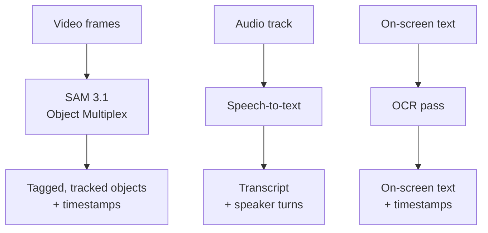

*SAM 3.1 in one line:* describe an object in a short phrase and it finds
every matching instance across the video, tracking up to 16 objects per pass
in real time — no manual outlining required.

#### 7.2.2 Spatio-temporal concept graph

The three perception outputs are fused into a single structure: every
concept node links a specific object, at a specific timestamp, to the
sentence being spoken and any on-screen text at that moment.

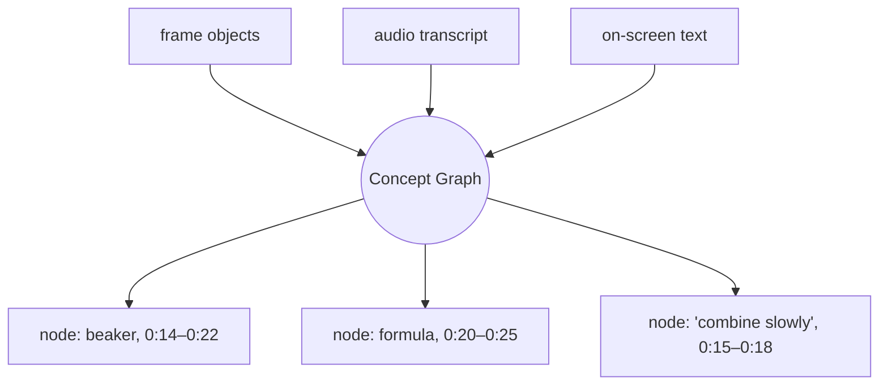

This graph is the shared reference every agent in the mesh reads from — no
agent works from raw video directly.

#### 7.2.3 Agent mesh (A2A)

Six specialist agents plus an orchestrator, each advertising its capability
through an **A2A Agent Card** so any compliant agent — including a
third-party one — can register.

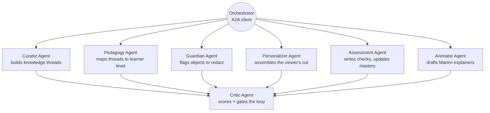

| Agent | Role |
|---|---|
| Curator | Breaks the concept graph into short, self-contained knowledge threads |
| Pedagogy | Compares threads to what this learner already knows |
| Guardian | Flags exactly which object needs redaction for this viewer |
| Personalizer | Assembles the actual sequence of clips, masks, and overlays |
| Assessment | Writes targeted questions and updates the mastery graph |
| Animator | Drafts and renders a Manim scene for a tapped concept |
| Critic | Scores every candidate output and gates delivery |

#### 7.2.4 Verification loop

Every candidate cut runs through a capped loop instead of shipping on the
first pass.

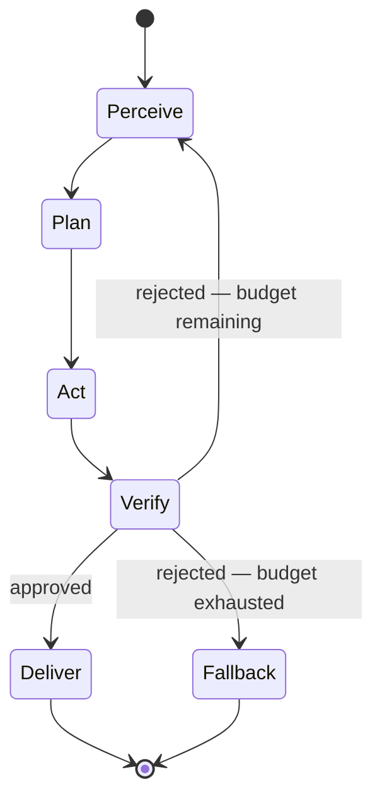

The budget cap exists specifically to prevent the "thrashing" failure mode
seen in unattended agent loops — after a fixed number of revisions, the
system falls back to the last verified cut rather than looping forever.

#### 7.2.5 Guardian — safety redaction

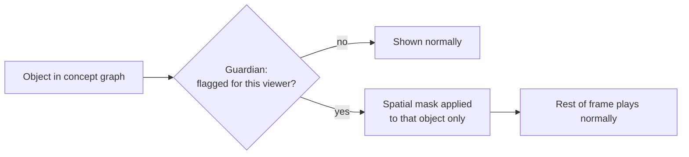

This is the direct answer to the "block the whole app, or risk everything"
dilemma — redaction happens per object, not per video.

#### 7.2.6 Animator — generated explainers

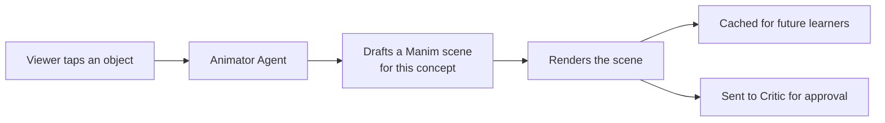

The first viewer to ask about a concept waits a couple of seconds for the
render; everyone after gets the cached version instantly.

#### 7.2.7 Delivery layer

Masks, overlays, and rendered explainer clips are composited client-side, so
playback cost stays flat whether one person or a million people are
watching — no per-viewer server-side re-encoding of the base video.

#### 7.2.8 Memory & feedback

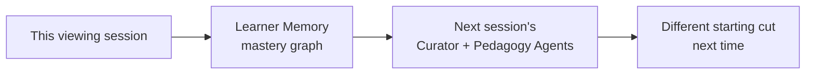

---

## 8. Process Flow (technical sequence)

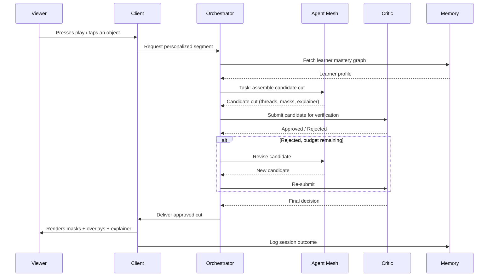

---

## 9. User Journey

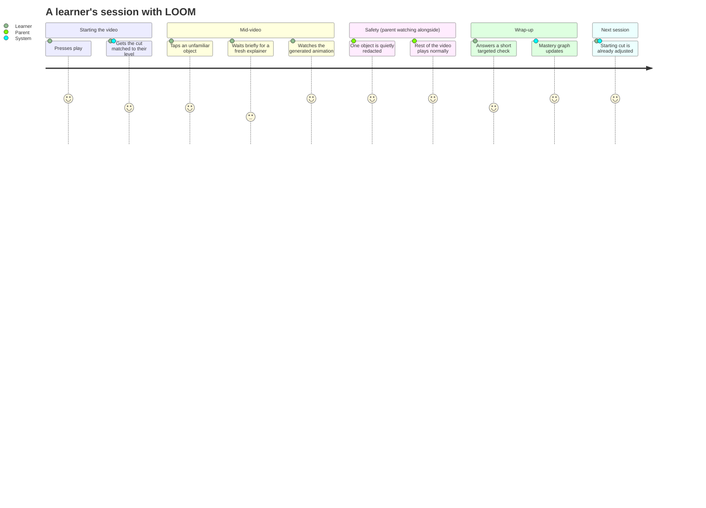

### Persona comparison

| Persona | Starting cut | Mid-video behavior | Safety needs | Outcome |
|---|---|---|---|---|
| Alex (expert) | 90-second condensed version | Skips setup, jumps to the new material | None | Stays engaged past the old 2-minute cliff |
| Priya (beginner) | Full walkthrough + explainers | Taps objects, watches generated animations | None | Doesn't fall behind by minute two |
| Parent (co-viewing) | Standard cut | May not interact at all | One object redacted | Keeps the other 95% of the video intact |

---

## 10. Technology Stack

| Layer | Technology | Purpose |
|---|---|---|
| Perception & generation | SAM 3.1 | Object segmentation and tracking |
| | Whisper-class ASR | Transcript + speaker turns |
| | OCR pass | On-screen text capture |
| | Manim (Community Edition) | Live-rendered explainer clips |
| | Graph fusion layer | Builds the concept graph |
| Agent mesh & orchestration | A2A protocol (JSON-RPC) | Agent discovery + tasking |
| | Agent Cards | Capability advertisement |
| | LangGraph / ADK-style runtime | Per-specialist agent execution |
| | Critic gate | Loop-budgeted verification |
| Delivery | Next.js | App shell + player |
| | WebGPU / WASM | Client-side mask compositing |
| | Socket.io | Live loop status streaming |
| | FFmpeg | Encode + trim on ingest |
| State & memory | Vector + graph DB | Learner mastery model |
| | MongoDB | Concept-graph + agent output store |
| | S3 | Media + mask cache |
| | Redis | Loop + task queue |

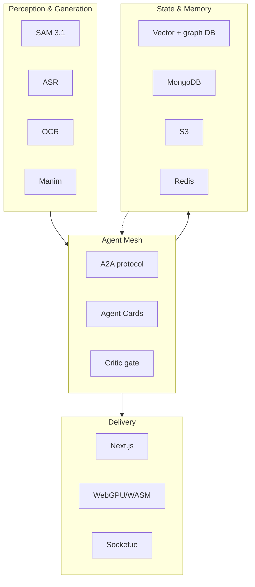

---

## 11. Novelty & Innovation Highlights

1. **Spatio-semantic personalization.** Prior adaptive-video work personalizes
   at the clip or chapter level (El-Sabagh, 2023). Fusing pixel-grounded
   segmentation (SAM 3.1) with a semantic timeline graph lets personalization
   act on individual in-frame objects — a finer unit than the literature
   currently reports.

2. **Loop engineering applied to personalized media, not code.** Bounded
   Perceive-Plan-Act-Verify loops are established practice for coding agents.
   Applying a Critic-gated, budget-capped loop to personalized video
   generation — with an explicit fallback to the last verified cut — is a new
   application domain.

3. **A federated pedagogical agent mesh.** EduPlanner (Zhang et al., 2025,
   IEEE TLT) shows multi-agent orchestration works well for lesson design, but
   with a closed, in-house agent set. Using A2A's open Agent Cards to let
   third-party pedagogy or compliance agents register into a live media
   pipeline tests real multi-vendor interoperability.

4. **Spatial safety as a dial, not a switch.** Current moderation research
   (Ayadi, 2025; Yousaf & Nawaz, 2022) still outputs one classification per
   video. Reframing parental control as object-level redaction turns a binary
   block/allow decision into a measurable, continuous trade-off.

5. **Agent-authored, verifiable animation.** Instead of a static overlay or a
   pre-recorded asset, the Animator Agent drafts executable Manim scene code
   per concept, checked by the Critic before render — a generated, checkable
   visual artifact rather than a canned one.

---

## 12. Competitive Analysis

| Category | Personalizes | Safety granularity | Agent interoperability | Verification |
|---|---|---|---|---|
| Quiz-overlay tools | Where a question appears | None | Closed | None |
| Script-to-video / avatars | Script, before render | Not applicable | Closed | Single render, shipped as-is |
| Lecture hosting & analytics | Search, captions, dashboards | Platform-level, binary | Closed | None |
| Academic multi-agent tutors | Learning path around the video | Not addressed | Fixed, in-house | Partial — hint refinement only |
| **LOOM** | **Individual objects inside the frame** | **Per-object redaction, tunable** | **Open — A2A Agent Cards** | **Bounded Critic loop before delivery** |

---

## 13. Research Grounding & References

Each entry is labeled by type — **Journal** (peer-reviewed), **Preprint**
(arXiv, not yet journal-reviewed), or **Industry** (technical report / spec /
open-source project). Use the Journal-tagged entries for a literature review
that requires peer-reviewed sources only.

### 13.1 Personalized & adaptive video learning

- **[Journal]** Cattaneo, van der Meij, Aprea, Sauli & Zahn (2018). "A model for designing hypervideo-based instructional scenarios." *Interactive Learning Environments*, 27(4), 508–529. https://doi.org/10.1080/10494820.2018.1486860
- **[Journal]** El-Sabagh (2023). "An improved adaptive personalization model for instructional video-based e-learning environments." *Journal of Computers in Education*. https://doi.org/10.1007/s40692-023-00310-x
- **[Journal]** Mo, Wang, Dai & Jin (2022). "Video playback speed influence on learning effect from the perspective of personalized adaptive learning." *Frontiers in Psychology*, 13. https://doi.org/10.3389/fpsyg.2022.947209
- **[Journal]** Halkiopoulos & Gkintoni (2024). "Leveraging AI in E-Learning: Personalized Learning and Adaptive Assessment through Cognitive Neuropsychology." *Electronics*, 13(18), 3762. https://doi.org/10.3390/electronics13183762
- **[Journal]** Hardaker & Glenn (2025). "Artificial intelligence for personalized learning: a systematic literature review." *The International Journal of Information and Learning Technology*, 42(1), 1–14. https://doi.org/10.1108/IJILT-07-2024-0160

### 13.2 Multi-agent AI in education

- **[Journal]** Zhang, Zhang, Sun, Xiao, Yang & Luo (2025). "EduPlanner: LLM-Based Multiagent Systems for Customized and Intelligent Instructional Design." *IEEE Transactions on Learning Technologies*, 18, 416–427. https://doi.org/10.1109/TLT.2025.3561332
- **[Preprint]** Wang et al. (2025). "GenMentor: LLM-powered Multi-agent Framework for Goal-oriented Learning in Intelligent Tutoring Systems." arXiv:2501.15749. https://arxiv.org/abs/2501.15749
- **[Preprint]** Elhaimeur et al. (2026). "ITAS: A Multi-Agent Architecture for LLM-Based Intelligent Tutoring." arXiv:2604.24808. https://arxiv.org/abs/2604.24808

### 13.3 Content safety & moderation for children's video

- **[Journal]** Ayadi (2025). "Automatic moderation of visual content: integration of emotions and semantic analysis through deep learning for the safety of young users." *Journal of Ambient Intelligence and Humanized Computing*, 16, 817–830. https://doi.org/10.1007/s12652-025-04979-z
- **[Journal]** Chuttur & Nazurally (2022). "A multi-modal approach to detect inappropriate cartoon video contents using deep learning networks." *Multimedia Tools and Applications*, 81(12), 16881–16900. https://doi.org/10.1007/s11042-022-12709-2
- **[Journal]** Yousaf & Nawaz (2022). "A deep learning-based approach for inappropriate content detection and classification of YouTube videos." *IEEE Access*, 10, 16231–16242. https://doi.org/10.1109/ACCESS.2022.3147519
- **[Preprint]** "SafeScreen: A Safety-First Screening Framework for Personalized Video Retrieval for Vulnerable Users" (2026). arXiv:2604.03264. https://arxiv.org/abs/2604.03264

### 13.4 Core infrastructure (not journal-published — cite as industry sources)

- **[Industry]** Meta AI — "Segment Anything Model 3," Nov 2025; SAM 3.1 Object Multiplex, Mar 2026. https://ai.meta.com/blog/segment-anything-model-3/
- **[Preprint]** "SAM 3: Segment Anything with Concepts." arXiv:2511.16719. https://arxiv.org/abs/2511.16719
- **[Industry]** Google Developers Blog — "Announcing the Agent2Agent Protocol (A2A)." https://developers.googleblog.com/en/a2a-a-new-era-of-agent-interoperability/
- **[Industry]** IBM — "What Is Loop Engineering?" https://www.ibm.com/think/topics/loop-engineering
- **[Preprint]** Madaan et al. (2023). "Self-Refine: Iterative Refinement with Self-Feedback." arXiv:2303.17651. https://arxiv.org/abs/2303.17651
- **[Industry]** Manim Community — the animation engine used by the Animator Agent.

---

## 14. Roadmap

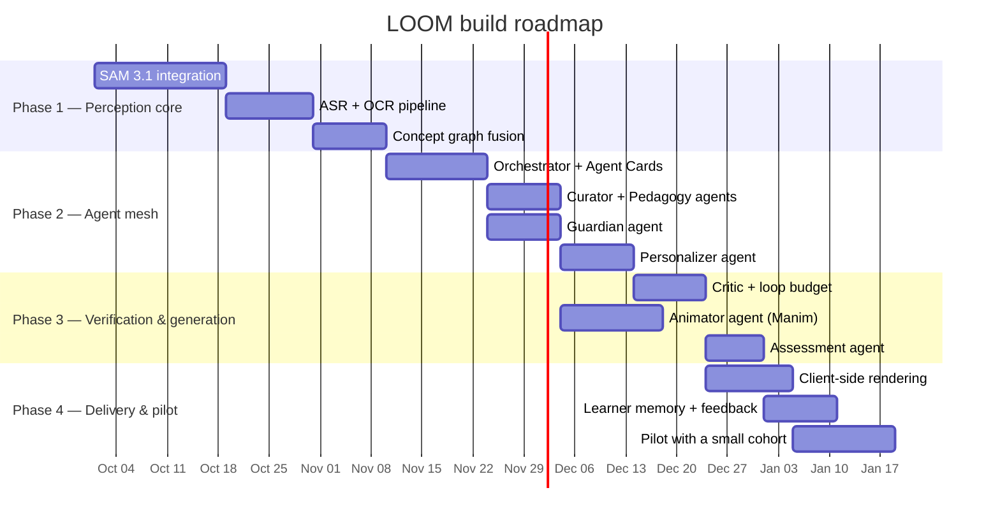

---

## 15. Risks & Open Questions

| Risk | Why it matters | Current mitigation |
|---|---|---|
| Loop cost / latency | Each revision re-runs perception-to-verify | Fixed loop budget, cached explainers, client-side compositing |
| Agent trust boundary | A third-party A2A agent could misbehave | Critic gate applies to every agent's output, not just first-party ones |
| Redaction accuracy | A missed or over-broad mask undermines the safety promise | Guardian output is scored by the Critic before delivery, same as any other agent |
| Evaluation metrics not yet defined | "Better personalization" needs a measurable definition | See proposed metrics below |

**Proposed evaluation metrics** (for a pilot study or paper):

- Object-grounding accuracy (SAM 3.1 mask vs. ground truth)
- Loop convergence rate / revisions-to-pass
- Redaction precision & recall, false-block rate
- Cross-framework agent-swap cost (time to integrate a new A2A agent)
- Scene-code compile rate and render latency for the Animator Agent

---

## 16. Appendix

### 16.1 Example A2A Agent Card (illustrative)

```json
{
  "name": "guardian-agent",
  "description": "Flags and redacts unsafe objects per viewer profile",
  "version": "1.0",
  "capabilities": {
    "input": ["concept_graph_segment", "viewer_profile"],
    "output": ["redaction_mask_list"]
  },
  "endpoint": "https://loom.internal/agents/guardian",
  "protocol": "a2a/1.0"
}
```

### 16.2 Glossary

| Term | Meaning |
|---|---|
| Concept graph | The fused map linking objects, transcript, and on-screen text to timestamps |
| Agent Card | A2A's JSON description of what an agent can do |
| Loop budget | The fixed number of revision attempts before falling back to the last verified cut |
| Object Multiplex | SAM 3.1's ability to track up to 16 objects per pass in real time |

---

*End of document.*
