# LOOM: testing and evaluation report

> Every number here is read from `data/eval/*.json`, the stored lesson graphs or the event log by `uv run python -m loom.eval.report`; nothing is typed by hand. Hardware: one laptop, NVIDIA RTX 5070 Laptop GPU (8 GB), Windows 11, all models local (Ollama: qwen3.5:9b brain/VLM, gemma4:e4b judge, granite4.1-guardian safety; SAM 2.1, Grounding DINO, SigLIP2, faster-whisper, RapidOCR, Kokoro). Where a target is missed or a number rests on labels that are not human, it says so. (`data/` is not in git: copies of the evaluation files are in [`docs/eval/`](eval/).)

## At a glance

| Area | Result | Source |
|---|---|---|
| Automated tests | **263 passed**, 0 failed (263 collected) | `pytest` |
| Short lessons through the full pipeline | **22 of 30** (15.0 min of video, 12 styles) | `eval/batch/summary.json` |
| Elements tracked / named parts | 850 / 203 | batch |
| Answer agent grounded in the video | 21 of 21 | batch |
| Critic fault detection | **76/76** detected, 9/9 controls approved | `eval/critic_faults.json` |
| Faults reaching a learner | 0 (49 repaired in the loop, 27 safe fallback) | same |
| Hazard grounding, demo (LOOM row) | precision 0.94, recall 0.796 (target 0.90 **missed**) | `eval/grounding.json` |
| Hazard grounding, Water Sciences | recall 0.00 by hazard class; the viewer's masks still cover 93% (Guardian) | `eval/grounding_water_sciences.json`, `eval/redaction.json` |
| Fact-check vs labels (n = 40) | judge alone 0.60 agreement; LOOM final 0.93, 0 false accepts (labels by the AI assistant) | `eval/factcheck_agreement_assistant.json` |
| Grounded answer latency | median **22.8 s** (n = 10, 12-73 s) | `eval/latency.json` |
| Verified session latency | median **0.27 s** (n = 12) | same |
| Perception cost | median 11.9 min per minute of video (35 lessons) | graphs' `perception_meta` |

## 1. Automated tests

263 tests in 27 modules (3 files in `tests/contract`, 24 files in `tests/unit`); 263 pass. They run without models or a GPU (fakes for Ollama and the vision models).

| Module | Tests |
|---|---:|
| `tests/contract/test_contracts.py` | 38 |
| `tests/unit/test_llm.py` | 16 |
| `tests/contract/test_a2a.py` | 14 |
| `tests/unit/test_board.py` | 14 |
| `tests/unit/test_config_offline.py` | 14 |
| `tests/contract/test_gateway.py` | 13 |
| `tests/unit/test_prompts.py` | 13 |
| `tests/unit/test_everything.py` | 12 |
| `tests/unit/test_ocr_text.py` | 12 |
| `tests/unit/test_events_jobs.py` | 11 |
| `tests/unit/test_store_blobs.py` | 9 |
| `tests/unit/test_verify.py` | 9 |
| `tests/unit/test_grounding_eval.py` | 8 |
| `tests/unit/test_geometry.py` | 7 |
| `tests/unit/test_gpu.py` | 7 |
| `tests/unit/test_mesh.py` | 7 |
| `tests/unit/test_ocr_spans.py` | 7 |
| `tests/unit/test_vocab.py` | 7 |
| `tests/unit/test_explainer_grounding.py` | 6 |
| `tests/unit/test_segment.py` | 6 |
| `tests/unit/test_track.py` | 6 |
| `tests/unit/test_asr_sentences.py` | 5 |
| `tests/unit/test_probe_shots.py` | 5 |
| `tests/unit/test_scene_dsl.py` | 5 |
| `tests/unit/test_visuals.py` | 5 |
| `tests/unit/test_runs.py` | 4 |
| `tests/unit/test_spike.py` | 3 |

Added in this round (each one a regression found while testing): caption letters joined into one line, board elements re-identified across restarts, burned-in caption overlays, OCR boxes on the frame edge, concepts without text evidence, the exact-construction solver (angle bisector, perpendicular bisector, straight given angle, arcs too narrow to meet), and the fact-checker's absence-only overrule.

## 2. Batch evaluation: 30 short lessons, 14 styles

Thirty 10-60 s lessons (`tests/eval_data/shorts_batch.txt`) went through the running gateway exactly as a user's would: perception, one question to the answer agent, screenshots. **22 were processed**; the 8 others are explained below. Chalkboard and digital-whiteboard picks were checked by watching them (not by title).

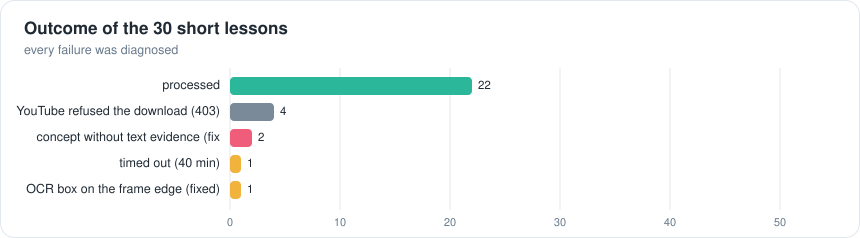

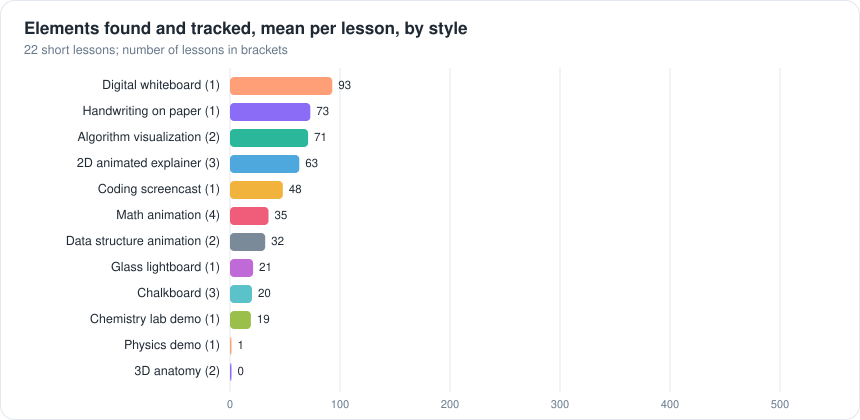

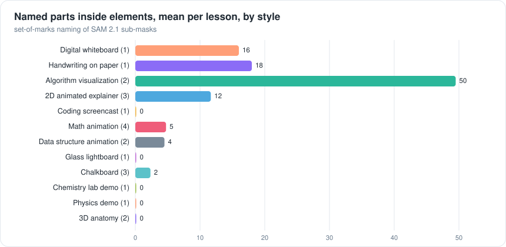

| # | Style | Lesson | Length | Elements | Parts | Concepts | Quiz | Perception | Answer from video |
|---:|---|---|---:|---:|---:|---:|---:|---:|---|
| 1 | Algorithm visualization | [Merge Sort Explained in 60 Seconds | Animated ](https://www.youtube.com/shorts/2FmSASgpC8M) | 58 s | 107 | 99 | 5 | 19 | 25.3 min | yes |
| 2 | Chalkboard | [Chalkboard Geometry: Bisect Angle Construction](https://www.youtube.com/shorts/XapGLl0ppD8) | 26 s | 34 | 7 | 2 | 4 | 11.2 min | yes |
| 3 | Chalkboard | [Chalkboard Geometry: Perpendicular Line Constr](https://www.youtube.com/shorts/nE2QubbYigs) | 16 s | 14 | 0 | 1 | 3 | 4.8 min | yes |
| 4 | Chalkboard | [Chalkboard Geometry: Construct Parallel Line!!](https://www.youtube.com/shorts/q6yUcJvFSiA) | 22 s | 12 | 0 | 3 | 0 | 4.2 min | yes |
| 5 | Digital whiteboard | [Graspable Math Whiteboard for Right Triangle T](https://www.youtube.com/shorts/BKUc10F8zlQ) | 104 s | 93 | 16 | 1 | 3 | 17.1 min | yes |
| 6 | Glass lightboard | [Sample of one of my Lightboard Classes during ](https://www.youtube.com/watch?v=UI3XHzrH6BA) | 47 s | 21 | 0 | 3 | 9 | 6.7 min | yes |
| 7 | Handwriting on paper | [Mathematical Tools Handwritten Short Notes | C](https://www.youtube.com/watch?v=gugFuLOL_RY) | 57 s | 73 | 18 | 0 | 0 | 13.5 min | yes |
| 8 | 2D animated explainer | [Convex Lens - Can a magnifying glass burn pape](https://www.youtube.com/watch?v=cf_aUBbyuts) | 51 s | 55 | 7 | 4 | 11 | 23.3 min | yes |
| 9 | 2D animated explainer | [Work in Physics Animation #shorts](https://www.youtube.com/watch?v=4Ku1shmtnx0) | 50 s | 69 | 19 | 6 | 0 | 36.7 min | yes |
| 10 | 2D animated explainer | [What Is Opportunity Cost? | 60-Second Economic](https://www.youtube.com/watch?v=yPW7Pm3HCA4) | 48 s | 65 | 9 | 7 | 18 | 16.4 min | yes |
| 11 | Math animation | [A 30 second short proof of the Pythagorean The](https://www.youtube.com/watch?v=keVhu2TFZkE) | 37 s | 29 | 8 | 5 | 0 | 5.0 min | yes |
| 12 | Math animation | [Folding the AM-GM Inequality V (quick visual p](https://www.youtube.com/watch?v=IJGwvvQdfgg) | 55 s | 51 | 5 | 3 | 0 | 12.9 min | yes |
| 13 | Math animation | [Parts of Circle | Easy to Remember Visualizati](https://www.youtube.com/watch?v=Qx2qtTF4pDw) | 32 s | 20 | 0 | 7 | 0 | 4.2 min | yes |
| 14 | Math animation | [Linear Regression Animation || Manim || Python](https://www.youtube.com/watch?v=P-BVVLD41NM) | 51 s | 40 | 6 | 6 | 18 | 11.8 min | yes |
| 15 | Algorithm visualization | [Insertion Sort Visualization](https://www.youtube.com/watch?v=Q1JdRUh1_98) | 24 s | 35 | 0 | 3 | 0 | 5.1 min | yes |
| 16 | Data structure animation | [Queue Data Structure Animation](https://www.youtube.com/watch?v=ojGf3SH7n48) | 18 s | 45 | 3 | 4 | 0 | 4.9 min | yes |
| 17 | Data structure animation | [Stack Animations | Data Structure | Visual How](https://www.youtube.com/watch?v=4wfGJMETkdc) | 33 s | 19 | 6 | 4 | 0 | 3.4 min | yes |
| 18 | Chemistry lab demo | [Demonstration: Precipitation Reaction of Potas](https://www.youtube.com/watch?v=8ydqPYBcpk0) | 35 s | 19 | 0 | 8 | 0 | 5.6 min | yes |
| 19 | Physics demo | [The Chain Fountain](https://www.youtube.com/watch?v=_dQJBBklpQQ) | 36 s | 1 | 0 | 3 | 6 | 5.3 min | yes |
| 20 | Coding screencast | [Learn Python in 59.001 seconds](https://www.youtube.com/watch?v=fabelAs_m08) | 59 s | 48 | 0 | 7 | 15 | 21.1 min | yes |
| 21 | 3D anatomy | [How the Ear Works -  3D Medical Animation || A](https://www.youtube.com/watch?v=GiuTQS1EyBM) | 23 s | 0 | 0 | 6 | 0 | 2.0 min | yes |
| 22 | 3D anatomy | [Diaphragm - 3D Medical Animation || ABP ©](https://www.youtube.com/watch?v=23-KAubf-js) | 15 s | 0 | 0 | 0 | 0 | 2.0 min | no |

### Where the time goes

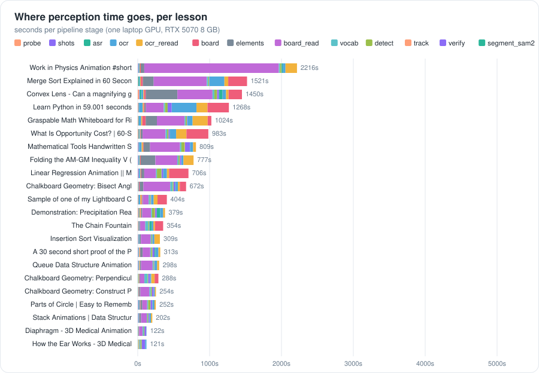

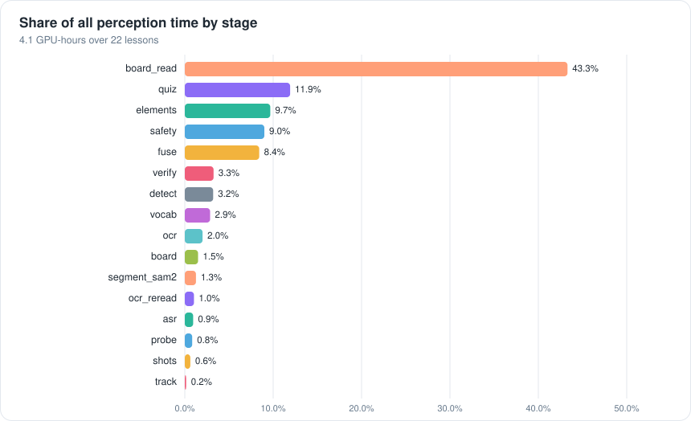

Reading every element with the vision model (`board_read`) is 43% of all perception time, writing and verifying the quiz 12%, concept fusion 8%. The segmentation itself (SAM 2.1) is cheap. Reading only the most salient elements, or several per call, is the obvious next speed-up.

### Failures, diagnosed

| Lesson | Style | What happened | Status |
|---|---|---|---|
| [_ZlapYF-HvM](https://www.youtube.com/watch?v=_ZlapYF-HvM) | Glass lightboard | YouTube refused the download (HTTP 403) | not a LOOM fault |
| [4W5iqMOrYck](https://www.youtube.com/watch?v=4W5iqMOrYck) | Handwriting on paper | YouTube refused the download (HTTP 403) | not a LOOM fault |
| [jIZe4x5lcKo](https://www.youtube.com/watch?v=jIZe4x5lcKo) | Whiteboard doodle animation | timed out after 40 min (whiteboard doodle: hundreds of strokes to read) | open: needs a cap on elements read |
| [dbU7vOEvnjY](https://www.youtube.com/watch?v=dbU7vOEvnjY) | Algorithm visualization | an OCR box touching the bottom edge (y = 1.0) failed validation and stopped the lesson | **fixed** (box clamped; regression test) |
| [Eg64S0DhAaI](https://www.youtube.com/watch?v=Eg64S0DhAaI) | Chemistry lab demo | YouTube refused the download (HTTP 403) | not a LOOM fault |
| [AiD81xpdcBo](https://www.youtube.com/watch?v=AiD81xpdcBo) | Chemistry lab demo | fusion returned a concept backed only by objects; the graph rejects it and the lesson stopped | **fixed** (concept dropped; regression test) |
| [jAP5Biyf7Nc](https://www.youtube.com/watch?v=jAP5Biyf7Nc) | 3D anatomy | YouTube refused the download (HTTP 403) | not a LOOM fault |
| [rDQbYyZOR4o](https://www.youtube.com/watch?v=rDQbYyZOR4o) | 3D anatomy | fusion returned a concept backed only by objects; the graph rejects it and the lesson stopped | **fixed** (concept dropped; regression test) |

The two fixes landed after the batch; those three lessons were not re-run.

### Board lessons: a bug the batch found

On the first chalkboard short the burned-in caption "Bisect angle!" came out as one element per letter (25 of 34 elements). Causes and fixes: a too-wide block was re-split with a fixed 10 px joining distance (big caption letters are farther apart), so pieces on one baseline are now re-joined relative to letter height; a stencil slid over the board restarted every track, so tracks are re-identified across restarts by box + shape; and an **overlay detector** finds pixels that keep their colour while what is beneath them changes (the arm passes under the caption) and turns each overlay line into one element. Replayed on that video: 43 board elements before, 13 after, the caption as one. The three chalkboard rows above predate this fix.

## 3. Hazard grounding (two ground-truthed lessons)

### Acid-Base demo

Ground truth: 48.033-58.333 s (10.3 s). Detector proposals: 937; VLM verdicts on hazard tracks: {'confirmed': 2, 'rejected': 28}.

| Decision rule | Hazard tracks kept | Precision | Recall | F1 | False-block (s) | Missed (s) |
|---|---:|---:|---:|---:|---:|---:|
| detector only | 30 | 0.240 | 0.922 | 0.381 | 30.1 | 0.8 |
| SigLIP generic only | 3 | 1.000 | 0.583 | 0.736 | 0.0 | 4.3 |
| SigLIP look-alikes only | 3 | 1.000 | 0.583 | 0.736 | 0.0 | 4.3 |
| VLM only | 2 | 0.889 | 0.388 | 0.541 | 0.5 | 6.3 |
| SigLIP AND VLM | 1 | 1.000 | 0.146 | 0.254 | 0.0 | 8.8 |
| SigLIP OR VLM (LOOM) | 4 | 0.943 | 0.796 | 0.863 | 0.5 | 2.1 |

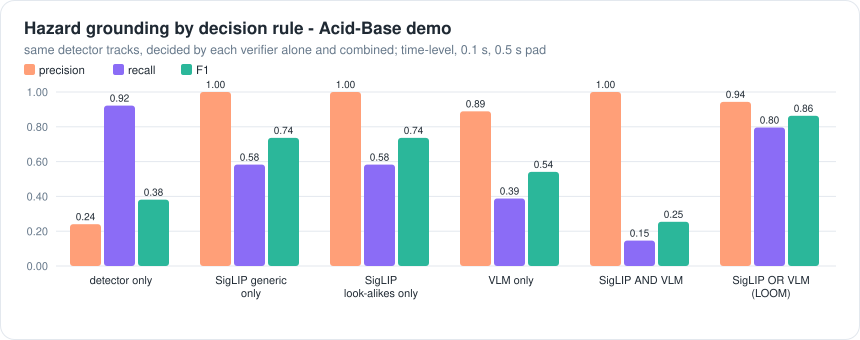

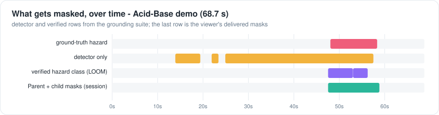

### Water Sciences

Ground truth: 61.9-66.77 s, 71.46-74 s (7.41 s). Detector proposals: 236; VLM verdicts on hazard tracks: {'rejected': 13}.

| Decision rule | Hazard tracks kept | Precision | Recall | F1 | False-block (s) | Missed (s) |
|---|---:|---:|---:|---:|---:|---:|
| detector only | 13 | 0.392 | 1.000 | 0.563 | 11.5 | 0.0 |
| SigLIP generic only | 0 | n/a | 0.000 | 0.000 | 0.0 | 7.4 |
| SigLIP look-alikes only | 0 | n/a | 0.000 | 0.000 | 0.0 | 7.4 |
| VLM only | 0 | n/a | 0.000 | 0.000 | 0.0 | 7.4 |
| SigLIP AND VLM | 0 | n/a | 0.000 | 0.000 | 0.0 | 7.4 |
| SigLIP OR VLM (LOOM) | 0 | n/a | 0.000 | 0.000 | 0.0 | 7.4 |

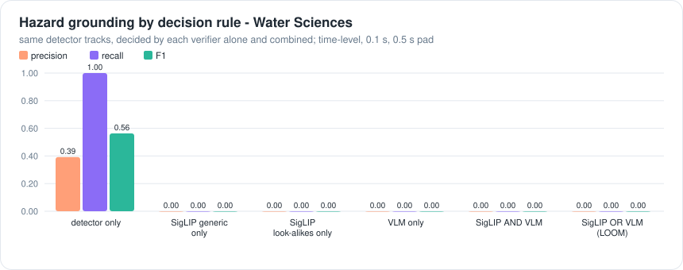

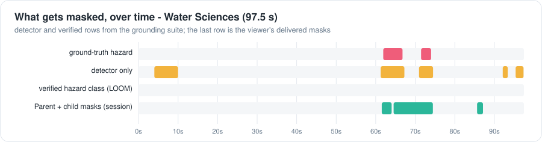

**Reading.** In the first demo run (2026-11-02) the VLM rejected all 30 hazard crops, true ones included, so the three verified rows were identical (precision 1.00, recall 0.583; README at commit 1945562). Re-measured on 2026-11-16, the detector and SigLIP rows are unchanged (deterministic) but the VLM confirmed 2 of 30 crops - one of them a true hazard SigLIP had dropped - so LOOM's row moved from SigLIP's 1.00 / 0.583 to 0.943 / 0.796 (precision / recall). The VLM is rarely decisive and not stable across runs; under the OR-rule its rare confirmations only add recall, while VLM-only or AND rules lose most of the hazard. On Water Sciences it rejected 13 of 13. On Water Sciences the hazard is a broken pipette on the floor; the detector proposed it as "cigarette", "needle", "syringe" and "open flame", all rightly rejected (the VLM called it a pipette), so class-level grounding finds none of it, while the Guardian's review of the tracked "glass pipette" object masks it. Two complementary paths; neither is enough alone.

## 4. Redaction for the Parent + child viewer

| Lesson | Layer | Time pad | Precision | Recall | False-block (s) | Missed (s) | Safe objects masked |
|---|---|---|---:|---:|---:|---:|---|
| Acid-Base demo | end-to-end (verified hazard class) | pad 0 s | 1.000 | 0.505 | 0.0 | 5.1 |  |
| Acid-Base demo | end-to-end (verified hazard class) | pad 0.5 s | 0.943 | 0.796 | 0.5 | 2.1 |  |
| Acid-Base demo | end-to-end (verified hazard class) | pad 1 s | 0.897 | 0.845 | 1.0 | 1.6 |  |
| Acid-Base demo | session masks (hand-authored fixture) | pad 0 s | 1.000 | 1.000 | 0.0 | 0.0 | - |
| Acid-Base demo | session masks (hand-authored fixture) | pad 0.5 s | 0.912 | 1.000 | 1.0 | 0.0 | - |
| Acid-Base demo | session masks (hand-authored fixture) | pad 1 s | 0.837 | 1.000 | 2.0 | 0.0 | - |
| Water Sciences | end-to-end (verified hazard class) | pad 0 s | n/a | 0.000 | 0.0 | 7.4 |  |
| Water Sciences | end-to-end (verified hazard class) | pad 0.5 s | n/a | 0.000 | 0.0 | 7.4 |  |
| Water Sciences | end-to-end (verified hazard class) | pad 1 s | n/a | 0.000 | 0.0 | 7.4 |  |
| Water Sciences | session masks (perception) | pad 0 s | 0.514 | 0.730 | 5.1 | 2.0 | bottle, gloves, safety goggles |
| Water Sciences | session masks (perception) | pad 0.5 s | 0.496 | 0.932 | 7.0 | 0.5 | bottle, gloves, safety goggles |
| Water Sciences | session masks (perception) | pad 1 s | 0.451 | 1.000 | 9.0 | 0.0 | bottle, gloves, safety goggles |

The demo lesson's served graph is the hand-authored fixture, so its session row tests the masking policy with perfect perception; the end-to-end rows use what perception actually verified. Time padding trades false blocking for recall exactly as designed.

## 5. Critic fault injection

For each of 3 lessons x 3 viewers, the state the loop approves is a control; then one fault at a time is planted and `mesh.critic_score` must name it. **76/76 detected, 9/9 controls approved (0 false rejections).** The loop's own actions repaired 49; the other 27 would end in the fallback cut (whole lesson, no quiz, every object masked), so no fault reaches a learner.

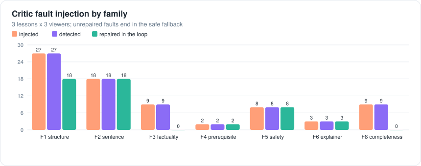

| Family | Injected | Detected | Repaired in loop |
|---|---:|---:|---:|
| F1 structure | 27 | 27 | 18 |
| F2 sentence | 18 | 18 | 18 |
| F3 factuality | 9 | 9 | 0 |
| F4 prerequisite | 2 | 2 | 2 |
| F5 safety | 8 | 8 | 8 |
| F6 explainer | 3 | 3 | 3 |
| F8 completeness | 9 | 9 | 0 |

Not repaired in the loop: quiz faults (the loop has no quiz re-selection, so they fall back) and overlapping threads, whose repair trims a thread mid-sentence, whose repair re-creates the overlap - a real oscillation found by this suite.

## 6. Explainers and the fact-checker

From the event log (12 explainer runs): first-draft line support 72% of 82 lines; 9 of 12 first drafts accepted; 9 delivered; drafts needed {'1': 10, '2': 1, '3': 1}.

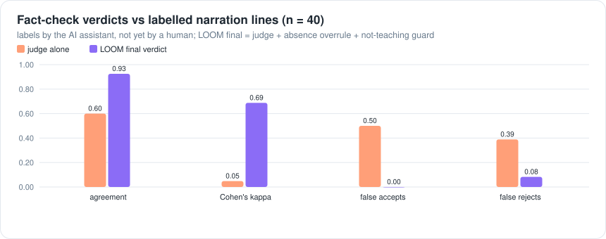

| Verdict | n | Agreement | Cohen's kappa | False accepts | False rejects |
|---|---:|---:|---:|---:|---:|
| judge alone (gemma4:e4b) | 40 | 0.60 | 0.05 | 2 (50%) | 14 (39%) |
| LOOM final (judge + absence overrule + not-teaching guard) | 40 | 0.93 | 0.69 | 0 (0%) | 3 (8%) |

**Caveat:** the labels are the AI assistant's, not a human's. The sheet (`data/eval/factcheck_lines.csv`) has an empty `human` column; `python -m loom.eval.factcheck_history --score human` re-scores once it is filled.

**Construction explainers.** Geometry questions are now planned as compass-and-straightedge steps that LOOM solves exactly (`loom/agents/geometry.py`) and draws on a slate with a 3-D compass; the angle-bisector request that produced a scene of meaningless orbs now resolves 12/12 steps with both half-angles equal to 4 decimals.

## 7. Latency

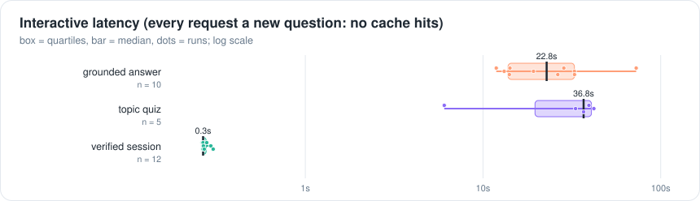

| Interaction | n | Median | p25-p75 | Min-max | Mean ± sd |
|---|---:|---:|---:|---:|---:|
| grounded answer (A2A, retrieve + generate + cite) | 10 | 22.80 s | 13.84-32.69 s | 11.87-72.74 s | 26.55 ± 18.17 s |
| topic quiz (write + verify) | 5 | 36.84 s | 19.61-40.74 s | 6.05-42.05 s | 31.51 ± 14.61 s |
| verified session (6 agents + Critic loop) | 12 | 0.27 s | 0.27-0.28 s | 0.26-0.30 s | 0.27 ± 0.01 s |

A repeated question is a cache hit: 0.08 s. Sessions are fast because the mesh and Critic are deterministic; the LLM work happened at ingest.

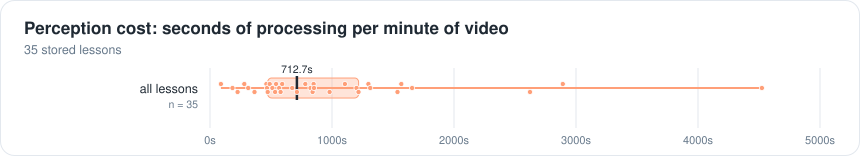

| Stage | Lessons | Median (s) | p25-p75 (s) | Max (s) |
|---|---:|---:|---:|---:|
| probe | 35 | 6.3 | 3.9-8.6 | 64.4 |
| shots | 35 | 4.8 | 2.7-9.6 | 69.5 |
| asr | 35 | 5.8 | 4.7-13.6 | 77.9 |
| ocr | 35 | 12.8 | 8.4-34.6 | 344.1 |
| ocr_reread | 35 | 8.0 | 3.1-17.3 | 2495.0 |
| board | 31 | 8.3 | 4.0-20.5 | 71.7 |
| elements | 27 | 27.2 | 13.9-51.6 | 440.8 |
| board_read | 31 | 159.8 | 79.5-386.1 | 1872.7 |
| vocab | 35 | 17.9 | 13.2-32.7 | 106.5 |
| detect | 35 | 19.2 | 12.6-76.5 | 2893.7 |
| track | 35 | 0.3 | 0.0-1.7 | 26.1 |
| verify | 35 | 21.2 | 5.1-26.1 | 337.1 |
| segment_sam2 | 35 | 2.2 | 1.7-14.8 | 290.2 |
| fuse | 35 | 38.9 | 22.5-87.2 | 344.3 |
| safety | 35 | 28.8 | 18.1-58.9 | 1267.7 |
| quiz | 35 | 54.5 | 0.0-195.4 | 697.6 |

## 8. What still needs a human

* **Mask IoU**: 15 keyframes of the demo lesson are exported with instructions (`tests/eval_data/mask_keyframes/`); after polygons are drawn, `python -m loom.eval.mask_iou score` reports IoU.
* **Fact-check labels**: the 40-line sheet above.
* **Water Sciences hazard window**: annotated by the AI assistant from frames (method in the ground-truth file); a human should confirm it.
* **SQL lesson objects**: audited from frames by the AI assistant (both are the channel's flame logo).

