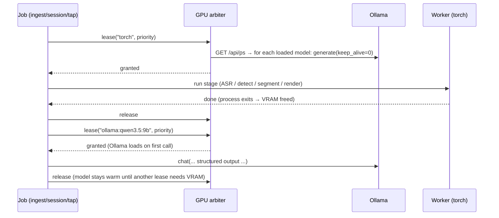

# 02 — Architecture

## 1. System overview

```mermaid
flowchart LR
    SRC["Video<br/>upload · file · YouTube link"] --> ING["INGEST & PERCEIVE<br/>(once per video, GPU worker)"]
    ING --> CG[("Concept graph v2<br/>+ pixel-mask tracks<br/>+ safety review<br/>+ verified quiz bank")]
    CG --> MESH["AGENT MESH (A2A)<br/>Orchestrator · Curator · Pedagogy<br/>plug-ins · Personalizer · Assessment"]
    LP[("Learner profile<br/>mastery graph")] --> MESH
    MESH -->|candidate cut| LOOP["VERIFICATION LOOP ≤3<br/>Guardian · Animator · Critic"]
    LOOP -->|revise_cut| MESH
    LOOP -->|verified / fallback cut| DEL["DELIVERY<br/>web player · YouTube extension"]
    DEL -->|events · answers| MEM["MEMORY<br/>server-side grading · mastery update"]
    MEM --> LP
    style ING fill:#241D10,stroke:#FFB020
    style MESH fill:#12312F,stroke:#2DD4C7
    style LOOP fill:#241C3D,stroke:#A78BFA
    style DEL fill:#141728,stroke:#F5F3ED
```



The single biggest change from the old build is **where model work happens**:

| Work | Old build | Remake |
|---|---|---|
| Safety review of each object | Per session, LLM call, failure = safe | **Ingest**, two independent local judges, failure = unsafe |
| Quiz questions | Per session, LLM, unverified until the loop | **Ingest**: a verified question bank per concept × level; the session *selects* |
| Explainer drafts | On demand only | On demand **plus** optional background pre-render of `auto` explainers after ingest |
| Session personalization | LLM role labelling + LLM quiz on the critical path | Deterministic assembly; LLM only for cache misses (new tap explainer) |
| Verification | Same | Same loop, now with independent hazard set and content-hash caches |

## 2. Process model (all on localhost)

```
┌──────────────────────┐   ┌───────────────────────────────────────────────┐   ┌───────────────────┐
│ ollama serve :11434  │◄──┤ loom gateway :8000  (FastAPI, uvicorn)        │◄──┤ web :3001 Next.js │
│  brain / judge /     │   │  /api/*   REST + SSE                           │   │ (proxies /api,    │
│  safety / embed / ocr│   │  /a2a/<agent>/   first-party A2A agents        │   │  /media)          │
└──────────▲───────────┘   │  /media/*  videos, clips, mask tracks          │   └───────────────────┘
           │               │  job scheduler + GPU arbiter + event bus       │   ┌───────────────────┐
           │               └──────┬───────────────────────────┬────────────┘◄──┤ Chrome extension  │
           │                      │ spawns per job            │ A2A JSON-RPC    │ (YouTube overlay) │
           │               ┌──────▼──────────────┐     ┌──────▼─────────────┐   └───────────────────┘
           └───────────────┤ loom worker         │     │ plug-in agent :8100│
                           │ (perception / render│     │ school-policy-agent│
                           │  subprocess, torch) │     └────────────────────┘
                           └──────────┬──────────┘
                                      ▼
                         data/loom.db (SQLite WAL)  ·  data/blobs/ (content-addressed media)
```

| Process | Responsibility | Why separate |
|---|---|---|
| `ollama serve` | All LLM/VLM/safety/embedding inference | Already a managed local server; handles model load/unload |
| `loom gateway` | REST/SSE API, A2A host for first-party agents, orchestration, verification loop, job scheduling, GPU arbiter | One process keeps the demo simple; agents still talk **only** over A2A HTTP |
| `loom worker` (spawned per job) | Torch-heavy perception stages and Manim renders | CUDA memory is fully released when the process exits; a crash cannot take down the gateway |
| `web` | Library, player, agents, compare, mastery | — |
| plug-in agent(s) | Third-party skills (e.g. `policy_review`) | Proves interoperability across processes |
| extension | Overlay on YouTube | — |

`loom gateway --split` runs every first-party agent as its own uvicorn process on ports 8101–8108 with the same
code, to demonstrate that nothing depends on shared memory. The default is in-process mounting.

## 3. GPU and memory arbitration (8 GB VRAM)

Only one heavy model fits at a time. The **GPU arbiter** (in the gateway) serializes all GPU work:



Rules:

- Leases are priority-ordered: `tap_explainer` (interactive) > `session` > `ingest` > `prerender`.
- A lease for a different Ollama model unloads the resident one first (`keep_alive: 0`), because
  `OLLAMA_MAX_LOADED_MODELS=1` (set by setup) — no surprise co-residency.
- Work is **batched per model**: e.g. at ingest, all brain calls run, then all safety calls, then all judge calls
  — never ping-pong between models in a loop.
- The arbiter publishes `gpu_lease` events so the UI can show "waiting for GPU (ingest running)".
- RAM budget: ≤ 20 GB total for gateway + worker + Ollama CPU buffers (32 GB machine).

## 4. Data flow per stage

### 4.1 Ingest (per video)

```
source ─► probe/normalize (ffmpeg, ≤ LOOM_MAX_SECONDS=600)
       ─► shots (PySceneDetect)            ─► keyframes per shot
       ─► ASR (faster-whisper, word times) ─► sentences s_###
       ─► OCR (RapidOCR boxes; glm-ocr re-read for formula crops) ─► text spans x_###
       ─► vocabulary (brain VLM: keyframes + transcript → object phrases) ∪ always-on hazard classes
       ─► detect (Grounding DINO) ─► segment+track (SAM 2.1 video) ─► verify (SigLIP2 look-alikes + brain VLM on hazards)
       ─► objects o_### with mask tracks
       ─► fuse (embed topic segmentation + brain concept labelling with evidence IDs) ─► concepts c_## (DAG)
       ─► safety review (safety model + brain VLM crop check, union, fail closed) ─► per-object safety record
       ─► quiz bank (brain writes, judge verifies against cited sentences)
       ─► [optional] pre-render auto explainers (Animator + Critic)
       ─► concept-graph v2 committed (immutable, content-hashed)
```

Every stage writes its output to `data/blobs/` keyed by `sha256(inputs + stage version + model ids)`. Re-running
an ingest re-uses unchanged stages (NFR-REL-04).

### 4.2 Session (per viewer)

```
POST /api/sessions {video_id, learner_id}
  ─► cache lookup: (graph hash, learner-state hash, agent-set hash) → verified cut?  ── hit ─► deliver
  ─► Orchestrator (A2A):
       Curator.build_threads ─► Pedagogy.plan_threads ─► [plug-ins].policy_review
       ─► Personalizer.assemble_cut ─► Assessment.select_quiz        ═► candidate cut pass 1
  ─► Verifier.verify_cut (loop, budget 3):
       PERCEIVE  Guardian.review_objects (deterministic over ingest safety records)
                 Animator.render_explainer for auto requests (cache → else render)
       PLAN      Critic.score_cut  (independent hazard set, coherence, factuality, completeness)
       VERIFY    approved ─► deliver
       ACT       local fixes (force masks, re-render with feedback) ; mesh issues ─► Orchestrator.revise_cut
     budget spent ─► last verified cut for (video, learner) else conservative baseline
  ─► verified cut stored, `delivered` event
```

### 4.3 Playback and memory

```
player ─► GET verified cut + graph view + mask tracks
       ─► plays kept threads only; composites masks; shows tap targets; auto explainers at anchors
       ─► POST /api/sessions/{id}/events  (batched telemetry: play, seek, tap, explainer_shown, mask_shown)
       ─► POST /api/sessions/{id}/quiz/{qid}/answer {option_index}  → server grades → {correct, rationale}
       ─► POST /api/sessions/{id}/finish  → Assessment.update_mastery (server-side events only) → learner profile
```

## 5. A2A layer

Conformance target: A2A protocol **0.3.x** subset.

| Element | Requirement |
|---|---|
| Agent Card | `GET {agent_url}/.well-known/agent-card.json` (also serve the legacy `agent.json` path). Fields: `protocolVersion`, `name`, `description`, `url`, `version`, `capabilities`, `defaultInputModes`, `defaultOutputModes`, `skills[]` with `id`, `name`, `description`, `tags`, plus LOOM extension `x-loom: {input_contract, output_contract, trust: "first_party"\|"plugin"}`. |
| Tasking | JSON-RPC 2.0 `message/send`; one `data` part carrying the request; `metadata.skill` selects the skill. Response: a `Message`/`Task` with one `data` part. Errors: JSON-RPC error objects with LOOM codes. |
| Long tasks | `tasks/get` polling for explainer renders (status `working` → `completed`), so the A2A call itself never blocks > 30 s. |
| Payload size | Requests carry **artifact references** (`{"$ref": "loom://graph/<video_id>@<sha>", "view": "mesh"}`) plus small inline data. Agents resolve refs via `GET /api/artifacts/{ref}?view=…`. Views: `mesh` (no tracks/masks), `safety` (objects + times + labels), `full`. Plug-ins only get the view their card declares. |
| Registry | SQLite table `agents`; first-party agents auto-registered at startup; plug-ins via `POST /api/agents/register {url}` (fetches + validates the card) or the Agents page. |
| Selection | Orchestrator picks agents by skill id; multiple agents with `policy_review` are all called (fan-out); for exclusive skills the first-party agent wins unless an operator pins another. |
| Timeouts | Per-skill timeout from config; a timed-out plug-in is skipped and recorded as `degraded: plugin_timeout:<name>` (its omission can only make the cut *less* restrictive than the plug-in wanted → the Critic flags it as `plugin_unavailable`, blocking if the plug-in was marked `required`). |

## 6. Storage

**SQLite** (`data/loom.db`, WAL mode, one writer via the gateway) replaces JSON files, Mongo and Redis.

| Table | Content |
|---|---|
| `videos` | id, title, source, duration, status, graph_ref, created_at |
| `artifacts` | ref, kind, sha256, path, created_at, model_ids, stage_version |
| `jobs` | id, kind (`ingest`, `render`, `prerender`), status, stage, progress, error, payload, attempts |
| `events` | id (monotonic), channel, kind, payload JSON, ts — backs SSE with `Last-Event-ID` resume |
| `learners` | id, display_name, persona, preferences JSON, safety_profile JSON, created_at |
| `mastery` | learner_id, concept_key (`video_id/concept_id`), level, last_seen, evidence count |
| `sessions` | id, video_id, learner_id, status, verified_cut_ref, pass_count, created_at, finished_at |
| `session_events` | session_id, seq, type, payload, client_ts, server_ts |
| `quiz_attempts` | session_id, question_id, option_index, correct, ts |
| `explainers` | concept_key, level, content_hash, clip_ref, storyboard, code, verified (bool), judge_model, created_at |
| `safety_reviews` | video_id, object_id, status (`reviewed`/`unreviewed`/`failed`), tags, severity, child_unsafe, reasons, models |
| `agents` | name, url, card JSON, trust, enabled, required, last_seen, failures |
| `cut_cache` | key (graph_sha, learner_state_sha, agent_set_sha, policy_version), verified_cut_ref |
| `llm_cache` | key (sha256 of digest, prompt@version, rendered messages, images, options, schema), role, model, digest, prompt, validated value — **successful results only** (spec/03 §4.7) |

Migrations are ordered SQL files `loom/core/migrations/NNNN_name.sql` (contiguous numbering, applied once each,
tracked in `PRAGMA user_version`). `jobs` also carries `dedupe_key` (same lesson ⇒ same job) and `cancel_requested`.

Media and blobs live under `data/blobs/sha256/ab/cdef…` with friendly symlink-free URLs served by the gateway
(`/media/videos/<video_id>.mp4`, `/media/clips/<content_hash>.mp4`, `/media/masks/<video_id>/<object_id>.json`).

## 7. Events

One event model for ingest jobs, sessions and taps (`05-contracts.md` §6). Transport:

- **SSE** `GET /api/events/{channel}` with `Last-Event-ID` resume (events are persisted, so a reload or a
  restarted gateway replays history).
- Extension: the MV3 **service worker** holds the stream with `fetch()` streaming and relays to content scripts
  over `chrome.runtime` ports. No 100-requests-per-second long-polling.

## 8. API surface (gateway)

| Method & path | Purpose |
|---|---|
| `GET /api/health` | Liveness (process up). Never reports model state (`{alive, version, uptime_s}`). |
| `GET /api/ready` | Readiness: Ollama reachable, each required model present + last smoke result, worker spawnable, disk free, offline mode. `ready:false` lists what is missing; HTTP 200 when ready, **503** otherwise. Model presence is polled every `ollama.ready_poll_s` (10 s) via `/api/tags` — it never loads a model into VRAM; "last smoke" = the newest of the last successful call per role (client metrics) and the last `loom doctor` smoke run (`data/run/smoke.json`). |
| `GET /api/models` | Per-role model status, residency, last latency, failure counts. |
| `GET /api/videos` · `GET /api/videos/{id}` · `DELETE /api/videos/{id}` | Library. |
| `POST /api/videos/upload?filename=&max_height=` (raw body) · `POST /api/videos/link {url, max_height?}` | Ingest from upload / YouTube (link disabled when offline). Returns `{status, channel}`; progress streams on `channel`; an active run on the same channel is joined, not restarted. |
| `POST /api/videos/{id}/reprocess {from_stage}` | Re-run perception from a stage. |
| `GET /api/videos/{id}/graph?view=mesh\|player\|full` | Concept graph views. |
| `GET /api/videos/{id}/weaves` | Per-learner cut summaries for "Compare weaves". |
| `GET /api/jobs/{id}` | Job status. |
| `GET/POST /api/learners` · `PATCH /api/learners/{id}` · `POST /api/learners/{id}/reset` · `POST /api/learners/reset` | Learner management. |
| `POST /api/sessions {video_id, learner_id}` | Start personalization → `{session_id}`. |
| `GET /api/sessions/{id}` | Status + verified cut (player view, **no quiz answers**). |
| `POST /api/sessions/{id}/events` | Batched client telemetry. |
| `POST /api/sessions/{id}/quiz/{question_id}/answer {option_index}` | Server-side grading → `{correct, correct_index, rationale, evidence}`. |
| `POST /api/sessions/{id}/finish` | Mastery update → `{mastery_updates, learner}`. |
| `POST /api/sessions/{id}/explain {concept_id, level?}` | Tap-to-learn → `{status: ready, clip}` or `{status: rendering, job_id}`. |
| `GET /api/events/{channel}` | SSE. |
| `GET /api/agents` · `POST /api/agents/register {url, required?}` · `PATCH /api/agents/{name}` · `DELETE /api/agents/{name}` | Agent registry. |
| `GET /api/artifacts/{ref}?view=` | Artifact resolution for agents. |
| `/a2a/{agent}/…` | First-party A2A endpoints. |
| `/media/…` | Static media with range requests (video seeking). |

CORS: allow `http://localhost:3001`, `http://127.0.0.1:3001` and the extension origin only. A per-install token
(`data/run/token`) is required on mutating endpoints from the extension.

## 9. Technology stack — old → new

| Layer | Old | New (local) | Reason |
|---|---|---|---|
| LLM | Vertex AI Gemini / Groq / Gemini API | **Ollama**: `qwen3.5:9b` (brain, vision), `gemma4:e4b` (judge), `granite4.1-guardian:8b-q4_K_M` (safety) | Local, no billing, different families for generator vs judges |
| Embeddings | sentence-transformers / hashing fallback | **Ollama** `qwen3-embedding:0.6b` | One runtime; better retrieval |
| ASR | Groq whisper-large-v3-turbo (cloud) / openai-whisper | **faster-whisper** `large-v3-turbo` (CTranslate2, CUDA fp16), Silero VAD, word timestamps | Local, 4–8× faster than openai-whisper |
| OCR | Tesseract (missing on Windows) / RapidOCR | **RapidOCR** (PP-OCR ONNX) for boxes + text; **glm-ocr** via Ollama for formula/equation crops | No system binary; formulas read correctly |
| Shots | colour-histogram heuristic | **PySceneDetect** ContentDetector | Robust track resets |
| Vocabulary | LLM over transcript + fixed hazards | **brain VLM** over keyframes + transcript + OCR, ∪ fixed hazard classes | Sees objects the narrator never names |
| Detection | Grounding DINO *tiny* | Grounding DINO **base** (transformers) | Higher hazard confidence |
| Segmentation/tracking | IoU box tracking @1 fps (SAM 3.1 promised, not run) | **SAM 2.1** hiera-base-plus video predictor → pixel masks (RLE) @2–4 fps; **SAM 3** as an optional tier (§10) | Real masks; temporal propagation |
| Verification | CLIP + look-alikes | **SigLIP2** + look-alike negatives, then **brain VLM** yes/no on hazard crops | Two independent signals |
| Safety | gpt-oss-safeguard on Groq | **granite4.1-guardian:8b-q4_K_M** (BYOC criteria) ∪ **brain VLM** crop check | Local; union = over-mask on doubt |
| Animation | Manim CE + LLM, AST gate | Manim CE 0.20 + **brain** (code), AST gate **+ sandbox** + **layout check** (VLM on frame grid + geometric bounds) | Safer; catches overlapping/off-frame layouts |
| TTS | Google Cloud TTS → OS speech | **Kokoro-82M** (ONNX, CPU) → Piper → Windows SAPI | Local, natural voice |
| API | FastAPI, in-memory events, polling | FastAPI + SSE (persisted events) | Resume, no polling storms |
| Store | JSON files (+ unused Mongo/Redis) | **SQLite** WAL + content-addressed blobs | One file, transactional |
| Front end | Next.js 15 JSX (+ unused TSX app) | **Next.js 15 + TypeScript**, one app; shared `@loom/engine` | One implementation |
| Mask compositing | CSS blur boxes | Canvas 2D (WebGL2 if available) mask-alpha blur from RLE tracks; box fallback | Pixel-accurate redaction |
| Contracts | hand-written JSON Schema | **Pydantic v2** → JSON Schema → TS types (`json-schema-to-typescript`) | Single source of truth |
| Packaging | pip + venv, macOS docs | **uv** workspace, Windows-first PowerShell scripts | Reproducible on the target machine |

## 10. Segmentation tiers

| Tier | Stack | When |
|---|---|---|
| T0 `boxes` | Grounding DINO + IoU tracker (old approach) | CPU-only machines, smoke tests |
| T1 `sam2` (**default**) | Grounding DINO base → SAM 2.1 video propagation per shot | Target laptop |
| T2 `sam3` | SAM 3 concept-prompted video segmentation (transformers `Sam3Video*`) at reduced resolution | Only if Stage 1 benchmark shows ≤ 7.5 GB peak and ≥ T1 quality; otherwise documented as future work |

The segmenter is an interface (`Segmenter.segment(video, shots, phrases) -> list[ObjectTrack]`); tiers are swapped
in `loom.toml`. The paper must report which tier produced each number.

## 11. Repository layout (remake)

```
remake/
  pyproject.toml                 uv workspace root
  loom.toml                      all models, prompts versions, thresholds, ports, paths
  prompts/                       *.md prompt templates, versioned (front-matter: id, version, model_role)
  loom/
    core/        config.py contracts/ (pydantic + export.py) llm.py ollama.py gpu.py events.py store.py migrations/
                 blobs.py a2a.py jobs.py offline.py prompts.py weights.py logging.py
    ops/         doctor.py (`loom doctor`)
    perception/  probe.py shots.py asr.py ocr.py ocr_text.py (LaTeX→Unicode, S0) vocab.py detect.py
                 segment/ (boxes.py sam2.py sam3.py) verify.py fuse.py safety_review.py quiz_bank.py pipeline.py
    agents/      orchestrator.py curator.py pedagogy.py personalizer.py assessment.py
                 guardian.py animator/ (draft.py sandbox.py render.py layout.py narrate.py) critic.py verifier.py
    gateway/     app.py routes/ (videos, sessions, learners, agents, events, artifacts, media, health)
    worker/      main.py (stage runner for subprocess jobs)
    eval/        spike.py demo_script.py make_demo.py (S0) asr.py ocr.py grounding.py redaction.py critic_faults.py
                 animator.py loop.py latency.py report.py
    cli.py       `loom gateway | worker | ingest | session | eval | doctor`
  plugins/school_policy_agent/   standalone A2A agent (own pyproject, no import of loom except a2a helper copy)
  web/                           Next.js + TS app
  extension/                     MV3 extension (Preact, esbuild)
  packages/engine/               @loom/engine (TS, pure functions, node:test)
  packages/contracts-ts/         generated TS types
  tests/                         unit/ contract/ e2e/ fixtures/
  data/                          (gitignored) loom.db, blobs/, run/
  setup/                         pull-models.ps1, doctor.ps1
  spec/                          this pack
```
