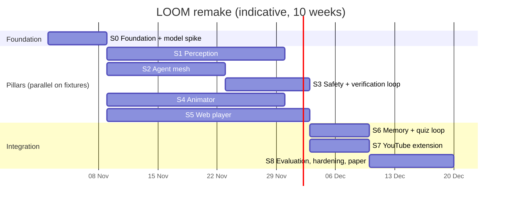

# 06 — Build stages

Nine stages. Each stage has a goal, deliverables, exit criteria that are **tests or demo steps** (not opinions),
and a demo checkpoint. A stage is done only when its exit criteria pass on the target laptop.

Ownership follows the old work split (one member per pillar); Stage 0 is shared.

| Member | Pillar | Primary stages |
|---|---|---|
| Member 1 | Perception & concept graph | S1 |
| Member 2 | Agent mesh & personalization | S2, S6 (assessment) |
| Member 3 | Verification, safety & generation | S3, S4 |
| Member 4 | Delivery, memory & infra | S0 (lead), S5, S6, S7 |
| All | Evaluation & paper | S8 |

Parallel work is possible from day 8 because S0 ships **golden fixtures**: a hand-checked concept graph v2 for
the demo lesson (authored fresh from the demo script in `loom/eval/demo_script.py`, which also drives the demo
rebuild — nothing is taken from the old build), the three learner profiles, and sample candidate/verified cuts.
S2–S5 build against fixtures; S1 replaces them with real perception output.

---

## S0 — Foundation and model spike (shared, week 1)

**Goal** A repo where every later stage plugs into working infrastructure, and proof that the chosen local
models do what `03-local-ai.md` assumes.

**Deliverables**
- `remake/` uv workspace; `loom.toml`; `loom` CLI skeleton; ruff/mypy/pytest; eslint/tsc; pre-commit; GitHub
  Actions (lint + unit + contract tests on CPU).
- `loom.core`: `config`, `contracts` (all v2 models + export to JSON Schema/TS), `llm` (Ollama client with
  structured output, repair, typed errors, cache), `gpu` (arbiter), `store` (SQLite schema + migrations),
  `blobs`, `events` (persisted + SSE), `a2a` (server router + client), `jobs` (persisted queue), `offline`.
- `loom doctor` and `setup/pull-models.ps1` (primary models done) passing; run once with
  `-Fallbacks -OpenWeights -ConfigureServer` so the spike can compare fallbacks and perception weights are cached.
- Gateway skeleton: `/api/health`, `/api/ready`, `/api/models`, `/api/events/{channel}`, `/media` with range
  requests.
- Golden fixtures in `tests/fixtures/` (see above).
- **Demo lesson rebuild** (`loom eval make-demo`): build the demo lesson on Windows from royalty-free sources
  downloaded once into `tests/eval_data/`, Kokoro narration, and generated ground truth (`07-evaluation.md` §1).
  Keyframe box/mask annotation (needs a human) moves to S1. The old build's videos and fixtures are not used.
- **Model spike report** `prompts/README.md`: for `qwen3.5:9b`, `gemma4:e4b`, `granite4.1-guardian:8b`,
  `glm-ocr:q8_0`, `qwen3-embedding:0.6b`: structured output reliability (50 calls each on a toy schema),
  image input works, latency, VRAM at `num_ctx` 8192 (`nvidia-smi`), guardian prompt format and parsing, thinking
  on/off behaviour. Decide fallbacks (e.g. `qwen3.5:4b`) based on data.

**Exit criteria**
- `loom doctor` all green on the target laptop.
- `pytest tests/unit tests/contract` green; contracts exported; TS types compile.
- Spike: each Ollama role ≥ 98 % schema-valid structured outputs; peak VRAM per model ≤ 7.5 GB at its configured
  context; findings committed. "Schema-valid" per role: `brain`/`judge` = JSON `format` output validates on the first
  try; `safety` = native `<score>` verdict parses; `ocr` = non-empty text (accuracy reported separately); `embed` =
  correct dimension, unit norm, deterministic. "Findings committed" = recorded in `prompts/README.md` and spec/03
  (git setup is deferred, see CLAUDE.md).
- Stopping Ollama makes `/api/ready` report the missing roles within 30 s.

**Demo checkpoint** `loom doctor` output + `/api/ready` JSON + the spike table.

---

## S1 — Perception (Member 1, weeks 2–4)

**Goal** `loom ingest <video>` produces a validated concept graph v2 with pixel-mask tracks, safety reviews and a
verified quiz bank, locally, within the time budget.

**Order of work** (each step lands with its unit tests and an eval script from `07-evaluation.md`):
1. `probe` + normalize + `content_rect`; `shots` (FR-ING-01, FR-PER-03).
2. `asr` (FR-PER-01) → WER eval.
3. `ocr` (FR-PER-02) → OCR eval.
4. `vocab` (FR-PER-04).
5. `detect` + `segment` T0 boxes first (fast path to an end-to-end graph), then T1 SAM 2.1 (FR-PER-05/06).
6. `verify` with look-alikes + VLM crop check (FR-PER-07) → grounding ablation eval.
7. `fuse` + prerequisites (FR-PER-08).
8. `safety_review` (FR-PER-09) and `quiz_bank` (FR-PER-10) — co-owned with Member 3 / Member 2.
9. Job runner integration: worker subprocess, stage caching, progress events, resume (FR-ING-02).
10. Inspector page data endpoint (FR-PER-12; UI in S5).

**Exit criteria**
- Demo lesson ingest ≤ 4 min; meets the S1 rows of `07-evaluation.md` (WER ≤ 0.03, OCR recall 1.0 / tIoU ≥ 0.9,
  hazard P ≥ 0.95 / R ≥ 0.9, mask IoU ≥ 0.7).
- Two newly sourced real lessons (CC-licensed, stored in `tests/eval_data/`) and one YouTube lesson ingest end to
  end.
- Resume test: kill during `segment`, restart, completes without recomputing ASR/OCR.
- Outage test: with Ollama stopped, ingest completes with `degraded` flags and **all objects `unreviewed`**.

**Demo checkpoint** Inspector view of the demo lesson with masks following the beaker and broken glass.

---

## S2 — Agent mesh (Member 2, weeks 2–3)

**Goal** Given a concept graph and a learner, the mesh produces candidate cuts deterministically over A2A.

**Deliverables** Curator, Pedagogy, Personalizer (assemble + revise), Assessment (`select_quiz`), Orchestrator
(plan from config, fan-out to plug-ins, `revise_cut`), registry + registration endpoints, `--split` mode,
school policy plug-in package (FR-MESH-01…09).

**Exit criteria**
- Golden-file tests: the three personas on the fixture graph produce the expected candidate cuts.
- Contract tests on every skill; Curator payload < 50 KB (artifact refs).
- `--split` mode passes the same tests (agents in separate processes).
- Live registration of the plug-in changes the Parent + child candidate; malicious plug-in test has no effect.

**Demo checkpoint** `loom session <fixture> learner_alex|priya|family` prints the three candidate cuts and traces.

---

## S3 — Safety and verification loop (Member 3, weeks 4–5)

**Goal** No cut reaches a viewer without passing an independent Critic; failures fail closed.

**Deliverables** Guardian `review_objects` (FR-SAF-01/02), mask builder (FR-SAF-03), Critic (FR-VER-02…05),
Verifier loop with local fixes, `revise_cut`, fallback, cut cache (FR-VER-01, 06–08); session endpoints.

**Exit criteria**
- Fault-injection suite (`07-evaluation.md` §4) — all families incl. **model outage**: 100 % caught, 0 false
  rejects on controls.
- Parent + child on the demo lesson: broken glass masked; Critic safety = 1.0 with an *independent* hazard set.
- With Ollama stopped: Parent + child gets full-lesson fallback with every object masked; Alex gets an unmasked
  fallback; both labelled `fallback` with reasons.

**Demo checkpoint** Loop panel JSON trace of a forced 2-pass session (planted mid-sentence cut → revise → pass).

---

## S4 — Animator (Member 3, weeks 2–4, parallel)

**Goal** Verified, narrated, layout-checked Manim explainers on demand, safely.

**Deliverables** `manim_draft`/`manim_repair` prompts + style pack; AST gate v2; sandboxed render (Job Object);
geometric + visual layout check; Kokoro narration with beat alignment; content-addressed cache; tap-to-learn job
with progress events; prerender job (FR-GEN-01…08, FR-PER-11).

**Exit criteria**
- 12-concept set (6 concepts × beginner/expert): render success ≥ 0.95, first-attempt compile ≥ 0.95, first-draft
  Critic pass ≥ 0.70, layout pass ≥ 0.90 by second draft, median render ≤ 20 s.
- Hostile-code corpus (25 snippets) rejected by the gate; sandbox test with the gate disabled shows no file
  write outside temp, no socket, memory cap enforced.
- Cached tap ≤ 1 s; uncached ≤ 120 s.

**Demo checkpoint** Tap the beaker → progress chips → narrated explainer about neutralization.

---

## S5 — Web player (Member 4, weeks 2–5, parallel on fixtures)

**Goal** One TypeScript Next.js app that shows the mechanism working and plays only verified cuts.

**Deliverables** `@loom/engine` (ported from `packages/loom-engine`, TypeScript, + RLE mask utilities, playback
plan), library + add-video + ingest progress (FR-DEL-01), learner picker/editor (FR-DEL-02), player with cut
playback, canvas mask compositing, tap targets, explainer overlay (FR-DEL-03…06), loop panel (FR-DEL-07), weave
timeline with reasons (FR-DEL-08), compare weaves (FR-DEL-09), agents page (FR-DEL-10), quiz panel (FR-DEL-11),
degraded banners (FR-DEL-13), inspector page (FR-PER-12), accessibility + brand (FR-DEL-14).

**Exit criteria**
- Playwright E2E for each persona on the fixture (then real) lesson: correct played duration, masks present in
  the hazard window (pixel check on screenshots), explainer opens, quiz flow completes.
- axe-core: 0 serious violations; keyboard-only run of the Priya flow.
- Mask lag ≤ 1 frame (frame-callback timestamp test).

**Demo checkpoint** The full three-viewer demo on fixtures, then on real perception output.

---

## S6 — Memory and the mastery loop (Members 4 + 2, week 6)

**Goal** Watching changes what you see next time, and the record can't be forged.

**Deliverables** Learner/mastery store, server-side grading, batched session events with `sendBeacon`,
`update_mastery` from server events, mastery view, "watch again" (FR-MEM-01…06, FR-MESH-08, FR-DEL-12).

**Exit criteria**
- Priya: watch → all answers correct → watch again → ≥ 1 thread changes action; cut cache miss recorded.
- Forged `correct:true` in a client payload changes nothing.
- Concurrency test: two sessions finishing simultaneously for different learners, profiles intact.

---

## S7 — YouTube extension (Member 4, week 7)

**Goal** LOOM on top of YouTube using the same engine and gateway.

**Deliverables** MV3 extension (Preact, esbuild): SPA-aware content script, service-worker event streaming,
canvas overlay, skip-to-cut, explainers in the player, panel, options with token (FR-EXT-01…06).

**Exit criteria** Ingest a YouTube lesson from the extension; masks align in default/theatre/fullscreen; skip
plan correct; navigation across 3 videos without reload.

---

## S8 — Evaluation, hardening, paper (all, weeks 9–10)

**Goal** Every number in the report/paper is regenerated by `loom eval` on the local stack.

**Deliverables** `loom eval all` → `data/eval/*.json` + `data/eval/results.md`; figures script; offline-mode
end-to-end test with outbound network blocked; demo warm-up (`loom warm`); updated report and IEEE paper
sections (method, results, limitations) with a table of which model/tier produced each number.

**Exit criteria**
- All targets in `07-evaluation.md` met or explicitly reported as not met with analysis.
- Offline E2E passes.
- Demo script (§ below) runs twice in a row from a cold boot without intervention.

### Final demo script (≈ 6 min, replaces `docs/DEMO.md`)

| Scene | Action | Shows |
|---|---|---|
| One lesson, three viewers | Library; point at personas; `/api/ready` green, "offline" badge | Fully local |
| 01 Perceive | Inspector: masks on objects, OCR boxes, concepts with evidence chips | Object-grounded graph |
| 02 Orchestrate | Agents page; register the school plug-in live | Open A2A mesh |
| 03 Verify | Watch as Priya; loop panel streams calls, scores, a pass-2 fix | Self-checked delivery |
| Tap anything | Tap the beaker → progress → narrated explainer | Generated, verified animation |
| Redact one object | Watch as Parent + child at 0:56 | Per-object pixel mask, reason badge |
| Different weave | Compare weaves | Same threads, different cloth |
| Mastery | Priya's quiz → finish → mastery view → watch again | Mastery graph, not a score |
| Fail closed | Stop Ollama; start Parent + child session | Fallback, everything masked, honest banner |
| Any video | Add a YouTube link / upload | Works on any lesson |

## Risk register

| Risk | Likelihood | Impact | Mitigation | Owner |
|---|---|---|---|---|
| `qwen3.5:9b` spills to CPU at 8k context | Medium | Slow brain calls | S0 spike; `num_ctx` 6144; fallback `qwen3.5:4b` for vision-only tasks | M4 |
| Granite Guardian prompt format unreliable via Ollama | Medium | Safety judge weaker | S0 spike; fallback to Gemma judge on same criteria; union with VLM | M3 |
| SAM 2.1 video propagation exceeds VRAM on long shots | Medium | Ingest failures | 60 s chunks, 960 px frames, bf16, T0 fallback per shot | M1 |
| Model swaps make sessions slow | Low (precompute) | Latency | Ingest-time precompute; batching per model; cut cache | M2/M3 |
| Disk space | Low (~215 GB free after cleanup) | — | Keep the page file at a fixed size (system-managed grew to 72 GB once); `loom doctor` warns below 20 GB | M4 |
| Windows-specific sandbox gaps | Medium | Security | Job Object + env scrub + socket block + AST gate; test corpus | M3 |
| Network drops during setup | Observed | Delays | Pull script retries with back-off, resumable | M4 |
| Scope creep (SAM 3, cross-video mastery) | Medium | Schedule | Marked S/C; only after Must items pass | All |
